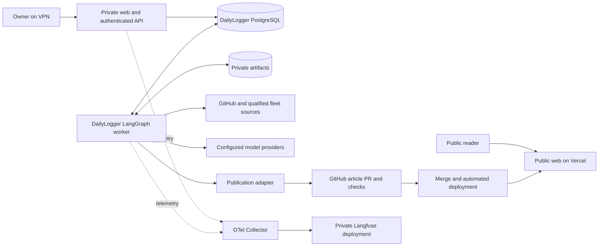

# DailyLogger application architecture

Status: proposed implementation design, revised after Yuri's review on 2026-11-17 America/Chicago. See the [review reconciliation](review-reconciliation.md), [roadmap](delivery-roadmap.md), and [plan index](README.md). Reported cross-session owner choices are attributed in the reconciliation; implementation and production qualification remain separate.

## Product and ownership

DailyLogger owns journal production, editorial review, journal priority snapshots, and the maintenance of its existing action records. It provides a web application and a persistent backend in one pnpm monorepo. Core continues to own shared fleet contracts, FleetRunner owns fleet execution admission and supervision, HelpDesk carries correspondence, and MorningCockpit consumes work projections and exposes its qualified controls.

The backend is a modular application with an HTTP entry point and a background worker. Reviewer roles are LangGraph nodes or subgraphs inside that worker. Adding a reviewer does not require another deployed microservice.

## Proposed technology choices

| Concern | Choice and reason |
| --- | --- |
| Language and workspace | TypeScript, the repository's supported Node runtime, and pnpm. Reuse existing collector, schema, verification, and UI code. |
| Web | Retain React, Vite, and Redux Toolkit. Move the existing frontend incrementally; a framework rewrite adds no necessary capability to this service. |
| Backend API | Fastify with small versioned JSON endpoints and runtime validation. Keep transport handlers separate from domain operations. |
| Agent execution | LangGraph for TypeScript, embedded in the worker, with a PostgreSQL checkpointer. No separate LangGraph hosting product is required. |
| Application persistence | PostgreSQL for workflows, attempts, review records, approvals, artifact metadata, events, and delivery intents. Explicit versioned SQL migrations. |
| Background delivery | pg-boss over PostgreSQL for application run requests, wakeups, and recurrence. LangGraph owns the steps within a run; pg-boss does not define a second graph. |
| Artifact storage | A private application-owned volume for the first single-host service, addressed by digest; an object-store adapter when needed. Reference large artifacts from checkpoints. |
| Observability | OpenTelemetry and Langfuse. Langfuse is a separately operated deployment that can later serve other fleet applications. |
| Model access | A typed provider adapter; preserve the working Anthropic integration initially. Add a second configured provider or local endpoint with capability tests. Integrate Switchboard through its qualified interface when available. |
| Public publication | Existing GitHub article/action records, PR checks, and automated Vercel deployment. Preserve published URLs and JSON contracts. |

Pin mutually compatible package and container versions during M1, including LangGraph, its checkpointer, Langfuse instrumentation, Zod, and the existing Node/pnpm toolchain. Do not turn the package move into an unrelated dependency upgrade.

The first M1 proof is an offline fixture workflow with a supported local durable checkpointer. That development backend establishes process-restart behavior only. PostgreSQL concurrency, backup, release compatibility, and production recovery remain separate qualification work. The fixture cannot call the live collector, model providers, or publication endpoints.

## Repository layout

Target layout; directories move only in the implementation slices that update their consumers:

```text
daily-logger/
  apps/
    web/                         # existing packages/frontend, moved with Vercel config
    service/
      src/
        api/                     # HTTP, sessions, owner and service authorization
        worker/                  # run admission, queue delivery, recovery, scheduler
        storage/                 # SQL repositories and private artifacts
        publication/             # intents, GitHub writes, remote readback
      migrations/
      Dockerfile                 # one image, api and worker command modes
  packages/
    contracts/                   # public DTOs and versioned boundary schemas
    journal/                     # pure journal/action rules and existing validators
    workflows/                   # LangGraph state, nodes, subgraphs, prompt assets
    integrations/                # GitHub, providers, core/FleetRunner/HelpDesk adapters
    observability/               # OTel setup, IDs, redaction, Langfuse mapping
  api/                           # existing Vercel functions during migration
  src/                           # compatibility CLI wrappers until extraction finishes
  _articles/                     # canonical published journal artifacts
  actions/                       # existing canonical action registry and dated records
  evals/                         # existing real-failure evaluation corpus
  tests/service/                 # persistence, recovery, API and adapter conformance
  ops/
    compose/                     # development and single-host deployment definitions
    otel/                        # collector configuration without credentials
    runbooks/                    # release, backup, restore, cutover and rollback
  docs/agent-service/
```

The public web build may import `contracts` and browser-safe presentation utilities. It must not import workflow, provider, database, or publication modules. The worker composes `workflows`, `journal`, and integrations through explicit interfaces. Shared packages must have a real consumer before extraction; create the minimum needed for each milestone.

Keep `pnpm generate`, API-building, editorial scripts, and current tests working through adapters while the layout moves. Update workspace globs, TS project boundaries, lockfile, CI path filters, Vercel output paths, and Docker build contexts together. The root package becomes tooling and compatibility entry points rather than a second backend implementation.

The first service slice may add `apps/service` while the working reader stays in `packages/frontend`. Frontend relocation and the full LAN workspace are independent increments, not prerequisites for proving persisted output against the existing reader or cutting over through its editor.

## Deployment and access



Use one web source tree with two deployment configurations initially. The public build serves the journal at `log.jim.software`; the private build exposes run status, review, and priority controls on a VPN-accessible origin with a same-origin API. Preserve current Vercel editorial functions until a replacement is deliberately cut over. The private hostname and host are deployment inputs, not invented requirements for a new public endpoint.

Cut over publication and exact-revision acceptance through the existing editor. Deliver the richer LAN workspace in parallel: Draft inbox, one revision history per article, any-two revision comparison, retained feedback across repeated rewrites and failures, restore as a new revision, and explicit running/failed/stale states. Default both surfaces to dark on a fresh visit, provide an accessible light switch, and retain the visitor's explicit choice. Verify keyboard access, narrow layouts, status labels, and diff contrast in both themes. Yuri's sample-data prototype is design evidence; its simulated writes do not qualify the production editor.

Serve the private Vite build as static assets through the private ingress, routing `/v1/*` to the service API. Release those assets with a compatible API version. Public web, backend, and Langfuse have independent deployment lifecycles; keeping application code together does not require hosting everything on the NAS or deploying all components for every change.

Private access requires application authentication and owner authorization in addition to VPN reachability. Reuse the established GitHub OAuth pattern after reviewing its callback, session, and CSRF assumptions for the private origin. Use separate host-scoped sessions; do not assume the public site's cookie authenticates the private service. Validate the owner identity on each mutation. Machine integrations receive narrowly scoped service identities and cannot submit a human approval.

The public site remains readable when the NAS is unavailable. No Vercel-to-VPN connection is assumed. A later unified public origin for protected journal routes requires M6's server authorization and deployment design.

The owner selected a private fleet CA for the private operator surface on 2026-11-18. The public journal keeps its normal browser-trusted HTTPS; public readers need neither fleet CA enrollment nor VPN access. Intended operator devices must trust the private CA and still pass application authentication. Keep signing keys outside the application and proxy. The first supervised certificate-rotation proof uses a complete validated leaf/key generation, an atomic pointer switch, and a proxy-only restart; unattended issuance, renewal and activation require separate qualification. Protected journal sections may later use public HTTPS with server-side authorization under M6.

Build an application image once per reviewed release and run API and worker processes separately from it. Begin with one worker and one publication owner. Use dedicated application storage and credentials, health/readiness checks, process restart supervision, resource limits, and graceful shutdown. Expose actionable alerts for missed eligible runs, stuck reviews, exhausted budgets, and unknown publication, delivered through an explicitly configured owner channel. An unattended single-host deployment needs tested backups and restore; Docker Compose alone supplies neither high availability nor a backup policy.

Use the [runtime qualification contract](runtime-qualification.md) to distinguish source/image proof, a supervised private fixture, and production operation. It records authenticated artifact provenance, the actual built revision, upgrade quiescence, partial migration recovery and the fixture store's physical ownership requirements. A supervised fixture can qualify independently of the broader NAS firewall rollout when its own entry point and bypass tests pass. Main-LAN qualification does not imply WireGuard qualification; verify the source identity observed at ingress before admitting remote peers.

Langfuse runs outside the application image. Its own web/worker services and PostgreSQL, ClickHouse, Redis/Valkey, and blob storage have separate data ownership and credentials. A physical database server may be shared only through separate databases and roles. Keep production Langfuse lifecycle under the fleet infrastructure owner; this repo owns its instrumentation and local development configuration. Its optional gateway is not part of this design.

## Persistence and canonical records

| Record | Authority and storage |
| --- | --- |
| LangGraph checkpoints | PostgreSQL checkpoint schema; execution cursor and bounded state, never approval or queue authority by themselves. |
| Run requests and attempts | DailyLogger tables plus pg-boss delivery records. Stable logical run ID; separate retry/attempt IDs. |
| Evidence and draft artifacts | Private digest-addressed artifacts with metadata, source revisions, visibility, collector version, and retention policy. |
| Priority snapshots | Versioned DailyLogger records approved by the owner for journal emphasis; source links to current fleet goals. They do not amend core northstars or authorize fleet work. |
| Reviews and approvals | Attributable records bound to exact subject revision, evidence/policy versions, allowed operation, and expiry or revocation where relevant. |
| Published articles and action dispositions | Existing Git records remain canonical during this roadmap. Database projections carry the Git revision they represent. |
| DailyLogger domain events | Application-owned append-only records of its own observations and transitions, with corrections represented explicitly. Remote systems retain authority for their native facts. |
| Langfuse traces, scores, and datasets | Diagnostic and evaluation records linked to durable IDs. Trace deletion cannot remove an approval, original action, or publication receipt. |

Use an application transaction to save an accepted command, its state change, and the corresponding outbox entry. Deliver external effects from the outbox, then record readback and receipts. Never hold a database transaction across a model call or a human wait. A transactional inbox deduplicates external deliveries by authenticated source and native delivery ID.

The database is not a second writable copy of `actions/`. Action changes are proposals until the existing verifier, authority checks, revision checks, and Git publication boundary accept them. Serialize action-store updates against the current canonical revision, reconcile after merge, and invalidate stale projections. A future canonical-store migration requires its own decision and export/rollback proof.

## Workflow boundaries

The overnight Draft workflow is deliberately bounded:

```text
admit reporting interval → collect permitted sources → freeze evidence/context manifest
  → select changed, relevant material → draft
  → deterministic claim/schema checks → independent evidence-aware review
  → bounded revision when justified → Draft publication policy gate
  → prepare verified Draft artifact → publish through GitHub → public readback

later human editorial loop:
display exact revision → feedback/rewrite or Accept Draft for that revision
  → trusted exact-head receipt and required checks → merge/deploy → public readback
```

Reuse existing schemas and run eligibility, including consecutive 03:30 America/Chicago cutoffs, DST behavior, discovery failure handling, and generated-activity exclusions. Keep excluded activity in context when another event qualifies the run. Backfill, replay, forced execution, and fixture execution are explicit modes with separate publication permissions. Historical dates must not silently acquire today's goal context.

Preserve the current [timing contract](../daily-schedule.md): 03:30 is the workflow start target; 04:00 America/Chicago is the public Draft readback deadline. Human acceptance is a separate later operation. Complete bounded overnight review before first publication, reserving measured time for required checks, merge, deployment, and cache/readback. End the revision loop at its budget boundary and select the latest passing Draft under the existing article/action policy. No passing candidate means an explicit missed target, not an unverified publication or another generation. Keep the separate 07:00 independent review through qualification.

Public delivery requires an unauthenticated rendered article and its per-date JSON to match the intended date, Draft/accepted status, source blob and action projection. A successful run, PR merge, deployment notification, or SPA shell alone is insufficient. Record deadline misses separately from no-activity skips and failover operation.

Reviewers receive a selected evidence bundle, priority-snapshot revision, relevant prior articles, and a typed review objective. They produce attributable findings with source references, affected claims, severity, and suggested corrections. Additional style, repetition, architecture, or follow-up roles become subgraphs only after evaluation shows their value. Distinct prompts or a second model alone do not prove independent verification.

Each model step records prompt/version, input digest, provider/model, capability requirements, output validation, token usage, and budget reservation. Bound concurrency, wall time, tokens, and repair attempts per logical run. Classify invalid output, unavailable evidence, provider failure, and semantic holds separately. A different provider is an explicit permitted route with visibility constraints, never silent fallback. Persist indeterminate usage conservatively; replay must not recreate consumed one-time grants.

Use separate workflows for weekly priority review, follow-up proposals, and action/decision maintenance. Article text review can complete while follow-up review remains pending. The publication adapter must still obey the existing ready/pending article and action-card contract; a finished graph node is not permission to bypass it.

### Exact revision acceptance

Initial Accept Draft must carry the immutable revision the browser displayed: article identity and source blob, serving projection revision, applicable action snapshot, and the expected editorial proposal/PR head when present. The server verifies that tuple against current authoritative state before admitting acceptance. Date, title, or a fresh read of main cannot substitute for the displayed version. The current initial stamper's date/title request therefore needs a migration; the stricter continuation path already supplies useful exact-head and unknown-write controls to retain.

Separate a request to rewrite from acceptance of its resulting bytes. Keep feedback attached to its source revision, preserve it through failures and stale responses, and create each rewrite or restore as a new revision. If a proposal advances after display or approval, require fresh approval of the newer revision. Preserve the trusted editorial workflow's exact PR-head receipt; required checks and automatic merge/deploy may complete only for the same approved subject. A prior green check cannot authorize a changed head. Independent action-review state and open holds remain intact even when the article is accepted.

Before production ownership transfers, the M2 shadow proof must exercise two successive rewrites on the same PR, preserving original and subsequent feedback, and reject approval/merge when the proposal advances while checks are running. Keep the full LAN workspace parallel; its completion is not the evidence for qualifying the existing production editor.

### Publisher authority and manual failover

Use one verifiable publication authority shared by the local producer and Actions, reachable independently of the local host. The proposed record binds reporting interval, allowed producer, authority epoch, admitted artifact/PR revision, outstanding intents, and transfer state. A local database flag or GitHub's visible run census cannot establish that the other producer has stopped preparing a write.

Before M3 cutover, select and qualify a trusted publication boundary that can enforce that record. The preferred design is a trusted GitHub-side publication workflow/adapter that holds publication credentials and serializes pinned requests from either producer. Workers prepare artifacts and submit scoped intents; they cannot retain a separate route that bypasses the gate. The authority record's update must be atomic and operator-attributable. Transfer commands and publication effects use the same serialization boundary, with epoch and exact-head checks immediately before each remote effect. Retire or constrain legacy direct-write credentials at cutover. GitHub workflow concurrency alone is not a durable command queue or a fence for already-enabled auto-merge. This gate is proposed infrastructure, not an existing repository guarantee.

Manual transfer first closes old-epoch admission, reconciles outstanding remote writes and already-enabled auto-merge, and establishes an effective fence against the old producer. Prefer adapter-managed automatic merge after required checks with a fresh authority/head check; otherwise enumerate and revoke all outstanding GitHub auto-merge requests before transfer. Activate the new producer only after that evidence is read back. A recovering host must acquire current authority before further effects. Merely expiring a lease, updating a record, or changing an already-passed CI check does not cancel an in-flight request or queued GitHub merge. If the old writer can still publish, or an unknown effect cannot be resolved, failover remains held. Qualification must exercise this with the local host unreachable, not just gracefully stopped. Retain a durable transfer receipt and the last resolved reporting interval for rollback.

### Cleaner workflow and admission

M3 migrates Cleaner into a separate persistent LangGraph workflow within the same service. Reuse the existing collection, candidate sweep, validation, and PR preparation behind explicit interfaces; retain the CLI as a compatibility entry point. Manual admission accepts an explicit article date, optional target repository, and `dry_run` defaulting to `true`. Give Cleaner its own pause control, model budget, run/attempt identities, checkpoints, and scoped effect intents. Pausing Publisher or approving an article does not implicitly authorize Cleaner work.

Persist the branch commit and PR intent separately. If the worker stops after pushing a branch but before creating its PR, resume by reconciling that exact branch/commit and any matching PR, then complete the same intent without duplicating proposals or overwriting a changed branch. Unknown push or PR outcomes remain held until remote readback resolves them. Prove parity with the existing CLI on pinned inputs and qualify a separately admitted Cleaner canary through the existing PR review boundary.

Qualify Publisher first and Cleaner separately within M3. The revised rollout keeps Cleaner manual until its workflow parity, recovery, and canary checks pass and Publisher accounts for seven consecutive scheduled intervals, produces at least three eligible live local Drafts with public readback, passes backup/restore, and demonstrates exact-version acceptance through the production editor. Current Cleaner behavior is an existing workflow to migrate explicitly, not a state changed by this document.

After qualification, automatic Cleaner admission requires a durable receipt for a verified live local publication, the matching producer epoch, and immutable article/action/evidence input revisions. Materialize those inputs before evaluation rather than checking out whatever main contains later. Deduplicate by the publication identity. Skip automatic Cleaner on Actions-failover days, missing/stale receipts, uncertain publication, and unresolved qualification. Whether a late but eventually verified local publication may automatically admit Cleaner is an unresolved owner policy decision to settle before automatic activation; the deadline miss is recorded separately and does not establish a permanent manual-only rule. Preserve original action holds and the existing authority for reviewing and merging Cleaner PRs; admission to analyze is not authority to settle work or merge repairs.

### Weekly context

Before M4 automation, manually approve a small structured snapshot: effective interval, source goal revisions, current priorities, exclusions, next checkpoints, unresolved owner decisions, and public-safe wording. Store private notes separately. Pin the snapshot to each run. Expired or missing context produces a visible review requirement and disables new goal-dependent recommendations; it must not silently return to Frame-era assumptions.

The weekly graph later prepares changes from current evidence and your recent edits, asks a small number of targeted questions, and saves a new snapshot after your confirmation. No answer preserves the previous revision with its original expiry. Do not interpret silence as approval or repeatedly grow the prompt with old snapshots.

### Action and decision maintenance

Retain stable action IDs, original wording/history, current evidence gates, holds, and the distinction between recommendation ranking and action disposition. Link a follow-up to an existing action, issue, PR, or decision when appropriate. A merged PR is evidence to inspect against the original completion condition, not an automatic closure instruction.

Article `decisions[]` are reported decisions. A pending approval must resolve to its real decision venue and exact revision. The service proposes maintenance through existing authoritative interfaces; it never creates a parallel fleet task queue. Inaccessible evidence remains explicit and cannot be replaced with yesterday's generated prose.

## Recovery and side effects

LangGraph's durable checkpointer persists progress, but the application must make replay safe. Resume can re-enter a node; isolate interrupts from external writes and give each effect an immutable operation key. See [LangGraph persistence](https://docs.langchain.com/oss/javascript/langgraph/persistence) and [interrupt behavior](https://docs.langchain.com/oss/javascript/langgraph/interrupts).

| Failure | Required behavior |
| --- | --- |
| Duplicate schedule or request | One logical reporting run; record the duplicate without another model budget. An explicit editorial revision has its own revision identity. |
| Worker dies between nodes | Resume the same checkpoint and reuse persisted successful artifacts. |
| Worker dies during a model request | Record uncertain outcome/cost; reconcile provider evidence where possible. Retry only within the remaining policy, without promising exactly-once billing. |
| Owner approves an old draft | Reject the stale subject revision and request review of the current artifact. |
| GitHub write times out | Hold that publication intent; inspect the exact branch/PR/artifact before retry. No blind reassignment while an effect is unknown. |
| Worker lease is lost | Stop new effects. An already in-flight remote request remains uncertain until reconciliation; a lease alone cannot fence GitHub. |
| Local host is unreachable during manual failover | Use the shared transfer gate; prove old-writer exclusion and resolve unknown writes/queued auto-merge before enabling Actions. Otherwise remain held. |
| Public readback misses 04:00 | Report the missed delivery target; continue bounded read-only reconciliation without regenerating to repair deployment. Record any eventual verified receipt separately; late-publication Cleaner eligibility follows the owner policy required before automatic activation. |
| Cleaner stops after branch push, before PR creation | Reconcile the persisted branch/commit and matching PR, then resume the same effect intent. Hold unknown or changed remote state; do not duplicate or overwrite it. |
| Langfuse is unavailable | Continue durable application recording, expose telemetry degradation, and use bounded buffering/drop accounting. No unbounded disk queue. |
| Application database is unavailable | Reject new admissions and stop effects that cannot first record durable intent. |
| Release changes graph shape | Keep paused runs bound to their graph version; drain or explicitly migrate them with compatibility proof. Never resume old state under arbitrary new node names. |

Store final budget/accounting and publication evidence in DailyLogger even when telemetry export fails. Retain logical workflow IDs across multiple linked traces; close active execution spans at human pauses rather than holding one trace open indefinitely.

## Fleet events and observability

Define a DailyLogger adapter profile mapped to the proposed core crosswalk. Where CloudEvents is used, preserve its envelope fields and place domain data in a versioned payload. Keep native source ID, source revision, observed time, occurrence time when known, producer, authenticated sender, actor, subject revision, causation links, and visibility separate. Map disagreements explicitly; do not rewrite every source into a new universal canon.

Use trace/span IDs for execution correlation and stable workflow/action/artifact IDs for work relationships. Preserve typed links such as `derived_from`, `reports_on`, and `corrects`; a mention is not a dependency. Trace context and self-declared event metadata do not authenticate authority. Qualify any shared profile through a real producer and independent consumers using core's existing promotion process.

Instrument collection, context selection, model calls, tool calls, review, checkpoints, and publication. Langfuse should answer which input and prompt produced a draft, why it needed revision, which reviewer found the problem, and what each attempt cost. Track source coverage, queue age, pending review age, retries, uncertain effects, and export failures as operational metrics. Keep high-cardinality action/run IDs in traces and records rather than metric labels.

The first implementation boundary is [S05a offline fixture observations](../../apps/service/OBSERVABILITY.md). Explicit hooks project only fixed lifecycle labels, application-generated correlation IDs and bounded timing before any test sink receives a record. Admission observations describe the response after confirmed commit, including identical retries; they do not assert a newly created command. Durable attempts, saved run state, delivery-call results and queue acknowledgement retain separate meanings. The adapter is disabled by default and keeps observations outside graph state, approvals and artifacts.

S05a's in-process test sinks must be trusted and nonblocking. Queues and asynchronous export waits are bounded; a timed-out sink is quarantined without repeatedly creating unresolved exports. Synchronous JavaScript blocking cannot be preempted by that timeout. S05b must qualify the real SDK transport, map application correlation UUIDs to SDK trace/span identities, and demonstrate actual private Langfuse readback and outage behavior before claiming operational observability. Fixture events supply no model-quality, token-cost or production evidence.

Prompt assets remain versioned with reviewed code initially; record their digest in Langfuse. A later Langfuse prompt-management adoption must preserve reproducible version pins and promotion controls. Store human edits and reviewer findings as evaluation data with distinct authorship, rubric, dataset revision, and model version. Do not promote a model-generated score into an approval or an accepted fact.

## Security boundaries

Use metadata-first telemetry. Allow content capture only for approved fields and sources, and redact before it crosses the applicable boundary. Apply policy to every exporter, errors, events, artifact names, links, and attachments; SDK input/output masking alone is insufficient. Configure private projects, retention/deletion, backups, and access explicitly. Verify which Langfuse edition supplies required retention features rather than assuming all administration features are open source.

Collection preserves current repository exclusions and private-source opt-ins; broad GitHub credentials do not expand that policy. Public generation uses an explicitly approved evidence projection. Secret values, private owner notes, raw checkpoints, and unrestricted tool results never enter the public Git repository, static JSON, generated feed, or public build context. Treat retrieved documents as data, not authority to call tools or change instructions.

Workers receive narrow tools; publication credentials remain in the publication component. Allowlisted operations and server-side validation constrain effects independently of prompts. Secret references come from deployment configuration and are never stored in checkpoints or trace attributes.

M6 introduces protected journal content only after authorization, caching, artifact, search/index, export, and backup isolation tests pass. The existing public `/api/*` cache configuration must be reviewed for each protected route; a logged-in frontend is not a storage boundary. Use [OWASP authorization guidance](https://cheatsheetseries.owasp.org/cheatsheets/Authorization_Cheat_Sheet.html) and an applicable [ASVS](https://asvs.owasp.org/) requirements matrix.

## Operating interfaces

Initial API shape, subject to schema review:

- `POST /v1/runs`: named workflow, mode, reporting interval, idempotency key, and permitted source/context references. Return a durable run ID, not a long-lived HTTP request.
- `GET /v1/runs/:id`: authorized status, artifact summaries, pending decisions, costs, and trace links. Polling is sufficient initially.
- `POST /v1/runs/:id/reviews`: authenticated disposition tied to exact artifact and policy revision; resume through the application command handler.
- `POST /v1/runs/:id/cancel`: stop future work and preserve any pending external-effect reconciliation.
- `GET /v1/priorities` and `POST /v1/priorities/:id/approve`: inspect and approve journal context revisions.
- Health/readiness endpoints expose minimal operational state; sensitive diagnostics remain authenticated.

FleetRunner later invokes a scoped application command and receives run/receipt references. HelpDesk carries scoped questions and attributable responses; message text alone cannot grant authority. MorningCockpit consumes versioned projections with source watermarks and pending/unknown states. Add adapters to real, qualified endpoints rather than inventing new fleet APIs in this repository.

Before implementing the FleetRunner adapter, name its cross-project owner and review venue in the existing core contract process. Define whether a FleetRunner job completes at durable DailyLogger command admission or at a later application outcome. An admission receipt cannot stand in for workflow completion or verified publication. The generic FleetRunner job qualification does not qualify this application adapter.

Version the mapping between native FleetRunner job/generation/fence identities and DailyLogger run/command/attempt identities; retain source revisions and visibility. Keep those execution identities separate from owner approvals, publication authority and telemetry correlation. FleetRunner lease expiry or an offline device does not itself cancel an admitted DailyLogger workflow or settle an uncertain GitHub write. Qualify duplicate delivery, lost admission replies, stale generations, human waits and independent HelpDesk/telemetry outages before changing the single recurrence owner.

## Technical references

- [LangGraph subgraphs](https://docs.langchain.com/oss/javascript/langgraph/use-subgraphs) support separate bounded reviewer workflows.
- [pg-boss](https://pgboss.io/) provides PostgreSQL-backed job delivery and scheduling; external-effect idempotency remains this application's responsibility.
- [Fastify](https://fastify.dev/docs/latest/) supplies the HTTP server; application policy stays in domain operations.
- [Langfuse LangGraph integration](https://langfuse.com/integrations/frameworks/langchain), [OTel ingestion](https://langfuse.com/integrations/native/opentelemetry), [self-hosting](https://langfuse.com/self-hosting), [masking](https://langfuse.com/docs/observability/features/masking), and [retention](https://langfuse.com/docs/administration/data-retention) define the integration and operational requirements.
- [OTel GenAI conventions](https://github.com/open-telemetry/semantic-conventions-genai/blob/main/docs/gen-ai/README.md) remain in Development; pin their schema version. [W3C Trace Context](https://www.w3.org/TR/trace-context/) and [CloudEvents](https://github.com/cloudevents/spec/blob/v1.0.2/cloudevents/spec.md) supply correlation and event-envelope conventions.
