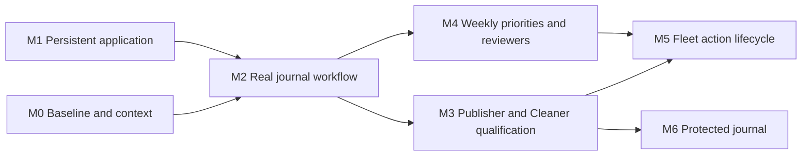

# DailyLogger service delivery roadmap

Status: proposed delivery sequence, revised after Yuri's review on 2026-11-17 America/Chicago. Langfuse is selected. Runtime qualification remains planned; fixture evidence does not mark a production milestone complete. Read the [review reconciliation](review-reconciliation.md), [architecture](architecture.md), and [index](README.md).

## First release target

The first operating release runs DailyLogger on an owner-controlled host, produces a source-grounded public journal through GitHub and Vercel, survives process restarts, exposes exact-version human acceptance through the existing editor, and provides useful Langfuse traces. It uses a versioned owner-approved priority snapshot. Finish bounded overnight review before first Draft publication and verify the latest passing Draft publicly by 04:00 America/Chicago. The richer LAN workspace develops in parallel; automated weekly preparation, expanded reviewers, full fleet coordination, and protected journal content follow as distinct increments.

Deliver a usable vertical slice early. M0 context work and M1 service foundations proceed together. M2 connects real drafting; M3 qualifies Publisher and a separate persistent Cleaner workflow. M4 and M5 can develop independently after their required contracts exist. M6 remains a separate security-qualified release.

The slice labels below organize this plan; they are not admitted tasks or newly created fleet queue items. Link implementation PRs to existing work where applicable and record their exact acceptance evidence before marking a milestone delivered.

## M0 Baseline and journal context

**Outcome:** a documented current behavior baseline, a small approved priority snapshot, and a corpus for judging editorial improvement.

1. Start from current main; reconcile PR #549 and related editorial work. Record actual run, article, action-card, publication, auto-merge, and auth behavior before extraction. Preserve source policy and 03:30 America/Chicago eligibility semantics.
2. Capture representative recent articles, their evidence, and owner corrections. Reuse the real November audit findings for stale Frame framing, repetition, unsupported status, and low-value inventory. Retain the existing golden suite and its advisory status.
3. Define a versioned journal-priority schema with source goal revisions, effective interval, approval identity, public-safe context, exclusions, and next checkpoints. Start with manual owner confirmation; the weekly automation is M4.
4. Define an editorial rubric: factual support, changed information, relevance to approved priorities, readable narrative, and useful distinct follow-ups. Record baseline token/cost/latency data where available and mark missing measurements unknown.

**Exit evidence:** a reproducible evidence manifest, a reviewed comparison corpus, and one approved priority snapshot consumable by the service. Missing/expired context and conflicting goals have explicit behavior. The proposal does not claim PR #549 is merged or replace fleet goals with this roadmap.

**Rollback:** existing generation continues; the new service context reader stays inactive. Update root `ROADMAP.md` and its prompt reader together only when the context migration is ready.

## M1 Persistent application and web controls

**Outcome:** from a private browser, start a fixture run, inspect its status, stop the worker, resume it, approve a checkpoint, and see the result and trace.

Deliver **M1A** first: an offline persisted LangGraph job using recorded inputs and a deterministic reviewer, with a process restart, one Draft output, and its unchanged dated action artifact. Rebuild the existing static API in a disposable checkout with Git history and verify the existing reader. A development-only SQLite checkpointer is acceptable for this bounded proof; it does not qualify the production PostgreSQL design. Neither `MOCK_LLM` nor a CLI dry run proves offline collection. Test with network/provider access blocked.

**M1B** completes the authenticated controls, PostgreSQL integration, and Langfuse proof below. Yuri's sample-data editorial prototype is a parallel design input. The existing public editor remains the M3 cutover surface; the full private workspace and frontend relocation do not block M1A.

1. **Workspace extraction.** Add `apps/service` and the smallest shared contracts/domain packages. Keep the current frontend path for M1A. Move `packages/frontend` to `apps/web` later in a focused change updating Vercel, scripts, tests, and workspace paths. Retain compatibility CLI entry points. No model or queue policy rewrite is required for this move.
2. **Durable execution.** Add PostgreSQL migrations, pg-boss run delivery, and a LangGraph fixture workflow with a persistent checkpointer. Record workflow/attempt identities, graph version, state transitions, and artifact digests. Serialize concurrent resumes of one workflow.
3. **Owner API and UI.** Add private-origin authentication, owner authorization, CSRF protection, request validation, idempotent admission, run detail, cancel, and revision-bound review controls. Do not assume a public-site session or VPN membership is sufficient approval identity.
4. **Langfuse and local operations.** Add OTel instrumentation, source redaction, a configured Langfuse endpoint, and reproducible local compose setup. Test API, worker, database, artifact volume, and Langfuse lifecycles independently. Record proposed production storage and backup requirements.

Apply the [runtime qualification contract](runtime-qualification.md) to the private fixture. Qualify trusted private TLS, actual-peer ingress restrictions, exact Host forwarding, owner login/CSRF/logout, and proxy restart/recreation without losing API sessions or durable commands. Keep API/database ports unpublished and test direct, IPv6 and public-path bypass. A supervised Main-LAN fixture need not wait for the entire fleet firewall rollout; VPN access requires its own observed-source and reachability proof. Public journal access remains independent and uses normal public HTTPS.

**Exit evidence:** a clean checkout boots the documented local application with fixture providers and no paid API calls. Browser and integration tests prove unauthorized requests fail, repeated start/resume does not create another logical run, restart preserves the human wait, stale approval is rejected, and Langfuse outage leaves durable state intact. Canary secret strings are absent from exported traces and public output.

M1A has a narrower receipt: source pin and input manifest, separate start/resume processes, persisted reviewer/checkpoint state, output artifact identity, deterministic repeat-resume behavior, and an existing-reader playback showing the date, Draft label, expected source blob, and original action state. The Nov 17 baseline has three pending candidates and zero admissions. Signed-out playback must not show Accept Draft. A fixture receipt cannot establish model quality, authentication, live Langfuse delivery, production timing, or M3 cutover.

**Rollback:** disable the service deployment and return web build paths through the reversible relocation change. Current Actions generation remains the producer.

## M2 Real journal generation through the service

**Outcome:** real collected evidence and bounded model calls produce a reviewed draft in the private web app; restarting does not discard completed steps.

1. Extract the existing collector, eligibility, schema checks, citation checks, and rendering behind typed interfaces. Freeze source revisions and the approved priority snapshot into a manifest. Use bounded role-specific evidence rather than copying the entire action history into each prompt; preserve the complete deterministic identity/hold index.
2. Implement the article graph: selection, draft, deterministic checks, one evidence-aware independent reviewer, bounded revision, and a prepared Draft artifact. Persist reviewer findings and exact versions. Model the later owner acceptance/rewrite loop separately so a human wait cannot block the initial 04:00 Draft target. The shadow proof may use an interrupt to test persistence without publishing.
3. Wrap existing action intake and verification without weakening its canonical-store, independent-verifier, budget, or hold contracts. Article review and action review have separate statuses. The existing publication policy still determines whether their combined result is publishable.
4. Implement the provider boundary and durable budget accounting. Start with the existing provider; exercise a second permitted provider or local endpoint against the same structured-output and cancellation tests when configured. Do not make Switchboard deployment a prerequisite for the first working service.
5. Connect draft/evidence/review screens and Langfuse trace links. Provide fixture, recorded-evidence replay, and explicitly budgeted live modes. `DRY_RUN` is not an offline-test guarantee.

**Exit evidence:** a recorded end-to-end real run with owner review, model/prompt/evidence versions, per-step usage, and no production publication. Fault injection covers a failed reviewer, malformed response, restart after a successful node, exhausted budget, stale evidence, and ambiguous provider completion. Replay never restores a consumed grant or silently substitutes another provider.

The shadow editorial proof must complete two successive rewrites on the same PR while retaining original and subsequent feedback, then demonstrate rejection when that proposal advances during required checks. These proofs precede production ownership transfer and do not authorize merging trial output. Keep the richer LAN workspace in parallel; use the existing editor's acceptance contract for this qualification.

Editorial acceptance compares the service with the captured baseline on the same evidence. Preserve factual coverage while reducing repeated material; annotate owner judgments instead of treating an uncalibrated LLM score as the acceptance gate.

**Rollback:** service remains in shadow mode. Its prepared artifacts cannot enter existing automatic publication workflows.

## M3 Scheduled operation and publication cutover

**Outcome:** the persistent service becomes the daily producer and runs Cleaner as a separate durable LangGraph workflow. Qualify Publisher first and Cleaner separately within M3. GitHub Actions continues CI and deployment and can retain a disabled emergency generation path.

1. Implement publication intents, deterministic operation keys, branch/PR readback, canonical action revision checks, and reconciliation of unknown effects. Qualify a shared publication authority/epoch and an enforcing trusted publication gate reachable when the local host is down. Gate every producer and remove bypass credentials/routes; a shared flag alone is insufficient.
2. Close the initial acceptance gap in the existing editor: bind Accept Draft to the article/projection/action revision actually displayed, preserve feedback and successive rewrites, reject concurrent changes, and retain the trusted workflow's exact-head receipt. Qualify required checks followed by automatic merge/deploy for that exact accepted subject. Exercise initial acceptance and the existing continuation path separately. Qualify a canary through the same public URL and UX; exclude trial artifacts from auto-merge until deliberately admitted.
3. Add recurrence and startup catch-up. Reuse the local-day reporting interval and eligibility logic; distinguish eligible, intentionally skipped, failed, stale, and missed runs. Admit at most one normal run for each reporting interval. On recovery, expose older missed intervals for deliberate backfill rather than flooding the provider or site.
4. Qualify the actual host: supported container architecture, reserved memory/disk, dedicated application identity and volumes, private ingress/TLS, secrets, release delivery, backup destinations, and restore. Build immutable images in CI; deploy reviewed releases through the automated release path. Do not give an untrusted PR job production host credentials or a host Docker socket.
5. Run shadow comparisons and recovery drills, then transfer production ownership through the shared gate. Close old-epoch admission, resolve unknown writes and queued auto-merge, prove old-writer exclusion, and activate the new producer only after readback. Keep Actions failover manual. Verify that a recovering host cannot publish with stale authority. If FleetRunner later provides the trigger, retain application idempotency and remove the competing recurrence owner.
6. Reserve a measured delivery budget from the 03:30 start target through collection, bounded review/rewrites, CI, merge, deployment, and public readback by 04:00 Chicago. Read the actual rendered article and JSON, matching date, status, source blob and action state. Report missed targets without another generation. Keep the independent 07:00 review through qualification.
7. Migrate Cleaner into its own persistent LangGraph workflow in the service, preserving the current CLI through shared interfaces. Provide manual date and optional target-repository inputs with dry-run defaulting to true, an independent pause control and model budget, and durable step/effect identities. Demonstrate parity with the existing CLI on pinned inputs. Recover after branch push but before PR creation by reconciling the exact branch/commit and completing the same PR intent without duplicate writes. Qualify a separately admitted Cleaner canary through existing PR review; preserve action holds and Cleaner PR merge authority.
8. Keep Cleaner manual until its workflow checks and the gate below pass. During handoff, disable the `workflow_run` trigger for `Daily Dev Blog` in `.github/workflows/daily-cleaner.yml`; preserve `workflow_dispatch` and its dry-run default. Then replace workflow-success admission with a verified-live-local-publication receipt and pinned article/action/evidence inputs. Cleaner remains manual on Actions-failover days. Settle the owner policy for late but eventually verified local publication before automatic activation; this plan does not impose a permanent manual-only rule for late days.

**Publisher qualification and Cleaner activation gate:** seven consecutive scheduled intervals accounted for, including intentional skips; at least three eligible Drafts produced by the local service and verified live; no unexplained missing run, duplicate publication, or unauthorized disposition. Exact-version acceptance must be verified through the production editor and an isolated backup restore must pass. If fewer than three intervals are eligible, extend observation; offline replays and Actions-failover outputs cannot satisfy the three-live-local-Draft requirement. Record each 04:00 readback result and owner disposition of any miss. Automatic Cleaner additionally requires its own CLI-parity, recovery, and canary evidence and a recorded late-publication policy. These rollout targets were relayed in Yuri's review handoff; they are not a claim that current production has passed them.

**Recovery proof:** kill the worker at checkpoint and publication boundaries; simulate DB loss, provider outage, GitHub timeout, duplicate triggers, DST transitions, and Langfuse outage. Exercise Cleaner restart after branch push before PR creation, including an unknown PR-create response and a changed branch. Transfer authority with the local host unreachable, an unknown write outstanding, and auto-merge already queued; the correct result is a hold until a fence and reconciliation can be proved. Restore a backup without republishing completed work or reviving consumed grants. State measured recovery point/time after the drill; the earlier proposed 24-hour data-loss and four-hour restore targets remain provisional. Recovering stale authority or spent grants is never permitted merely because data falls within an accepted RPO.

**Rollback:** request a manual authority transfer, close old-epoch admission, reconcile outstanding publication intents and queued auto-merge, and record the last resolved reporting interval. Re-enable exactly one legacy producer only after effective old-writer exclusion is proven, including when its host is unreachable. Retain the database and artifacts; do not downgrade through destructive migrations. Restore Cleaner to manual operation on failover; report workflows retain their existing ownership unless separately migrated.

## M4 Weekly priorities and useful specialist agents

**Outcome:** the owner reviews a prepared weekly brief; the accepted priorities guide articles and follow-ups until their expiry. Additional agent roles earn their place through observed improvement.

1. Add the weekly workflow: gather goal/roadmap changes and current work, summarize meaningful deltas, surface unresolved questions, collect owner edits, and approve a new version. Expose it in the private web app with before/after context and an editable proposal. Timezone and check-in time are configuration; do not create a second external reminder automation implicitly.
2. Add repetition and relevance review using bounded recent article history and explicit change detection. Keep full work inventories in machine-readable projections and UI disclosures rather than mandatory narrative repetition.
3. Add follow-up planning and specialist reviewers as separate workflows/subgraphs with role-specific context, schemas, limits, and attribution. Begin with evidence accuracy and editorial usefulness; add architecture review only when it has appropriate source material and a measured purpose.
4. Curate owner edits and real review failures into versioned datasets. Calibrate subjective evaluators against held-out human labels. Keep deterministic checks, model findings, and human acceptance distinct; preserve existing eval promotion rules.

**Exit evidence:** two completed weekly check-ins with attributable approvals; at least one expired/no-response case that preserves the old expiry and exposes the need for review. A matched-corpus evaluation shows each retained new reviewer catches useful issues at an accepted latency/cost and false-positive rate. Follow-up suggestions preserve original identities and do not reopen completed or held work.

**Rollback:** return to manual priority snapshots and the smaller reviewer set. Preserve prior priority and review records; no automatic prompt optimization or self-assigned execution authority.

## M5 Shared action and decision lifecycle

**Outcome:** one original action can be followed through a qualified fleet handoff and returned disposition in DailyLogger and MorningCockpit, with source identities intact.

1. Map actual producer records and existing core decision venues before implementing adapters. Use current revisions of FleetRunner, HelpDesk, and MorningCockpit contracts. Keep source-specific state and unresolved disagreements visible.
2. Add a bounded DailyLogger event/outbox profile and read projections. Map it to core's proposed correspondence/evidence profile; promote shared fields only through core's qualification process. A CloudEvents envelope is not approval, delivery proof, or a new canonical fleet store.
3. Name the cross-project owner and existing core review venue, then qualify FleetRunner command/receipt integration for a named DailyLogger workflow. Define the job's completion boundary and versioned native-identity mapping: durable command admission, workflow completion and verified publication are distinct outcomes. Qualify HelpDesk questions and responses across distinct/new correspondence threads with explicit subscription scope and actual reader binding; cover replacement, expiry, replay and uncovered routes without treating an agent message as a human ruling. Qualify MorningCockpit reads with source watermarks, unknown states, and authorized command delegation where supported.
4. Add maintenance triggers for relevant PR/issue/decision changes. Reconcile against original completion conditions; route a verified disposition through the existing canonical action writer and accepted Git boundary. Re-fetch on stale revisions rather than applying a stale review.

**Exit evidence:** one real producer and two independent consumers demonstrate identity preservation, duplicate delivery handling, stale-revision rejection, source disagreement, and recovery. The FleetRunner adapter also covers a lost admission reply, stale execution generation, human wait and independent coordination/telemetry outage; no case may create another schedule owner or revive a consumed approval. A real original action receives the correct attributable disposition; a completed attempt or merged PR alone cannot settle it. Negative cases cover forged human authority, unknown publication, rejected old suggestions, and a removed shortlist item whose underlying work remains open.

**Rollback:** disable the adapters and external triggers; preserve the local article workflow and authoritative action files. No queue or event-store migration is necessary to roll back an integration.

## M6 Protected journal sections

**Outcome:** the owner can read protected journal sections with demonstrated separation from every public representation.

1. Model public articles and private additions as separately stored, authorized resources. Keep private bytes out of the public Git repository and static build context. Link them through stable article identity and explicit classification.
2. Review the deployment choice for protected routes at the public domain versus continued VPN-only access. Implement server-side identity and per-resource authorization, session expiration/revocation, safe rendering, explicit cache policy, and protected attachment delivery.
3. Classify search, feeds, sitemap, exports, model contexts, telemetry, backups, and administrator access. Define a deliberate owner-reviewed public-release/redaction operation; do not publish by removing a UI visibility flag.
4. Run an independent security review against an applicable ASVS matrix and the actual deployment. Verify logout/revocation, guessed identifiers, cross-user access, CDN/cache behavior, error payloads, static assets, source maps, search results, attachment URLs, and restore handling with canary private content.

**Exit evidence:** recorded positive/negative authorization tests, public-artifact scans, cache-isolation proof, backup/restore checks, and resolved material findings from the independent review. Production access follows the normal reviewed release process.

**Rollback:** withdraw protected routes while preserving private storage and access audit records. Public journal availability remains independent.

## Implementation PR sequence

These are review-sized starting slices; split them further when the actual diff warrants it.

| Slice | Main change | Depends on | Required proof |
| --- | --- | --- | --- |
| S01 | Baseline, source manifest, priority contract, reconcile #549 | Current main | Existing editorial/action behavior identified; no invented shipped state |
| S02 | Minimal service workspace; frontend relocation separately | Baseline | Existing build, public API, editorial browser flow and CLI compatibility |
| S03a | PostgreSQL checkpoints and durable fixture run identity | S02 / M1A | Real-database restart, duplicate admission, concurrent resume, checkpoint crash recovery and stale-input rejection |
| S03b | Durable job delivery and worker lifecycle | S03a | Atomic admission/outbox handoff, duplicate delivery, worker restart, retry exhaustion, cancellation and graceful shutdown; reuse the same logical run |
| S04 | Private owner API and run/review UI | S03 | Real session boundary, CSRF, stale-review and browser tests |
| S05a | Offline application observation hooks and closed metadata projection | S03 | Identical fixture outputs/approvals, post-commit semantics, durable attempt identity, restart correlation, bounded asynchronous failures and privacy canaries |
| S05b | Official Langfuse/OTel mapping, private local stack and runbook | S05a | Pinned compatible SDK/server, real authenticated readback, outage/lifecycle tests, measured exporter impact and exercised deletion/retention for the selected edition |
| S06 | Evidence collection, drafting and bounded review graph | S01, S03–S05 | Recorded real draft; provider and recovery tests |
| S07 | Action-review adapter, exact-version editor acceptance, publication gate | S06 | Two successive same-PR rewrites with feedback retained, rejection when the proposal advances during checks, identity/hold preservation, trusted receipts and unknown-write reconciliation |
| S08 | Host release, recurrence, Publisher cutover and separate persistent Cleaner workflow | S07 | Publisher live/readback and restore gates; Cleaner CLI parity, manual dry-run controls, independent pause/budget, branch-push/PR recovery, canary and receipt admission; unreachable-host failover |
| S09 | Weekly owner check-in and priority lifecycle | S04, S06 | Two approved cycles and expiry/no-response behavior |
| S10 | Additional reviewers and follow-up evaluation | S06, S09 | Human-calibrated value against baseline within budget |
| S11 | Qualified fleet adapters and original-action settlement | S07, S09; current core interfaces | M5 end-to-end and adversarial evidence |
| S12 | Protected journal delivery | M3 and accepted M6 security design | Security and recovery evidence before exposure |

M1A is the offline subset of S02/S03 with existing-reader verification. M1B completes S02–S05; M2 completes with S06 and the preserved action-review behavior in S07. M3 completes at S08. S09 and the LAN workspace can proceed in parallel with qualification. The critical path does not require a new shared event bus, graph database, a fleet-wide rewrite, or private journal content.

S05 means both S05a and S05b. The [offline observation boundary](../../apps/service/OBSERVABILITY.md) prepares application instrumentation alongside S04. A test sink is not Langfuse ingestion, and an asynchronous timeout does not isolate synchronously blocking code on the application event loop. Qualify real export separately and retain the existing worker deadlines. S04 authenticated browser controls and S05b real observability are both still required to complete M1B.

S05b has progressed through the inactive exporter boundary, compiled runtime packaging and authenticated image delivery. [PR #571](https://github.com/ojfbot/daily-logger/pull/571) joins those components. [PR #573](https://github.com/ojfbot/daily-logger/pull/573) adds explicit API/worker configuration and has passed real PostgreSQL tests using actual CLI processes, the compiled exporter and a synthetic strict-TLS receiver; defaults remain disabled. [PR #574](https://github.com/ojfbot/daily-logger/pull/574) passed those same enabled tests inside the exact final image, with application code and dependencies supplied by that image. The [runtime delivery checkpoint](runtime-qualification.md#delivery-checkpoint--2026-11-18) records exact passing revisions and their limits. Complete target-host qualification, real Langfuse readback, host capacity and selected-edition retention qualification before closing S05b.

S06 starts with the bounded recorded-evidence protocol in [PR #575](https://github.com/ojfbot/daily-logger/pull/575). It binds opaque evidence and recorded responses to an independently supplied bundle digest, preserves unknown completion, and grants no authority from capture labels or embedded approvals. This is a protocol slice, not a recorded real draft or completed journal graph. Next separate collection from pure prompt/schema/render transformations and bring those transformations inside the service's runtime boundary, validate reporting and action/priority semantics, and capture a complete real evidence packet with request-bound draft/review responses. Then qualify the separate journal graph with evidence-aware review, durable budget accounting and PostgreSQL recovery. Existing fixture admission remains unchanged; protocol work can proceed while the operational M1B gates remain open.

The first shared-rule extraction is [PR #576](https://github.com/ojfbot/daily-logger/pull/576): reporting windows and eligibility move to the dependency-free journal package while existing CLI paths keep their signatures and behavior. Its original 46 behavior tests, typechecks and build-context tests passed. At head `10a2e7f`, [image run 44445445258](https://github.com/ojfbot/daily-logger/actions/runs/44445445258) verified both installed TypeScript entry points inside the final image, representative DST behavior and the package's dependency declarations, followed by enabled-exporter and matched-restore proofs. The package has only explicit committed image inputs. This initial slice did not extract prompt/render transformations or establish semantic admission of reporting and action/priority inputs. Preserve the distinct action ID schemes when those adapters are extracted.

[PR #580](https://github.com/ojfbot/daily-logger/pull/580) shares the unchanged article schemas, adds their existing Zod dependency to the journal package and validates an exactly bound recorded V2 draft without legacy salvage. At head `ee2dd56`, [delivery CI](https://github.com/ojfbot/daily-logger/actions/runs/44599598175) passed on both Node versions with 170 journal, 71 local, 26 checkpoint, 25 delivery, 17 HTTP and 4 enabled-exporter tests per job. [Image CI](https://github.com/ojfbot/daily-logger/actions/runs/44599597972) exercised all installed journal subpaths and the synthetic recorded-draft adapter, then passed the existing exact-image exporter and matched-restore gates. This proves original-response shape validation; existing defaults, unknown-field stripping and status/outcome assertions grant no authority. Real capture, evidence/priority/action admission, provider budgets and persisted journal graph recovery remain open. The slice is a sibling of #577; reconcile their reviewed revisions before integration.

[PR #581](https://github.com/ojfbot/daily-logger/pull/581), stacked on #580, shares the unchanged V1/V2 body assembly, Markdown normalization and rendering, reference helpers, reporting-day titles and continuation-context transformations. At head `4e1ccfe`, [delivery CI](https://github.com/ojfbot/daily-logger/actions/runs/44621612795) passed on both Node versions with 256 journal, 71 local, 26 checkpoint, 25 delivery, 17 HTTP and 4 enabled-exporter tests per job, with zero failures or skips. [Image CI](https://github.com/ojfbot/daily-logger/actions/runs/44621612658) exercised all eleven installed journal exports against the sealed synthetic draft, then passed enabled-exporter and matched-restore checks using the same exported image. Root compatibility, API generation and the frontend production build also passed. This rendering slice does not cover prompt construction, provenance/footer serialization, complete real capture, semantic admission, durable provider budgets or persisted journal graph recovery. These PR-image checks do not qualify receiving verification, target-host deployment or real Langfuse ingestion. Reconcile this stack with #577 before integration.

[PR #582](https://github.com/ojfbot/daily-logger/pull/582), stacked on #581, shares unchanged Markdown serialization and the existing pure provenance schemas/helpers. At head `2b8742f`, [delivery CI](https://github.com/ojfbot/daily-logger/actions/runs/44625271103) passed on both Node versions with 290 journal, 71 local, 26 checkpoint, 25 delivery, 17 HTTP and 4 exporter tests per job, with zero failures or skips. [Image CI](https://github.com/ojfbot/daily-logger/actions/runs/44625270806) exercised thirteen installed journal exports, synthetic provenance roundtrip and revision attribution, then passed the same-image exporter and matched-restore gates. Root compatibility, API generation and frontend build passed. Provenance still describes local/GitHub Actions runs; durable service provenance needs its own design. Environment/API capture and diagnostic output stay in the CLI. Supplied attribution is descriptive data, not authenticated authority or publication permission.

[PR #549](https://github.com/ojfbot/daily-logger/pull/549) now carries its roadmap-first behavior forward on current main and fixes the remaining Frame-only writer/reviewer framing, unsupported static project rankings and contradictory synthesis action quota. At head `d32e335`, [CI](https://github.com/ojfbot/daily-logger/actions/runs/44627705125) passed 1,764 unit tests with two explicitly private-corpus-dependent skips, 31 browser tests, pipeline smoke and both 12-test service-checkpoint runs; the 366-test advisory evaluation suite also passed. Versions are article-v8 and council-synthesis-v3. This is request-construction and compatibility evidence, not a live writing-quality evaluation or weekly priority approval. The shared-prompt slice below integrates that reviewed revision with the journal stack. The shared user-prompt boundary still needs a bounded context projection; opaque recorded evidence does not validate canonical actions or accepted closing continuity. Keep their existing identity, classification and source verification in their domain adapters.

[PR #583](https://github.com/ojfbot/daily-logger/pull/583), stacked on #582, integrates #549 and shares its unchanged draft system/telemetry prompts and tool definition. At head `c2461be`, [delivery CI](https://github.com/ojfbot/daily-logger/actions/runs/44631497459) passed on both Node versions with 293 journal, 71 local, 26 checkpoint, 25 delivery, 17 HTTP and 4 exporter tests per job, with zero failures or skips. [Image CI](https://github.com/ojfbot/daily-logger/actions/runs/44631496321) exercised fourteen installed journal exports and passed the same-image exporter and matched-restore gates. The actual built PR-merge revision is `0c70f267`; root/provider compatibility and full-root lint also pass. The provider SDK, user-context builder and response handling stay in the CLI. [Core #634](https://github.com/ojfbot/core/pull/634) preserves prompt-maintenance wayfinding; the separate [Core #635](https://github.com/ojfbot/core/issues/635) tracks the stale shared fleet brief. This source/image qualification does not admit real context, resolve the legacy response mismatch below, qualify model quality or activate a service.

Resolve the versioned provider-output contract before connecting live journal drafting. The legacy tool does not request `date`, while the CLI inserts it before V2 validation; the recorded-draft adapter validates the original V2 response, which requires it. The tool also permits telemetry without three fields required by the V2 schema. Preserve extraction compatibility and explicitly qualify any later tool correction or request-bound adaptation. Original-response validation and adapted article validation must remain distinguishable.

Preserve the distinction between original-response validation and legacy recovery behavior during extraction. The current [article validator](../../src/schema.ts) can salvage malformed output, the [council reviewer](../../src/council.ts) receives the draft and persona without the source evidence, and synthesis can return the original draft after failure. Record original validation failures and fallback outcomes explicitly; repaired output is not evidence that the original response was valid, and a returned original draft is not a successful independent review.

S08 release preparation starts with the versioned, non-deploying candidate workflow in [PR #577](https://github.com/ojfbot/daily-logger/pull/577). Integrate it with the current image qualification gates, then record an actual manual-main candidate and independent receiving verification. Durable private artifact storage, controlled promotion, production recovery authority and deployment remain separate delivery slices; candidate verification grants none of them. See the [release and recovery contract](runtime-qualification.md#production-release-and-recovery).

S03 means both S03a and S03b in the dependencies above. S04 contract and sample UI work may proceed alongside S03b, but operational API delivery must use the qualified job-admission boundary. [PR #555](https://github.com/ojfbot/daily-logger/pull/555) develops S03a on the merged [M1A foundation](https://github.com/ojfbot/daily-logger/pull/554). Its revised implementation checks checkpoint ancestry, physical output-directory reservations, actual saver migrations and canonical UUID identities. Qualification requires its real PostgreSQL Linux/macOS matrix and independent review at the exact revision. [S03b's fixture implementation](../../apps/service/DELIVERY.md) adds atomic command/job admission, explicit resume targets, cancellation and bounded worker delivery; its separate PostgreSQL crash/concurrency matrix must also pass before S04 wiring. Current PR validation receipts remain authoritative. These increments do not complete the remaining M1B controls or qualify production operation.

## Engineering and release discipline

Run checks appropriate to each change: existing TypeScript/lint/unit checks for extraction; existing frontend/browser tests for the move; real PostgreSQL integration tests for crash/replay/transactions; contract tests for adapters; and redaction/public-artifact checks for data boundaries. Use synthetic fault cases as service tests. Add golden evals only from real documented failures under the existing corpus rules.

Use fixture providers in default CI and an explicitly configured budget for live evaluations. Never imply that mock runs prove model quality or production recovery. Record code SHA, graph/prompt/schema versions, evidence manifest, model routes, and observed outcomes with each qualification run.

Update `opm/system.opl` and regenerate `opm/system.md` in each implementation PR that changes actual pipeline inputs, outputs, requirements, or steps. The current OPM model remains an as-built description while this architecture is proposed. Keep accepted policy, implementation status, and deployment evidence separate.

Maintain independent pause controls for generation, model spend, action review, publication, and external adapter effects. Deployment, publication, and migration go through PR review, CI, merge, and automated release. Select and qualify the production invoker, including any permitted `workflow_dispatch` entry point. A reviewed image or script invoked directly over SSH does not by itself establish the automated deployment path. Preserve the distinction between a disposable fixture rehearsal and production activation.

Before a production upgrade, close admission and quiesce old API/worker writes within bounded deadlines, then capture a consistent database/filesystem recovery point. Application, saver and delivery migration phases commit separately; reconcile their ledgers and rerun the same qualified migrator after interruption. Current fixture reservations bind a canonical path and physical device/inode. Qualify restoration into an isolated destination with a deliberate ownership reconciliation procedure; a database dump and copied directory alone do not prove recoverability. These upgrade/restore requirements do not block a fresh disposable fixture.

The first [matched restore fixture](https://github.com/ojfbot/daily-logger/pull/572) assumes the original source stays stopped with no later effects. Production recovery additionally requires an authority epoch outside restored state, effective old/new writer fencing, invalidation of restored login/session and execution grants, and reconciliation of effects after capture before fresh exact-version approval. Matching backup bytes alone cannot show that a restored approval or session is still valid. Track this control plane as an S08 release gate; preserve the fixture's narrower evidence in the [runtime qualification contract](runtime-qualification.md#production-release-and-recovery).

## Decisions to close during implementation

| Decision | Proposed default | Needed by |
| --- | --- | --- |
| Host and storage | Dedicated application identity on an owner-controlled Linux host/VM; private volumes and a separate backup destination | M1 development profile; actual production qualification in M3 |
| Langfuse placement | Separate self-hosted fleet service, private ingress, per-app/environment projects; verify edition, retention and capacity | S05 |
| Owner login | Reviewed GitHub OAuth owner allowlist on the private origin; future fleet identity adoption through an adapter | S04 |
| Private TLS | Owner-selected private fleet CA; device enrollment plus application auth; supervised leaf rotation first, unattended renewal separately qualified; public journal retains public HTTPS | Private fixture before real login |
| Production schedule owner | DailyLogger recurrence until a qualified FleetRunner trigger replaces it; one active owner | S08 |
| Model routes and budget | Existing provider first; explicit per-role routes, allowed egress, and per-run/period ceilings | S06 before paid qualification |
| Publication policy | Bounded overnight Draft review; 04:00 verified public readback; exact-version Accept Draft through current editor; shared fenced manual failover; preserve 07:00 independent review | S07–S08 |
| Cleaner activation | Manual until Publisher's live qualification, restore and production exact-version acceptance and Cleaner's own parity/recovery/canary checks pass; then verified local publication receipts only, with Actions-failover days manual | S08 |
| Late-publication Cleaner policy | Unresolved owner decision for late but eventually verified local publication; record the decision before automatic Cleaner activation, without assuming a permanent manual-only rule | S08 before automatic activation |
| Fleet contract versions | Use accepted current interfaces, qualify proposed crosswalk fields, retain native IDs | S11 |
| Protected-content access | VPN-only first; any protected routes on the public origin require the separate security review | S12 |

The first implementation action is S01/S02 on current main, followed immediately by the persistent fixture service. Host procurement, model-spend limits, and deployment details do not prevent preparing that reviewable code, but their unresolved values must be settled before dependent live operation.
