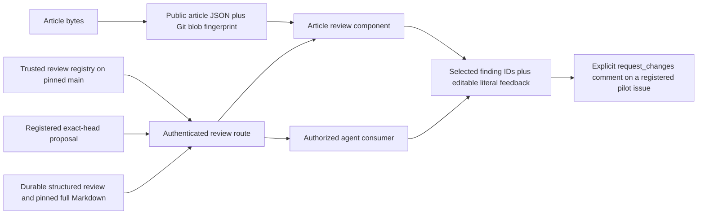

# Request article corrections from an independent review

The current surface supports published records, eligible open review PRs and
GitHub-backed human/agent correspondence. See [Open reviews and saved
discussion](correspondence.md) for current behavior, routing and verification.
Recording feedback remains separate from accepting an article.

The remainder records the original bounded pilot and its historical verification
at the stated source pins; its original publication-pending statements are not
the current deployment status.

## What the current system already does

At base `ce04d6762fa5a8e5dff59388849e3ea164aff940`, `ArticlePage` loads public
article JSON into `articlesSlice`. Authorized draft readers receive
`EditorialSidebar` and `EditorialEditor`. Every submission there calls
`stampDraft`, which creates `accept/<date>`, changes status to accepted, and opens
a PR. Feedback starts `editorial-revise.yml`, which may call a drafting provider.
That path cannot express a correction request alone.

`docs/article-review.md` describes a Proposed advisory procedure and a Markdown
record format. Main tracks the October 12 record. October 13 and 14 automation
reviews exist locally and are uncommitted. No review discovery API, registry, or
article review component exists at the base. #357 already defines the pilot and
explicitly says not to wait for a separate design sign-off. Opening another spike
issue would repeat planning work.

The source issue is the repository owner's specification. Its permission language
is not an execution grant from a session. The direct human instruction in this
session authorizes bounded local preparation of today's new and resurfaced
follow-ups. It does not authorize this worker to publish, merge, deploy, submit
production feedback, dispatch models, or change article/action states.

## The two designs considered

A static API build could export only merged review records. That would reuse the
article build, but private and proposed work could leak into public assets. It
also cannot discover an authorized in-flight review without another data path.

The chosen design uses a narrow authenticated route and a trusted registry. It
reads only explicitly registered paths, pins each read to main or a registered
proposal head, and supplies the same JSON to the editor and an authorized agent.
It requires one extra request and GitHub availability. Those costs keep private
review work out of the public static build and avoid a new database or scheduler.
These alternatives were evaluated by one Codex worker. They are not independent
or cross-model design reviews.

## Ownership and data flow



- `shared/article-review.ts` owns the runtime schemas used by both consumers.
- `reviews/registry.json` owns eligibility and date-specific correspondence
  routing. An unregistered local session is unknown, not a missing successful run.
- `reviews/registered/*.json` owns the structured advisory findings. Each record
  binds article date, exact reviewed commit and article blob, reviewer/session,
  timestamp, scope, full Markdown path and full Markdown blob.
- `api/_lib/article-review-service.ts` projects those records and records requests.
  It verifies the claimed article blob at the reviewed commit and verifies the
  full review artifact before offering a finding.
- `api/article-reviews.ts` owns authenticated admission. It reuses the encrypted
  token cookie, validates GitHub identity against `ALLOWED_USERS` for reads and
  writes, requires the CSRF header for POST, and emits private/no-store responses.
- `IndependentArticleReviews` is an authorized article-page view. It has a direct
  navigation link, native keyboard controls, and the existing narrow-screen
  column behavior. It keeps request feedback separate from acceptance notes.
- `src/build-api.ts` adds the Git blob fingerprint of the exact source bytes to
  per-article JSON. It does not rewrite article prose or action dispositions.

The article's authoring `provenance.run.sourceSha` is the generator input commit.
It is not used as the output article identity. Fingerprint equality means the
review covers the visible article bytes. It does not revalidate the external
world or certify every claim in a review.

## State and authority rules

| Observed state | Presentation and action |
| --- | --- |
| Registered record read from pinned main | Published review record, advisory findings |
| Registered same-repository open PR with exact expected head | Proposed, unmerged review record |
| Proposal moved, closed, foreign, missing or malformed artifact | Unavailable with a reason; no eligible findings from that record |
| Review article blob matches visible article blob | Matches visible article |
| Article blob changed | Stale; request disabled until a fresh eligible review exists |
| Visible article has no fingerprint | Unknown visible revision; request disabled |
| No registered review | No eligible registered review; no clean-review verdict |
| Recorded failed run | Failed with reason; no clean-review verdict |
| Completed review with no findings | Reviewer reported no findings within the stated scope |
| GitHub/history outage or bounded-history limit exceeded | Error, not an empty successful result |

A request includes an explicit `request_changes` intent, stable request UUID,
visible article blob, exact structured record blob, selected finding IDs, and
verbatim feedback. The server verifies open finding state and current article
bytes, then rechecks main immediately before recording the comment. It does not
call `stampDraft`, create a branch or PR, change article status, dispatch a model,
or claim a correction was applied. A later article change can race the final
read and comment write; the comment names the checked commit and article blob.
That race can only leave an explicitly historical feedback request. It cannot
accept or publish an article.

The checked-in `claude.yml` dispatches a provider job when a newly created issue
comment contains its mention token, including text inside a code fence. The
comment display therefore uses JSON Unicode escapes for every at-sign, uses
mention-free account attribution, and percent-encodes review artifact paths.
Both the display JSON and structured record decode to the original feedback
exactly. A final raw-body guard rejects any remaining at-sign or slash-command
prefix before the write. The `pipeline-alert-commands.yml` comment rule requires
a slash prefix; generated correspondence starts with its fixed heading instead.
A regression reads the actual checked-in predicates and fails if the known
correspondence workflow inventory changes. This qualifies those repository
predicates, not unknown organization-level integrations.

The same UUID and identical actor/payload reuse an existing comment. A changed
payload under the same UUID is rejected. GitHub comments provide no atomic
create-if-absent operation, so truly concurrent identical requests can still
produce duplicate comments. The UI disables double submission; a transport
failure retains feedback and instructs the editor to refresh history. This pilot
does not claim exactly-once publication.

Accepted/rejected finding dispositions require an actor and evidence URL in the
registered source record. `open` remains the initial advisory state. Recording a
request does not change that disposition or article acceptance. A correction PR
can be linked in a later attributed source-record update. There is no automatic
correction-PR generation or human-adjudication authority in this pilot.

## Why the pilot uses issue #357

#357 explicitly owns the October 13 T1 walkthrough and asks the team to capture
expected/observed behavior in its PR or issue. The local registry therefore names
#357 as the pilot correspondence target for October 13. Today's October 14 route
is a proposed local dogfood extension under the current human request. The UI
names that destination before submission. The server accepts only the registered
date route, not a caller-supplied issue number.

This does not adopt #357 as a permanent fleet-wide or daily feedback sink. Other
dates have no request target and fail closed. Before using this outside the
pilot, register the actual article PR or deliberately chosen correspondence
issue, with its owner. Adding another target type needs source-backed ownership
and an appropriate negative control.

## Existing editorial work remains intact

- #334's independent notes and failure/reload preservation remain in
  `EditorialEditor`; review feedback uses a different storage key and request.
- #341/#349's browser regression still uses the acceptance path. This pilot adds
  separate request-changes browser controls and does not replace that regression.
- #347's literal feedback invariants remain intact. The new durable request
  records the feedback as UTF-8 JSON/base64, without trimming its stored value.
- #5's next-day corrective context is not implemented. The pilot records a
  correction request; it does not feed that request into a drafting prompt.
- No council/generator/provider source, editorial workflow, article Markdown,
  `api/actions.json`, or `api/done-actions.json` is changed by this candidate.

## Dogfood expectations and observations

Expected: today's editor and agent identify the same record, source revision and
C1 finding. The editor selects C1, edits its proposed correction, and records a
request without accepting the draft. A failed request preserves feedback and
existing editorial notes.

Observed in controlled browser tests: all of those steps passed. The actual
component called the actual review service through an intercepted route. The
service read registered source fixtures and wrote one in-memory issue comment.
The exact whitespace, Unicode and marker-like feedback bytes matched the decoded
comment payload. Existing editorial notes survived reload and submission. The
browser emitted only `POST /api/article-reviews`; the service emitted only the
registered comment mutation. No acceptance branch, file commit, PR or provider
call occurred. The real serverless handler's auth/CSRF/cache behavior has separate
native controls. Production OAuth, GitHub comment persistence and deployment are
not qualified by these fixtures.

Expected: the historical T1 path shows T2 fixtures before T1, permits feedback for
the original matching article pin, then becomes stale after #356's changed blob.
Observed: the controlled historical path recorded the correction and disabled
selection after the source changed. This is a historical fixture, not a new live
request against the already corrected October 13 article.

Expected: proposed work is labeled unmerged, narrow-screen keyboard selection
works, a moved proposal head becomes unavailable, and an outage never appears
clean. Observed: those checks passed at a 390px viewport with no horizontal
page overflow. Dogfooding exposed a navigation gap: the review section follows a
long article on narrow screens. The candidate now includes a direct link from
the article header to the review heading. Focused viewport screenshots accompany
the machine responses.

The two seeded full Markdown records are copied byte-for-byte from the existing
local automation artifacts. The structured October 13 projection intentionally
contains only C1 for the historical walkthrough. The October 14 projection
contains eight reported confirmed findings and four unverified claims. It is a
transcription of the existing advisory review, not an independent factual
recertification by this UI worker. Existing originals are preserved.

## Verify the candidate locally

```sh
pnpm install --frozen-lockfile --ignore-scripts
pnpm type-check
pnpm exec tsc --noEmit --target ES2022 --module NodeNext --moduleResolution NodeNext --strict --esModuleInterop --skipLibCheck api/article-reviews.ts api/_lib/article-review-service.ts shared/article-review.ts tests/review-surface/*.ts
pnpm test
pnpm exec node --import tsx src/build-api.ts
pnpm --dir packages/frontend build
pnpm exec playwright test --config playwright.review-surface.config.ts
```

The custom browser config uses owned loopback port 4057 and installed Chrome. The
same spec also uses the default browser configuration's base URL. All external
browser requests are denied; review reads and writes use in-process fixtures.
No live credential is needed. The native handler tests replace cookie extraction
and external fetch, so they verify admission behavior without a production token.

## Remaining work and estimate

The local end-to-end candidate is implemented, with source, browser and machine
proof. Before publication, independently review source visibility/routing and
transcription accuracy. Root owns branch/PR publication and merge approval.
After an approved normal deployment, verify actual OAuth, private cache headers,
source discovery, and one explicitly authorized request comment. Retain deployed
verification separately from source merge.

Estimate for a second engineer: one focused review session for the current
candidate and half a day for preview/deployed dogfood if auth/configuration works
as expected. A general article-correspondence routing policy or correction-PR
execution is additional work and is not included in that estimate. This is an
engineering estimate, not a measured delivery commitment.
