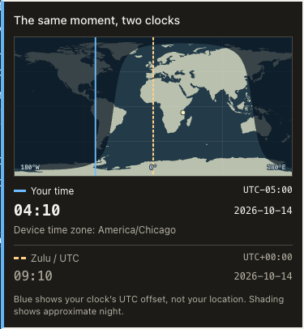

# Article time references

A time popover describes one complete instant, either recovered from an event record or stated explicitly with its date and offset. `Z` means UTC, so `09:10Z` gives a clock time but does not identify a day. The article date is not a substitute for an event date. For example, the October 15 article refers to daily-logger PR #359, which merged on October 14 at `2026-10-14T09:10:41Z`.

## Source timestamps

`src/time-reference-schema.ts` owns the browser-safe timestamp schema. `src/time-references.ts` resolves source records deterministically. Each reference retains its visible text, occurrence number, full UTC instant, displayed precision, and evidence. The occurrence number distinguishes repeated labels with different dates. A standard HTML5 parser reads the rendered article text, so Markdown escapes and HTML entities do not shift a reference onto another occurrence. Seconds in the evidence remain intact when prose displays only minutes.

Git commit author time, commit committer time, and pull-request merge time are different fields. The resolver uses the event described by the prose. A displayed minute must agree with that field. A matching clock elsewhere in the article does not establish provenance. Source selection reads the prose before it looks up evidence. If the closest mentioned source has no matching record, the clock remains unresolved instead of falling back to an earlier PR or commit.

An unqualified repository label names the project's `ojfbot` namespace. Other owners require an explicit full repository or source link. A compound heading or a repository name elsewhere in a clause does not establish which repository owns an unqualified PR or commit.

Current PR `updated_at` and `closed_at` values can change after the event described by an old article. They cannot supply the calendar date of a clock-only mention. Such mentions remain unresolved. A complete explicitly stated timestamp can still describe itself without claiming independent Git verification.

Complete timestamps with an explicit UTC offset can identify themselves. Their provenance is the stated timestamp, not independent Git verification. A minute-only timestamp retains minute precision. Bare times need a nearby event identity and a matching source record. Schedules, bounds, unsupported local abbreviations, and ambiguous event dates do not become popovers. The resolver never uses a model to fill a missing date.

Drafting and council synthesis produce editorial content. They neither receive a separate timestamp catalog nor emit time metadata. Source collection retains author, committer, and PR event facts separately from model output. This adds no model calls.

## Shipment completeness

Every GitHub pull-request link between any rendered `## What shipped` heading and its next level-two heading is a shipment candidate, regardless of whether it appears in a subheading, paragraph, list item, multi-link sentence, or a repeated `What shipped` section. Links outside those sections are not candidates. The code resolves candidates from retained GitHub event records; it does not depend on a clock written by the drafting model.

Each candidate must have exactly one accounted state before generation succeeds. A unique valid `merged_at` fact becomes a merge-time control. Missing, malformed, or conflicting source evidence becomes an explicit `timestamp unavailable` state. A pull request is excluded as closed-unmerged only when the captured provider response explicitly reports the current state as closed and `merged` as false; a historical `closed_at` event or an absent valid merge timestamp is not enough. The completeness assertion rejects missing, duplicate, unexpected, and unmerged controls.

New immutable time-record artifacts use schema version 2 and retain complete evidence groups for shipment candidates in addition to records selected for visible prose clocks. Starting with the October 19, 2026 article, the static API build fails if a dated article has shipment candidates but valid v2 coverage is unavailable. It repeats the completeness assertion and projects shipment states separately from prose `timeReferences`. A dated checker compares the current article blob, immutable resolution, and built API projection so a stale API or wrong-source state fails.

The frontend inserts each state immediately after the first matching in-section PR link. Available states reuse the existing single-event UTC/device-time/map popover; they do not create a grouped event panel. Section discussion context removes these code-owned decorations before quoting article prose.

## Generation, revision, and publication

After final prose, verification notes, normalization and the provenance footer are assembled, generation selects the source identities mentioned next to supported event clocks. It retains each complete source group, including competing facts, in a canonical artifact at `api/time-records/<article-date>/<digest>.json`. Unrelated fleet activity is excluded. The article carries only `time_records_sha256`; derived references are not cached in new articles.

The artifact records a collection observation instant or explicit unknown, an actual collection window or explicit unknown, and capture diagnostics. The current sweep mixes query windows, so generation records its actual post-collection observation time and leaves the shared window unknown. Neither value is inferred from the article date. These are recorded collector observations. The digest proves byte identity, not provider or account authenticity.

Capture is limited to 256 records and 64 KiB of canonical bytes. These are conservative policy limits. If a complete selection exceeds either limit, the artifact explicitly records exhaustion and retains no Git source records. It does not truncate a conflicting group into apparent certainty. Full stated timestamps can still identify themselves. A revision introducing a source not retained at generation leaves its clock unknown.

Only generation writes these artifacts. Persistence installs and syncs the immutable artifact before replacing the dated article through an atomic rename. Identical prepared inputs reuse the same bytes. Interruption can leave an unreferenced artifact; a successful article write cannot precede its artifact. The Git commit publishes both files. This is not a cross-file filesystem transaction.

Editorial revision removes all time metadata from model input and output, then mechanically restores the original declaration after prose, provenance and outcome processing. The model cannot create, replace or enrich the pointer. Ordinary acceptance and revision inherit the previously committed artifact and change only the dated article; their file guards remain intact. The API resolves the current rendered prose against recorded facts, so body or footer changes do not stale a new-format cache.

The API reader uses its injected repository root and validates the date, derived path, digest, canonical schema, regular file and directory boundaries, and byte limits. Missing or invalid facts remain unavailable with diagnostics. Stored legacy inline and historical sidecar claims are evaluated independently against the recorded historical evidence and deterministic current-prose resolution. A matching body fingerprint detects editing; it does not establish a source or calendar date. Stale or invalid inline data cannot suppress a separately valid historical sidecar. Conflicting source facts fail closed.

## Device timezone

The popover expresses the same instant in UTC and the viewer's current device timezone. It uses `Intl.DateTimeFormat().resolvedOptions().timeZone`, then formats the historical instant in that IANA zone. The daylight-saving offset belongs to the event date. Today's offset would be wrong for many past events.

| Approach | Tradeoff | Use |
| --- | --- | --- |
| Device IANA timezone | Honors device settings and historical daylight-saving rules; a misconfigured or privacy-hardened device can report another zone | Default |
| Browser numeric offset at the event instant | Local calculation without a timezone name | Fallback |
| Explicit UTC | Readable even when browser timezone information is unavailable | Final fallback |
| Manual timezone selection | Useful for travel or incorrect device settings; adds controls and local preference state | Future option |
| IP geolocation | Can locate a VPN exit and introduces a network service and IP processing | Not used |
| Device geolocation | Requires permission and coordinates-to-timezone data for information this feature does not need | Not used |

Timezone detection, formatting, and map calculations run locally. The feature sends no timezone or coordinates to a service or analytics. A VPN does not normally change the operating system's timezone. The caption describes the device timezone used to express the event, not the viewer's location when the event happened.

The device line is a **time-offset meridian** at 15 degrees per offset hour, wrapped around the map. It is not a geographic location: political timezone boundaries and daylight-saving time do not follow longitude. The local-time caption appears first and uses the primary solid blue line. UTC stays at Greenwich as a secondary dashed amber line. When both offsets are zero, two adjacent colored lines and separate captions preserve both meanings.

## Day and night

The map centers Greenwich in an equirectangular projection. Its bundled land outlines come from the public-domain Natural Earth 1:110m dataset, with source URL and checksum recorded in `worldLand.ts`. The shadow represents the referenced instant, including its date and season. The calculation uses NOAA's published solar declination and equation-of-time approximation. A point is shaded when its surface normal points away from the Sun. The result includes seasonal polar day and night.

This is a geometric day/night illustration. It does not model twilight, atmospheric refraction, terrain, or mission-grade ephemerides. The map does not imply precision beyond a thumbnail. No external map tile or astronomy service runs when the popover opens.

## Standards and sources

- [RFC 3339 date and time syntax](https://www.rfc-editor.org/rfc/rfc3339.html) defines complete timestamps and the UTC `Z` suffix.
- [ECMA-402 DateTimeFormat resolved options](https://402.ecma-international.org/#sec-intl.datetimeformat.prototype.resolvedoptions) defines the browser timezone API.
- [ECMAScript LocalTime](https://tc39.es/ecma262/2025/multipage/numbers-and-dates.html#sec-localtime) describes timezone rules and daylight-saving transitions at a given instant.
- [IANA timezone theory](https://www.iana.org/time-zones/theory.html) explains civil timezone boundaries and historical rules.
- [Natural Earth terms of use](https://www.naturalearthdata.com/about/terms-of-use/) identifies the map data as public domain.
- [NOAA general solar position equations](https://gml.noaa.gov/grad/solcalc/solareqns.PDF) specifies the solar approximation.
- [NOAA calculation details](https://gml.noaa.gov/grad/solcalc/calcdetails.html) describes numerical assumptions and limitations.

The implementation uses established browser APIs and documented calculations. Its evidence consists of source records, deterministic replay, numerical fixtures, and browser tests.

## Reconstruction limits

The migration scans every historical article, including recognizable local-clock forms it cannot safely convert. Its report distinguishes unsupported formats, missing evidence, mismatched clocks, and ambiguous instants. A scheduled or hypothetical time does not identify an event. An unqualified local abbreviation does not identify a unique zone.

The frozen source snapshot contains timestamp records and source identifiers. Failed source requests remain listed there. Some requests come from conservative cross-repository discovery, so a missing candidate does not mean the displayed article claim is false. The resolver uses only validated records.

## Repeatable validation

Run the commands in [Reconstruct article time references](backfill-time-references.md). Committed controls reject forged source, event, day and occurrence claims; exercise invalid inline with valid historical fallback; and cover missing, malformed, linked, conflicting and exhausted source artifacts.

The generation lifecycle control uses a mocked SDK response with the real serializer and persistence, changes article body and footer, runs the ordinary mock revision CLI, verifies the one-file editorial guard, and rebuilds the API in an injected repository root. A separate actual dry-run orchestration control fingerprints article, API and action directories before and after. No model or network service runs in these checks.

The frozen corpus through October 16, 2026 contains 134 articles and 33 resolved references across 16 articles. The committed replay reads all 134 and compares complete and reversed-input shard output byte for byte with the historical sidecar. Historical prose, action history and the recorded evidence remain unchanged. The reconstruction report keeps unsupported and uncertain mentions explicit.

Browser controls cover local-first styling, historical DST/date rollover, map hover, pinned content clicks, keyboard/touch/mobile interaction, stationary PR/commit cache refresh, target switching and late-response isolation. Discussion portals are excluded from article occurrence counting. These controlled checks are distinct from live authenticated deployment verification.
