# System model — Mermaid compatibility views

> Generated from `system.opl` by the /opm subset renderer v1. Do not hand-edit.
> Source SHA-256: `c979a3a482a08f814bfdfbfec993a3900447c5f020d61fe60042f583c526d4da`.
> Lossy projection, not a native OPD or ISO conformance claim. Rounded process nodes and
> labeled arrows replace standard symbols. States are summarized; native state, control,
> property, and refinement geometry is omitted. No order is inferred from decomposition.

## SD — daily-logger: one article per day

**Caption:** This view summarizes the source facts in this section. Rectangles identify objects;
rounded nodes identify processes. Labeled solid arrows distinguish human participation,
required instruments, and transformations. These are compatibility labels, not native OPM links.
Use the source facts below for properties, state detail, and decomposition membership.

```mermaid
---
title: "SD — daily-logger: one article per day"
---
flowchart TD
  accTitle: SD — daily-logger: one article per day
  accDescr: Lossy system model projection. Complete source facts follow this diagram.
  n19["Jim"]
  n4["GitHub"]
  n36["Claude API"]
  n0["Article — states: draft, accepted, rejected"]
  n1["Run Admission — states: generate, recover, complete"]
  n2["Cron Firing"]
  n3("Run Admitting")
  n5("Run Evidence Capturing")
  n6["Run Evidence"]
  n7("Article Generating")
  n8("Branch Recovering")
  n9["Article Completion"]
  n10("Cleaner Admitting")
  n11["Cleaner Admission — states: run, skip"]
  n12("Stale Content Cleaning")
  n13["Canonical Action Projection"]
  n14("Fallback Checking")
  n15["Fallback Decision — states: missing, active, complete, failed"]
  n16("Fallback Dispatching")
  n17["Workflow Run"]
  n18["Draft Action Candidates"]
  n20("Editorial Accepting")
  n21("API Building")
  n22("Action Projecting")
  n23["Action Registry"]
  n24["Closing Prompt — states: legacy-options, ranked-shortlist, needs-evidence"]
  n25("Suggested Action Card Rendering")
  n26["Suggested Actions Card"]
  n27["Draft Continuation Context — states: transient, retained"]
  n28("Action Reconciling")
  n29["Action Review Cycle — states: generation, revision"]
  n30["Source Evidence"]
  n31["Recommendation Maintenance Memory"]
  n32["Draft Candidate Evidence Requirements — states: prior-binding, current-binding"]
  n33("Suggestion Proposing")
  n34("Candidate Reference Resolving")
  n35("Suggestion Verifying")
  n37["Provider Action Proposal"]
  n39["Canonical Action Proposal"]
  n40["Malformed Output Repair Budget — states: available, spent"]
  n41("Action Output Repairing")
  n42["Invalid Action Output"]
  n43["Lossless Action Model View"]
  n44["Candidate Record Binding — states: available, unavailable"]
  n45("Candidate Record Isolating")
  n46("Candidate Record Repairing")
  n48["Draft Action Candidate — states: awaiting-review, promoted, mapped-existing, rejected, verified-closure"]
  n157["Candidate Review History"]
  n271["Candidate Review Transition"]
  n272["Historical Source Metadata"]
  n50["Draft Candidate Evidence Association — states: required, context"]
  n273["Background Evidence Reference"]
  n274["Candidate Action Relation"]
  n275["Candidate Input View"]
  n52("Candidate Evidence Preparing")
  n276["Canonical Action Index"]
  n277["Held Suggestion Memory"]
  n278["Rejection Memory"]
  n53["Action Review Snapshot"]
  n54("Candidate Evidence Refreshing")
  n55["unchanged Draft Candidate Evidence Association"]
  n56["unchanged prior Candidate Input View"]
  n57["Accepted Outcome Stamp"]
  n59("Acceptance Status Evidence Refreshing")
  n60["current-binding Draft Candidate Evidence Requirements"]
  n279["Ranked Recommendations"]
  n280["Handled Suggestions"]
  n61("Editorial Revising")
  n62["Editorial Revision Request"]
  n63["Draft Suggestion — states: proposed, open, done, dismissed, superseded, deferred"]
  n162["Imported Action Baseline"]
  n113["Article Action Files — states: pending, verified"]
  n64("Inclusion Choosing")
  n65["Reviewed Disposition — states: deferred, completed-existing-evidence, pending-receipt"]
  n281["Canonical Actions"]
  n66["JSON API"]
  n67("Frontend Rendering")
  n68["Rendered Site"]
  n69["Article Fingerprint"]
  n70("Independent Review Projecting")
  n71["Review Projection"]
  n72("Revision Requesting")
  n73["Revision Request"]
  n74("Conversation Saving")
  n75["Saved Message"]
  n282["Review Records"]
  n283["Correspondence"]
  n76["Time Record Pointer"]
  n77("Time Recording")
  n78["Commit Context"]
  n79["Issue Context"]
  n80["Time Evidence"]
  n81("Time Backfilling")
  n82("Time Resolving")
  n83["Time References"]
  n84["Shipment Timestamp — states: available, unavailable"]
  n85["Shipment Source State — states: open, closed-unmerged"]
  n86["Shipment Coverage — states: complete, unavailable"]
  n87("Shipment Time Resolving")
  n88("Issue Time Resolving")
  n89["Projected Issue Times"]
  n90["Time Expressions"]
  n91("Time Projecting")
  n92("Shipment Coverage Checking")
  n93["Projected Time References"]
  n94["Projected Shipment Timestamps"]
  n95["Projected Time Expressions"]
  n96("Time Visualizing")
  n97["Device Timezone"]
  n98["Time Popover"]
  n99("Time Metadata Preserving")
  n292["Source Identity"]
  n293["Source Kind"]
  n294["Source Locator"]
  n295["Full Content Digest"]
  n296["Operator Feedback"]
  n297["Article Status"]
  n2 -->|"triggers"| n3
  n4 -->|"requires (instrument)"| n3
  n3 -->|"yields"| n1
  n3 -->|"invokes"| n5
  n4 -->|"requires (instrument)"| n5
  n5 -->|"yields"| n6
  n1 -->|"condition: generate"| n7
  n1 -->|"condition: recover"| n8
  n4 -->|"requires (instrument)"| n8
  n8 -->|"yields"| n9
  n7 -->|"yields"| n9
  n9 -->|"requires (instrument)"| n10
  n10 -->|"yields"| n11
  n11 -->|"condition: run"| n12
  n13 -->|"requires (instrument)"| n12
  n12 -->|"affects"| n4
  n4 -->|"requires (instrument)"| n14
  n14 -->|"yields"| n15
  n15 -->|"condition: missing"| n16
  n4 -->|"requires (instrument)"| n16
  n16 -->|"yields"| n17
  n17 -->|"triggers"| n3
  n7 -->|"yields"| n0
  n7 -->|"yields"| n18
  n19 -->|"handles (human)"| n20
  n20 -->|"changes: draft to accepted"| n0
  n0 -->|"requires (instrument)"| n21
  n0 -->|"requires (instrument)"| n22
  n23 -->|"requires (instrument)"| n22
  n22 -->|"yields"| n13
  n24 -->|"requires (instrument)"| n25
  n23 -->|"requires (instrument)"| n25
  n25 -->|"yields"| n26
  n0 -->|"requires (instrument)"| n28
  n23 -->|"requires (instrument)"| n28
  n29 -->|"requires (instrument)"| n28
  n30 -->|"requires (instrument)"| n28
  n31 -->|"requires (instrument)"| n28
  n18 -->|"requires (instrument)"| n28
  n32 -->|"requires (instrument)"| n28
  n28 -->|"invokes"| n33
  n28 -->|"invokes"| n34
  n28 -->|"invokes"| n35
  n36 -->|"requires (instrument)"| n33
  n36 -->|"requires (instrument)"| n35
  n31 -->|"requires (instrument)"| n33
  n31 -->|"requires (instrument)"| n35
  n18 -->|"requires (instrument)"| n33
  n33 -->|"yields"| n37
  n37 -->|"requires (instrument)"| n34
  n18 -->|"requires (instrument)"| n34
  n34 -->|"yields"| n39
  n39 -->|"requires (instrument)"| n35
  n28 -->|"invokes"| n41
  n40 -->|"condition: available"| n41
  n41 -->|"changes: available to spent"| n40
  n42 -->|"requires (instrument)"| n41
  n43 -->|"requires (instrument)"| n41
  n37 -->|"requires (instrument)"| n45
  n18 -->|"requires (instrument)"| n45
  n45 -->|"yields"| n44
  n33 -->|"invokes"| n45
  n44 -->|"condition: available"| n46
  n41 -->|"invokes"| n46
  n44 -->|"requires (instrument)"| n46
  n37 -->|"requires (instrument)"| n46
  n30 -->|"requires (instrument)"| n46
  n36 -->|"requires (instrument)"| n46
  n46 -->|"yields"| n37
  n18 -->|"requires (instrument)"| n35
  n28 -->|"affects"| n23
  n28 -->|"affects"| n0
  n28 -->|"yields"| n24
  n28 -->|"yields"| n31
  n28 -->|"changes: transient to retained"| n27
  n48 -->|"part of"| n18
  n271 -->|"part of"| n157
  n272 -->|"part of"| n157
  n272 -->|"exhibits"| n292
  n272 -->|"exhibits"| n293
  n272 -->|"exhibits"| n294
  n272 -->|"exhibits"| n295
  n50 -->|"part of"| n32
  n273 -->|"part of"| n32
  n274 -->|"part of"| n32
  n275 -->|"part of"| n32
  n23 -->|"requires (instrument)"| n52
  n18 -->|"requires (instrument)"| n52
  n29 -->|"requires (instrument)"| n52
  n296 -->|"requires (instrument)"| n52
  n297 -->|"requires (instrument)"| n52
  n52 -->|"yields"| n32
  n276 -->|"part of"| n275
  n277 -->|"part of"| n275
  n278 -->|"part of"| n275
  n53 -->|"requires (instrument)"| n54
  n55 -->|"requires (instrument)"| n54
  n56 -->|"requires (instrument)"| n54
  n54 -->|"changes: prior-binding to current-binding"| n32
  n20 -->|"yields"| n57
  n53 -->|"requires (instrument)"| n59
  n57 -->|"requires (instrument)"| n59
  n0 -->|"condition: accepted"| n59
  n59 -->|"yields"| n60
  n279 -->|"part of"| n26
  n18 -->|"part of"| n26
  n27 -->|"part of"| n26
  n280 -->|"part of"| n26
  n7 -->|"yields"| n29
  n7 -->|"invokes"| n28
  n61 -->|"yields"| n29
  n61 -->|"invokes"| n28
  n62 -->|"requires (instrument)"| n61
  n20 -->|"yields"| n29
  n61 -->|"invokes"| n52
  n20 -->|"invokes"| n52
  n20 -->|"invokes"| n28
  n162 -->|"part of"| n23
  n113 -->|"part of"| n23
  n23 -->|"requires (instrument)"| n64
  n4 -->|"requires (instrument)"| n64
  n64 -->|"affects"| n23
  n19 -->|"handles (human)"| n64
  n281 -->|"part of"| n13
  n65 -->|"part of"| n13
  n21 -->|"invokes"| n22
  n13 -->|"requires (instrument)"| n21
  n21 -->|"yields"| n66
  n66 -->|"requires (instrument)"| n67
  n13 -->|"requires (instrument)"| n67
  n67 -->|"yields"| n68
  n21 -->|"yields"| n69
  n67 -->|"invokes"| n70
  n4 -->|"requires (instrument)"| n70
  n69 -->|"requires (instrument)"| n70
  n70 -->|"yields"| n71
  n19 -->|"handles (human)"| n72
  n71 -->|"requires (instrument)"| n72
  n72 -->|"yields"| n73
  n72 -->|"affects"| n4
  n4 -->|"requires (instrument)"| n74
  n69 -->|"requires (instrument)"| n74
  n71 -->|"requires (instrument)"| n74
  n74 -->|"yields"| n75
  n74 -->|"affects"| n4
  n282 -->|"part of"| n71
  n283 -->|"part of"| n71
  n0 -->|"exhibits"| n76
  n0 -->|"requires (instrument)"| n77
  n13 -->|"requires (instrument)"| n77
  n78 -->|"requires (instrument)"| n77
  n79 -->|"requires (instrument)"| n77
  n77 -->|"yields"| n80
  n77 -->|"affects"| n0
  n0 -->|"requires (instrument)"| n81
  n4 -->|"requires (instrument)"| n81
  n81 -->|"yields"| n80
  n81 -->|"invokes"| n82
  n80 -->|"requires (instrument)"| n82
  n0 -->|"requires (instrument)"| n82
  n82 -->|"yields"| n83
  n0 -->|"requires (instrument)"| n87
  n80 -->|"requires (instrument)"| n87
  n85 -->|"requires (instrument)"| n87
  n87 -->|"yields"| n84
  n0 -->|"requires (instrument)"| n88
  n13 -->|"requires (instrument)"| n88
  n80 -->|"requires (instrument)"| n88
  n88 -->|"yields"| n89
  n77 -->|"invokes"| n87
  n82 -->|"yields"| n90
  n21 -->|"invokes"| n91
  n21 -->|"invokes"| n92
  n0 -->|"requires (instrument)"| n92
  n80 -->|"requires (instrument)"| n92
  n92 -->|"yields"| n86
  n0 -->|"requires (instrument)"| n91
  n13 -->|"requires (instrument)"| n91
  n80 -->|"requires (instrument)"| n91
  n91 -->|"invokes"| n82
  n91 -->|"invokes"| n87
  n91 -->|"invokes"| n88
  n91 -->|"yields"| n93
  n91 -->|"yields"| n94
  n93 -->|"part of"| n66
  n94 -->|"part of"| n66
  n89 -->|"part of"| n66
  n91 -->|"yields"| n95
  n95 -->|"part of"| n66
  n67 -->|"invokes"| n96
  n93 -->|"requires (instrument)"| n96
  n94 -->|"requires (instrument)"| n96
  n89 -->|"requires (instrument)"| n96
  n97 -->|"requires (instrument)"| n96
  n96 -->|"yields"| n98
  n19 -->|"handles (human)"| n61
  n61 -->|"invokes"| n99
  n0 -->|"requires (instrument)"| n99
  n99 -->|"affects"| n0
  style n4 stroke-dasharray: 5 5
  style n36 stroke-dasharray: 5 5
```

Initial state: Draft.

**Source facts (OJF-OPL; bracketed provenance is local metadata):**

```text
Jim is physical.
GitHub is environmental.
Claude API is environmental.
Article can be draft, accepted, or rejected. [src: src/schema.ts]
Draft is initial.
Run Admission can be generate, recover, or complete. [src: .github/scripts/daily_blog_schedule.py]
Cron Firing triggers Run Admitting. [src: .github/workflows/daily-blog.yml]
Run Admitting requires GitHub. [src: .github/scripts/daily_blog_schedule.py]
Run Admitting yields Run Admission. [src: .github/scripts/daily_blog_schedule.py]
Run Admitting invokes Run Evidence Capturing. [src: .github/scripts/daily_blog_schedule.py]
Run Evidence Capturing requires GitHub. [src: .github/scripts/daily_blog_schedule.py]
Run Evidence Capturing yields Run Evidence. [src: .github/scripts/daily_blog_schedule.py]
Article Generating occurs if Run Admission is generate. [src: .github/workflows/daily-blog.yml]
Branch Recovering occurs if Run Admission is recover. [src: .github/workflows/daily-blog.yml]
Branch Recovering requires GitHub. [src: .github/workflows/daily-blog.yml]
Branch Recovering yields Article Completion. [src: .github/workflows/daily-blog.yml]
Article Generating yields Article Completion. [src: .github/workflows/daily-blog.yml]
Cleaner Admitting requires Article Completion. [src: .github/scripts/daily_blog_schedule.py]
Cleaner Admitting yields Cleaner Admission. [src: .github/scripts/daily_blog_schedule.py]
Cleaner Admission can be run or skip. [src: .github/scripts/daily_blog_schedule.py]
Stale Content Cleaning occurs if Cleaner Admission is run. [src: .github/workflows/daily-cleaner.yml]
Stale Content Cleaning requires Canonical Action Projection. [src: src/cleaner.ts]
Stale Content Cleaning affects GitHub. [src: .github/workflows/daily-cleaner.yml]
Fallback Checking requires GitHub. [src: .github/scripts/daily_blog_schedule.py]
Fallback Checking yields Fallback Decision. [src: .github/scripts/daily_blog_schedule.py]
Fallback Decision can be missing, active, complete, or failed. [src: .github/scripts/daily_blog_schedule.py]
Fallback Dispatching occurs if Fallback Decision is missing. [src: .github/scripts/daily_blog_schedule.py]
Fallback Dispatching requires GitHub. [src: .github/scripts/daily_blog_schedule.py]
Fallback Dispatching yields Workflow Run. [src: .github/scripts/daily_blog_schedule.py]
Workflow Run triggers Run Admitting. [src: .github/workflows/daily-blog.yml]
Article Generating yields Article. [src: src/index.ts]
Article Generating yields Draft Action Candidates. [src: src/index.ts]
Jim handles Editorial Accepting. [src: .github/workflows/editorial-revise.yml]
Editorial Accepting changes Article from draft to accepted. [src: packages/frontend/src/utils/stampDraft.ts]
API Building requires Article. [src: src/build-api.ts]
Action Projecting requires Article. [src: src/action-registry.ts]
Action Projecting requires Action Registry. [src: src/action-registry.ts]
Action Projecting yields Canonical Action Projection. [src: src/action-registry.ts]
Suggested Action Card Rendering requires Closing Prompt. [src: src/action-registry.ts]
Suggested Action Card Rendering requires Action Registry. [src: src/action-registry.ts]
Suggested Action Card Rendering yields Suggested Actions Card. [src: src/action-registry.ts]
Draft Continuation Context can be transient or retained. [src: packages/journal/src/recommendation-prose.ts]
Action Reconciling requires Article. [src: src/review-actions.ts]
Action Reconciling requires Action Registry. [src: src/review-actions.ts]
Action Review Cycle can be generation or revision. [src: src/action-review-cycle.ts]
Action Reconciling requires Action Review Cycle. [src: src/review-actions.ts]
Action Reconciling requires Source Evidence. [src: src/review-actions.ts]
Action Reconciling requires Recommendation Maintenance Memory. [src: src/review-actions.ts]
Action Reconciling requires Draft Action Candidates. [src: src/review-actions.ts]
Action Reconciling requires Draft Candidate Evidence Requirements. [src: src/review-actions.ts]
Action Reconciling invokes Suggestion Proposing. [src: src/review-actions.ts]
Action Reconciling invokes Candidate Reference Resolving. [src: src/review-actions.ts]
Action Reconciling invokes Suggestion Verifying. [src: src/review-actions.ts]
Suggestion Proposing requires Claude API. [src: src/review-actions.ts]
Suggestion Verifying requires Claude API. [src: src/review-actions.ts]
Suggestion Proposing requires Recommendation Maintenance Memory. [src: src/review-actions.ts]
Suggestion Verifying requires Recommendation Maintenance Memory. [src: src/review-actions.ts]
Suggestion Proposing requires Draft Action Candidates. [src: src/review-actions.ts]
Suggestion Proposing yields Provider Action Proposal. [src: src/review-actions.ts]
Candidate Reference Resolving requires Provider Action Proposal and Draft Action Candidates. [src: src/review-actions.ts]
Candidate Reference Resolving yields Canonical Action Proposal. [src: src/review-actions.ts]
Suggestion Verifying requires Canonical Action Proposal. [src: src/review-actions.ts]
Malformed Output Repair Budget can be available or spent. [src: src/review-actions.ts]
Action Reconciling invokes Action Output Repairing. [src: src/review-actions.ts]
Action Output Repairing occurs if Malformed Output Repair Budget is available. [src: src/review-actions.ts]
Action Output Repairing changes Malformed Output Repair Budget from available to spent. [src: src/review-actions.ts]
Action Output Repairing requires Invalid Action Output. [src: src/review-actions.ts]
Action Output Repairing requires Lossless Action Model View. [src: src/review-actions.ts]
Candidate Record Binding can be available or unavailable. [src: src/review-actions.ts]
Candidate Record Isolating requires Provider Action Proposal and Draft Action Candidates. [src: src/review-actions.ts]
Candidate Record Isolating yields Candidate Record Binding. [src: src/review-actions.ts]
Suggestion Proposing invokes Candidate Record Isolating. [src: src/review-actions.ts]
Candidate Record Repairing occurs if Candidate Record Binding is available. [src: src/review-actions.ts]
Action Output Repairing invokes Candidate Record Repairing. [src: src/review-actions.ts]
Candidate Record Repairing requires Candidate Record Binding, Provider Action Proposal, and Source Evidence. [src: src/review-actions.ts]
Candidate Record Repairing requires Claude API. [src: src/review-actions.ts]
Candidate Record Repairing yields Provider Action Proposal. [src: src/review-actions.ts]
Suggestion Verifying requires Draft Action Candidates. [src: src/review-actions.ts]
Action Reconciling affects Action Registry. [src: src/review-actions.ts]
Action Reconciling affects Article. [src: src/action-registry.ts]
Action Reconciling yields Closing Prompt. [src: src/review-actions.ts]
Action Reconciling yields Recommendation Maintenance Memory. [src: src/review-actions.ts]
Action Reconciling changes Draft Continuation Context from transient to retained. [src: packages/journal/src/recommendation-prose.ts]
Closing Prompt can be legacy-options, ranked-shortlist, or needs-evidence. [src: src/action-registry-schema.ts]
Draft Action Candidate can be awaiting-review, promoted, mapped-existing, rejected, or verified-closure. [src: src/action-registry-schema.ts]
Draft Action Candidates consists of Draft Action Candidate. [src: src/action-registry-schema.ts]
Candidate Review History consists of Candidate Review Transition. [src: src/action-registry-contract.ts]
Candidate Review History consists of Historical Source Metadata. [src: src/action-registry-contract.ts]
Historical Source Metadata exhibits Source Identity, Source Kind, Source Locator, and Full Content Digest. [src: src/action-registry-contract.ts]
Draft Candidate Evidence Requirements consists of Draft Candidate Evidence Association and Background Evidence Reference. [src: src/action-registry-contract.ts]
Draft Candidate Evidence Association can be required or context. [src: src/action-registry-contract.ts]
Draft Candidate Evidence Requirements consists of Candidate Action Relation and Candidate Input View. [src: src/action-registry-contract.ts]
Candidate Evidence Preparing requires Action Registry, Draft Action Candidates, Action Review Cycle, Operator Feedback, and Article Status. [src: src/action-evidence-selection.ts]
Candidate Evidence Preparing yields Draft Candidate Evidence Requirements. [src: src/action-evidence-selection.ts]
Candidate Input View consists of Canonical Action Index, Held Suggestion Memory, and Rejection Memory. [src: src/action-evidence-selection.ts]
Draft Candidate Evidence Requirements can be prior-binding or current-binding. [src: src/action-evidence-selection.ts]
Candidate Evidence Refreshing requires Action Review Snapshot. [src: src/action-evidence-selection.ts]
Candidate Evidence Refreshing requires unchanged Draft Candidate Evidence Association. [src: src/action-evidence-selection.ts]
Candidate Evidence Refreshing requires unchanged prior Candidate Input View. [src: src/action-evidence-selection.ts]
Candidate Evidence Refreshing changes Draft Candidate Evidence Requirements from prior-binding to current-binding. [src: src/action-evidence-selection.ts]
Editorial Accepting yields Accepted Outcome Stamp. [src: src/stamp-outcome.ts]
Acceptance Status Evidence Refreshing requires Action Review Snapshot and Accepted Outcome Stamp. [src: src/action-evidence-selection.ts]
Acceptance Status Evidence Refreshing occurs if Article is accepted. [src: src/action-evidence-selection.ts]
Acceptance Status Evidence Refreshing yields current-binding Draft Candidate Evidence Requirements. [src: src/action-evidence-selection.ts]
Suggested Actions Card consists of Ranked Recommendations, Draft Action Candidates, Draft Continuation Context, and Handled Suggestions. [src: src/action-registry.ts]
Article Generating yields Action Review Cycle. [src: src/index.ts]
Article Generating invokes Action Reconciling. [src: src/index.ts]
Editorial Revising yields Action Review Cycle. [src: src/revise-article.ts]
Editorial Revising invokes Action Reconciling. [src: src/revise-article.ts]
Editorial Revising requires Editorial Revision Request. [src: .github/scripts/editorial-revision-admission.mjs]
Editorial Accepting yields Action Review Cycle. [src: scripts/reconcile-actions.ts]
Editorial Revising invokes Candidate Evidence Preparing. [src: src/revise-article.ts]
Editorial Accepting invokes Candidate Evidence Preparing. [src: scripts/reconcile-actions.ts]
Editorial Accepting invokes Action Reconciling. [src: .github/workflows/editorial-revise.yml]
Draft Suggestion can be proposed, open, done, dismissed, superseded, or deferred. [src: src/action-registry-schema.ts]
Action Registry consists of Imported Action Baseline and Article Action Files. [src: src/action-registry-schema.ts]
Inclusion Choosing requires Action Registry. [src: packages/frontend/src/utils/actionInclusion.ts]
Inclusion Choosing requires GitHub. [src: packages/frontend/src/utils/actionInclusion.ts]
Inclusion Choosing affects Action Registry. [src: packages/frontend/src/utils/actionInclusion.ts]
Jim handles Inclusion Choosing. [src: packages/frontend/src/components/ArticleActions.tsx]
Reviewed Disposition can be deferred, completed-existing-evidence, or pending-receipt. [src: src/action-model.ts]
Canonical Action Projection consists of Canonical Actions and Reviewed Disposition. [src: src/action-model.ts]
API Building invokes Action Projecting. [src: src/build-api.ts]
API Building requires Canonical Action Projection. [src: src/build-api.ts]
API Building yields JSON API.
Frontend Rendering requires JSON API. [src: packages/frontend]
Frontend Rendering requires Canonical Action Projection. [src: packages/frontend/src/components/ActionsPage.tsx]
Frontend Rendering yields Rendered Site.
API Building yields Article Fingerprint. [src: src/build-api.ts]
Frontend Rendering invokes Independent Review Projecting. [src: packages/frontend/src/components/IndependentArticleReviews.tsx]
Independent Review Projecting requires GitHub. [src: api/_lib/article-review-service.ts]
Independent Review Projecting requires Article Fingerprint. [src: api/_lib/article-review-service.ts]
Independent Review Projecting yields Review Projection. [src: api/_lib/article-review-service.ts]
Jim handles Revision Requesting. [src: packages/frontend/src/components/IndependentArticleReviews.tsx]
Revision Requesting requires Review Projection. [src: api/_lib/article-review-service.ts]
Revision Requesting yields Revision Request. [src: api/_lib/article-review-service.ts]
Revision Requesting affects GitHub. [src: api/_lib/article-review-service.ts]
Conversation Saving requires GitHub. [src: api/_lib/article-review-service.ts]
Conversation Saving requires Article Fingerprint. [src: api/_lib/article-review-service.ts]
Conversation Saving requires Review Projection. [src: api/_lib/article-review-service.ts]
Conversation Saving yields Saved Message. [src: api/_lib/article-review-service.ts]
Conversation Saving affects GitHub. [src: api/_lib/article-review-service.ts]
Review Projection consists of Review Records and Correspondence. [src: shared/article-review.ts]
Article exhibits Time Record Pointer. [src: src/article-time-metadata.ts]
Time Recording requires Article. [src: src/article-time-metadata.ts]
Time Recording requires Canonical Action Projection. [src: src/index.ts]
Time Recording requires Commit Context. [src: src/index.ts]
Time Recording requires Issue Context. [src: src/collect-context.ts]
Time Recording yields Time Evidence. [src: src/article-time-metadata.ts]
Time Recording affects Article. [src: src/article-time-metadata.ts]
Time Backfilling requires Article. [src: src/backfill-times.ts]
Time Backfilling requires GitHub. [src: src/backfill-times.ts]
Time Backfilling yields Time Evidence. [src: src/backfill-times.ts]
Time Backfilling invokes Time Resolving. [src: src/backfill-times.ts]
Time Resolving requires Time Evidence. [src: src/time-references.ts]
Time Resolving requires Article. [src: src/time-references.ts]
Time Resolving yields Time References. [src: src/time-references.ts]
Shipment Timestamp can be available or unavailable. [src: src/shipment-times.ts]
Shipment Source State can be open or closed-unmerged. [src: src/shipment-times.ts]
Shipment Coverage can be complete or unavailable. [src: src/shipment-time-coverage.ts]
Shipment Time Resolving requires Article. [src: src/shipment-times.ts]
Shipment Time Resolving requires Time Evidence. [src: src/shipment-times.ts]
Shipment Time Resolving requires Shipment Source State. [src: src/shipment-times.ts]
Shipment Time Resolving yields Shipment Timestamp. [src: src/shipment-times.ts]
Issue Time Resolving requires Article. [src: src/issue-times.ts]
Issue Time Resolving requires Canonical Action Projection. [src: src/issue-times.ts]
Issue Time Resolving requires Time Evidence. [src: src/issue-times.ts]
Issue Time Resolving yields Projected Issue Times. [src: src/issue-times.ts]
Time Recording invokes Shipment Time Resolving. [src: src/article-time-metadata.ts]
Time Resolving yields Time Expressions. [src: src/time-references.ts]
API Building invokes Time Projecting. [src: src/build-api.ts]
API Building invokes Shipment Coverage Checking. [src: src/build-api.ts]
Shipment Coverage Checking requires Article. [src: src/shipment-time-coverage.ts]
Shipment Coverage Checking requires Time Evidence. [src: src/article-time-metadata.ts]
Shipment Coverage Checking yields Shipment Coverage. [src: src/shipment-time-coverage.ts]
Time Projecting requires Article. [src: src/article-time-metadata.ts]
Time Projecting requires Canonical Action Projection. [src: src/build-api.ts]
Time Projecting requires Time Evidence. [src: src/article-time-metadata.ts]
Time Projecting invokes Time Resolving. [src: src/article-time-metadata.ts]
Time Projecting invokes Shipment Time Resolving. [src: src/article-time-metadata.ts]
Time Projecting invokes Issue Time Resolving. [src: src/article-time-metadata.ts]
Time Projecting yields Projected Time References. [src: src/article-time-metadata.ts]
Time Projecting yields Projected Shipment Timestamps. [src: src/build-api.ts]
JSON API consists of Projected Time References and Projected Shipment Timestamps. [src: src/build-api.ts]
JSON API consists of Projected Issue Times. [src: src/build-api.ts]
Time Projecting yields Projected Time Expressions. [src: src/article-time-metadata.ts]
JSON API consists of Projected Time Expressions. [src: src/build-api.ts]
Frontend Rendering invokes Time Visualizing. [src: packages/frontend/src/hooks/useArticlePopovers.ts]
Time Visualizing requires Projected Time References. [src: packages/frontend/src/utils/timeReferences.ts]
Time Visualizing requires Projected Shipment Timestamps. [src: packages/frontend/src/utils/shipmentTimes.ts]
Time Visualizing requires Projected Issue Times. [src: packages/frontend/src/utils/issueTimes.ts]
Time Visualizing requires Device Timezone. [src: packages/frontend/src/utils/timeDisplay.ts]
Time Visualizing yields Time Popover. [src: packages/frontend/src/components/TimePopoverContent.tsx]
Jim handles Editorial Revising. [src: src/revise-article.ts]
Editorial Revising invokes Time Metadata Preserving. [src: src/revise-article.ts]
Time Metadata Preserving requires Article. [src: src/article-time-frontmatter.ts]
Time Metadata Preserving affects Article. [src: src/article-time-frontmatter.ts]
```

## SD1.1 — Article Generating in-zoom

**Caption:** This view summarizes the source facts in this section. Rectangles identify objects;
rounded nodes identify processes. Labeled solid arrows distinguish human participation,
required instruments, and transformations. These are compatibility labels, not native OPM links.
Use the source facts below for properties, state detail, and decomposition membership.

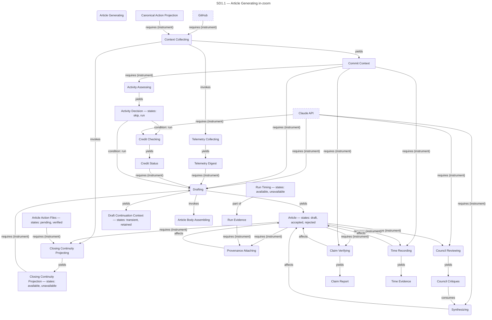

In-zoom membership: Article Generating contains Context Collecting, Activity Assessing, Credit Checking, Drafting, Council Reviewing, Synthesizing, Claim Verifying, Provenance Attaching, and Time Recording. No execution order is inferred from this compatibility view.

**Source facts (OJF-OPL; bracketed provenance is local metadata):**

```text
Activity Decision can be skip or run.
Run Timing can be available or unavailable.
Run Evidence consists of Run Timing.
Article Generating zooms into Context Collecting, Activity Assessing, Credit Checking, Drafting, Council Reviewing, Synthesizing, Claim Verifying, Provenance Attaching, and Time Recording. [src: src/index.ts]
Context Collecting requires GitHub. [src: src/collect-context.ts]
Context Collecting requires Canonical Action Projection. [src: src/collect-context.ts]
Context Collecting invokes Closing Continuity Projecting. [src: src/collect-context.ts]
Context Collecting invokes Telemetry Collecting. [src: src/collect-context.ts]
Context Collecting yields Commit Context.
Closing Continuity Projection can be available or unavailable. [src: src/types.ts]
Closing Continuity Projecting requires Article. [src: src/collect-context.ts]
Closing Continuity Projecting requires Article Action Files. [src: src/collect-context.ts]
Closing Continuity Projecting yields Closing Continuity Projection. [src: src/collect-context.ts]
Telemetry Collecting yields Telemetry Digest. [src: src/collect-telemetry.ts]
Activity Assessing requires Commit Context. [src: src/should-skip-run.ts] [src: packages/journal/src/eligibility.ts]
Activity Assessing yields Activity Decision. [src: src/should-skip-run.ts] [src: packages/journal/src/eligibility.ts]
Credit Checking occurs if Activity Decision is run. [src: src/index.ts]
Credit Checking requires Claude API. [src: src/check-anthropic-credits.ts]
Credit Checking yields Credit Status. [src: src/check-anthropic-credits.ts]
Drafting requires Claude API. [src: src/generate-article.ts]
Drafting requires Commit Context.
Drafting requires Telemetry Digest.
Drafting requires Credit Status. [src: src/index.ts]
Drafting requires Closing Continuity Projection. [src: src/generate-article.ts]
Drafting occurs if Activity Decision is run. [src: src/index.ts]
Drafting yields Article.
Drafting yields Draft Continuation Context. [src: src/generate-article.ts]
Drafting invokes Article Body Assembling. [src: src/generate-article.ts]
Council Reviewing requires Claude API. [src: src/index.ts]
Council Reviewing requires Article.
Council Reviewing yields Council Critiques.
Synthesizing requires Claude API. [src: src/index.ts]
Synthesizing consumes Council Critiques.
Synthesizing affects Article.
Claim Verifying requires Article. [src: src/verify-claims.ts]
Claim Verifying requires Commit Context.
Claim Verifying yields Claim Report.
Claim Verifying affects Article. [src: src/index.ts]
Provenance Attaching requires Article. [src: src/index.ts]
Provenance Attaching requires Run Evidence. [src: src/index.ts]
Provenance Attaching affects Article. [src: src/index.ts]
Time Recording requires Commit Context. [src: src/index.ts]
Time Recording requires Article. [src: src/index.ts]
Time Recording yields Time Evidence. [src: src/article-time-metadata.ts]
Time Recording affects Article. [src: src/index.ts]
```

## SD1.2 — Continued Editorial Revising in-zoom

**Caption:** This view summarizes the source facts in this section. Rectangles identify objects;
rounded nodes identify processes. Labeled solid arrows distinguish human participation,
required instruments, and transformations. These are compatibility labels, not native OPM links.
Use the source facts below for properties, state detail, and decomposition membership.

```mermaid
---
title: "SD1.2 — Continued Editorial Revising in-zoom"
---
flowchart TD
  accTitle: SD1.2 — Continued Editorial Revising in-zoom
  accDescr: Lossy system model projection. Complete source facts follow this diagram.
  n4["GitHub"]
  n118("Feedback Version Saving")
  n69["Article Fingerprint"]
  n119["Feedback Version"]
  n120("Explicit Revision Requesting")
  n121["PR Article Fingerprint"]
  n122["Explicit Revision Request"]
  n123("Explicit Revision Admitting")
  n124("Clean Acceptance Requesting")
  n125["Article Action File Fingerprint"]
  n126["Trusted Policy Fingerprint"]
  n127["Clean Acceptance Request"]
  n128("Clean Acceptance Admitting")
  n129["Editorial Request — states: outstanding, artifact-verified, owner-resolved"]
  n130("Owner Resolution Recording")
  n131["Failed First Workflow Attempt"]
  n132["Terminal Receipt Evidence — states: uncertain-receipt, proven-missing-receipt"]
  n133["Explicit Owner Acknowledgment"]
  n134["Owner Resolution"]
  n135["Owner Account"]
  n136["Admitted Revision"]
  n137["Integrated Trusted Policy"]
  n138["Admitted Clean Acceptance"]
  n139("Invocation Claiming")
  n140["Invocation Claim"]
  n141("Clean Acceptance Rechecking")
  n142["Reconfirmed Clean Acceptance"]
  n143("Continued Article Revising")
  n144("Continued Clean Accepting")
  n36["Claude API"]
  n23["Action Registry"]
  n0["Article — states: draft, accepted, rejected"]
  n145["Revision Outcome"]
  n28("Action Reconciling")
  n146["Clean Acceptance Outcome"]
  n147["Incomplete Action Review"]
  n148["Verified Action Output Storage Limit Failure"]
  n150("Article Completing")
  n20("Editorial Accepting")
  n151["Article Only Acceptance"]
  n152["Action Review Outcome — states: pending, verified"]
  n153["Action Evidence Request Receipt"]
  n22("Action Projecting")
  n154["Held Suggestions"]
  n155["Candidate Identity"]
  n113["Article Action Files — states: pending, verified"]
  n156["Dated Action State Digest"]
  n18["Draft Action Candidates"]
  n157["Candidate Review History"]
  n32["Draft Candidate Evidence Requirements — states: prior-binding, current-binding"]
  n158["valid Candidate Review History"]
  n159("Action Reviewing")
  n160("Action Registry Writing")
  n161["existing Candidate Review History"]
  n162["Imported Action Baseline"]
  n163("Editorial Output Binding")
  n164["Editorial Output Artifact"]
  n165("Clean Acceptance Output Admitting")
  n166("Editorial Rebinding")
  n167("Source Evidence Selecting")
  n30["Source Evidence"]
  n31["Recommendation Maintenance Memory"]
  n168["Selected Source Evidence"]
  n169["Evidence Coverage"]
  n170["Action Evidence Request — states: open, resolved, cancelled, expired, superseded, declined"]
  n171["Private Local Complete Source Artifact"]
  n172("Source Evidence Projecting")
  n173["Action Evidence Projection"]
  n174["an open Action Evidence Request"]
  n175["current Private Local Complete Source Artifact identity"]
  n176["explicit corrected Action Evidence Projection selection when multiple complete projections exist"]
  n177("Source Evidence Selecting with an explicitly selected incomplete Action Evidence Projection")
  n178("Action Evidence Request Closing")
  n179["Private Local Resolution Artifact"]
  n180("Action Model View Serializing")
  n181["Collector Generated Metadata Provenance — states: available, unavailable"]
  n182("Generated Metadata Compacting")
  n183["Partial Metadata Context"]
  n184("Lossless Metadata Factoring")
  n185["Lossless Source Model View"]
  n186("Coverage Model Packing")
  n187["Prepared Evidence View Receipt"]
  n33("Suggestion Proposing")
  n35("Suggestion Verifying")
  n43["Lossless Action Model View"]
  n188["Evidence Resolution Intent"]
  n189["Action Review Output Provenance"]
  n284["Created Action Record Binding"]
  n285["Updated Action Record Binding"]
  n286["Rejection Memory Binding"]
  n190("Evidence Resolution Recording")
  n7("Article Generating")
  n61("Editorial Revising")
  n4 -->|"requires (instrument)"| n118
  n69 -->|"requires (instrument)"| n118
  n118 -->|"yields"| n119
  n119 -->|"requires (instrument)"| n120
  n121 -->|"requires (instrument)"| n120
  n120 -->|"yields"| n122
  n122 -->|"triggers"| n123
  n121 -->|"requires (instrument)"| n124
  n125 -->|"requires (instrument)"| n124
  n126 -->|"requires (instrument)"| n124
  n124 -->|"yields"| n127
  n127 -->|"triggers"| n128
  n4 -->|"requires (instrument)"| n130
  n131 -->|"requires (instrument)"| n130
  n132 -->|"requires (instrument)"| n130
  n133 -->|"requires (instrument)"| n130
  n130 -->|"changes: outstanding to owner-resolved"| n129
  n130 -->|"yields"| n134
  n135 -->|"requires (instrument)"| n123
  n4 -->|"requires (instrument)"| n123
  n123 -->|"yields"| n136
  n135 -->|"requires (instrument)"| n128
  n4 -->|"requires (instrument)"| n128
  n137 -->|"requires (instrument)"| n128
  n128 -->|"yields"| n138
  n136 -->|"triggers"| n139
  n138 -->|"triggers"| n139
  n4 -->|"requires (instrument)"| n139
  n139 -->|"yields"| n140
  n140 -->|"triggers"| n141
  n4 -->|"requires (instrument)"| n141
  n126 -->|"requires (instrument)"| n141
  n127 -->|"requires (instrument)"| n141
  n141 -->|"yields"| n142
  n140 -->|"triggers"| n143
  n142 -->|"triggers"| n144
  n36 -->|"requires (instrument)"| n143
  n23 -->|"requires (instrument)"| n143
  n143 -->|"affects"| n0
  n143 -->|"affects"| n23
  n143 -->|"yields"| n145
  n23 -->|"requires (instrument)"| n144
  n144 -->|"invokes"| n28
  n144 -->|"affects"| n0
  n144 -->|"affects"| n23
  n144 -->|"yields"| n146
  n28 -->|"yields"| n147
  n28 -->|"yields"| n148
  n148 -->|"is a"| n147
  n147 -->|"requires (instrument)"| n150
  n23 -->|"requires (instrument)"| n150
  n20 -->|"invokes"| n150
  n150 -->|"affects"| n0
  n150 -->|"yields"| n151
  n151 -->|"exhibits"| n152
  n151 -->|"exhibits"| n153
  n146 -->|"exhibits"| n152
  n22 -->|"yields"| n154
  n154 -->|"exhibits"| n155
  n156 -->|"part of"| n113
  n18 -->|"part of"| n113
  n157 -->|"part of"| n113
  n32 -->|"part of"| n113
  n28 -->|"yields"| n156
  n28 -->|"changes: verified to pending"| n113
  n28 -->|"changes: pending to verified"| n113
  n28 -->|"yields"| n113
  n28 -->|"yields"| n157
  n158 -->|"requires (instrument)"| n28
  n158 -->|"requires (instrument)"| n159
  n156 -->|"requires (instrument)"| n159
  n156 -->|"requires (instrument)"| n160
  n161 -->|"requires (instrument)"| n160
  n160 -->|"yields"| n157
  n162 -->|"requires (instrument)"| n22
  n4 -->|"requires (instrument)"| n163
  n163 -->|"yields"| n164
  n164 -->|"requires (instrument)"| n123
  n164 -->|"requires (instrument)"| n165
  n0 -->|"requires (instrument)"| n166
  n166 -->|"affects"| n113
  n28 -->|"invokes"| n167
  n0 -->|"requires (instrument)"| n167
  n23 -->|"requires (instrument)"| n167
  n30 -->|"requires (instrument)"| n167
  n31 -->|"requires (instrument)"| n167
  n32 -->|"requires (instrument)"| n167
  n167 -->|"yields"| n168
  n167 -->|"yields"| n169
  n28 -->|"yields"| n170
  n28 -->|"yields"| n171
  n28 -->|"yields"| n153
  n153 -->|"part of"| n113
  n170 -->|"requires (instrument)"| n172
  n171 -->|"requires (instrument)"| n172
  n172 -->|"yields"| n173
  n174 -->|"requires (instrument)"| n172
  n173 -->|"requires (instrument)"| n167
  n175 -->|"requires (instrument)"| n167
  n176 -->|"requires (instrument)"| n167
  n177 -->|"yields"| n170
  n178 -->|"changes: open to resolved, cancelled, expired, superseded, or declined"| n170
  n178 -->|"yields"| n179
  n28 -->|"invokes"| n180
  n168 -->|"requires (instrument)"| n180
  n169 -->|"requires (instrument)"| n180
  n181 -->|"condition: available"| n182
  n181 -->|"requires (instrument)"| n182
  n182 -->|"yields"| n183
  n181 -->|"requires (instrument)"| n184
  n30 -->|"requires (instrument)"| n184
  n184 -->|"yields"| n185
  n185 -->|"requires (instrument)"| n167
  n169 -->|"requires (instrument)"| n186
  n186 -->|"yields"| n185
  n180 -->|"yields"| n187
  n187 -->|"requires (instrument)"| n33
  n187 -->|"requires (instrument)"| n35
  n187 -->|"requires (instrument)"| n28
  n23 -->|"requires (instrument)"| n180
  n180 -->|"yields"| n43
  n43 -->|"requires (instrument)"| n33
  n43 -->|"requires (instrument)"| n35
  n168 -->|"requires (instrument)"| n33
  n168 -->|"requires (instrument)"| n35
  n28 -->|"yields"| n188
  n28 -->|"yields"| n189
  n284 -->|"part of"| n189
  n285 -->|"part of"| n189
  n286 -->|"part of"| n189
  n189 -->|"part of"| n113
  n188 -->|"requires (instrument)"| n190
  n113 -->|"requires (instrument)"| n190
  n190 -->|"yields"| n179
  n7 -->|"invokes"| n190
  n61 -->|"invokes"| n190
  n20 -->|"invokes"| n190
  style n4 stroke-dasharray: 5 5
  style n36 stroke-dasharray: 5 5
```

In-zoom membership: Action Model View Serializing contains Lossless Metadata Factoring. No execution order is inferred from this compatibility view.

In-zoom membership: Action Model View Serializing contains Coverage Model Packing. No execution order is inferred from this compatibility view.

In-zoom membership: Action Model View Serializing contains Generated Metadata Compacting. No execution order is inferred from this compatibility view.

**Source facts (OJF-OPL; bracketed provenance is local metadata):**

```text
Feedback Version Saving requires GitHub. [src: api/_lib/editorial-continuation.ts]
Feedback Version Saving requires Article Fingerprint. [src: api/_lib/editorial-continuation.ts]
Feedback Version Saving yields Feedback Version. [src: api/_lib/editorial-continuation.ts]
Explicit Revision Requesting requires Feedback Version. [src: packages/frontend/src/components/EditorialContinuation.tsx]
Explicit Revision Requesting requires PR Article Fingerprint. [src: api/_lib/editorial-continuation.ts]
Explicit Revision Requesting yields Explicit Revision Request. [src: api/_lib/editorial-continuation.ts]
Explicit Revision Request triggers Explicit Revision Admitting. [src: .github/workflows/editorial-revise.yml]
Clean Acceptance Requesting requires PR Article Fingerprint. [src: api/_lib/editorial-continuation.ts]
Clean Acceptance Requesting requires Article Action File Fingerprint. [src: api/_lib/editorial-continuation.ts]
Clean Acceptance Requesting requires Trusted Policy Fingerprint. [src: api/_lib/editorial-continuation.ts]
Clean Acceptance Requesting yields Clean Acceptance Request. [src: api/_lib/editorial-continuation.ts]
Clean Acceptance Request triggers Clean Acceptance Admitting. [src: .github/workflows/editorial-revise.yml]
Editorial Request can be outstanding, artifact-verified, or owner-resolved. [src: shared/article-review.ts]
Owner Resolution Recording requires GitHub. [src: api/_lib/editorial-continuation.ts]
Owner Resolution Recording requires Failed First Workflow Attempt. [src: api/_lib/editorial-continuation.ts]
Owner Resolution Recording requires Terminal Receipt Evidence. [src: api/_lib/editorial-continuation.ts]
Terminal Receipt Evidence can be uncertain-receipt or proven-missing-receipt. [src: shared/article-review.ts]
Owner Resolution Recording requires Explicit Owner Acknowledgment. [src: shared/article-review.ts]
Owner Resolution Recording changes Editorial Request from outstanding to owner-resolved. [src: api/_lib/editorial-continuation.ts]
Owner Resolution Recording yields Owner Resolution. [src: api/_lib/editorial-continuation.ts]
Explicit Revision Admitting requires Owner Account. [src: .github/scripts/continue-editorial.ts]
Explicit Revision Admitting requires GitHub. [src: .github/scripts/continue-editorial.ts]
Explicit Revision Admitting yields Admitted Revision. [src: .github/scripts/continue-editorial.ts]
Clean Acceptance Admitting requires Owner Account. [src: .github/scripts/continue-editorial.ts]
Clean Acceptance Admitting requires GitHub. [src: .github/scripts/continue-editorial.ts]
Clean Acceptance Admitting requires Integrated Trusted Policy. [src: .github/scripts/continue-editorial.ts]
Clean Acceptance Admitting yields Admitted Clean Acceptance. [src: .github/scripts/continue-editorial.ts]
Admitted Revision triggers Invocation Claiming. [src: .github/scripts/continue-editorial.ts]
Admitted Clean Acceptance triggers Invocation Claiming. [src: .github/scripts/continue-editorial.ts]
Invocation Claiming requires GitHub. [src: .github/scripts/continue-editorial.ts]
Invocation Claiming yields Invocation Claim. [src: .github/scripts/continue-editorial.ts]
Invocation Claim triggers Clean Acceptance Rechecking. [src: .github/scripts/continue-editorial.ts]
Clean Acceptance Rechecking requires GitHub. [src: .github/scripts/continue-editorial.ts]
Clean Acceptance Rechecking requires Trusted Policy Fingerprint. [src: .github/scripts/continue-editorial.ts]
Clean Acceptance Rechecking requires Clean Acceptance Request. [src: .github/scripts/continue-editorial.ts]
Clean Acceptance Rechecking yields Reconfirmed Clean Acceptance. [src: .github/scripts/continue-editorial.ts]
Invocation Claim triggers Continued Article Revising. [src: .github/scripts/continue-editorial.ts]
Reconfirmed Clean Acceptance triggers Continued Clean Accepting. [src: .github/scripts/continue-editorial.ts]
Continued Article Revising requires Claude API. [src: src/revise-article.ts]
Continued Article Revising requires Action Registry. [src: src/revise-article.ts]
Continued Article Revising affects Article. [src: src/revise-article.ts]
Continued Article Revising affects Action Registry. [src: src/revise-article.ts]
Continued Article Revising yields Revision Outcome. [src: .github/scripts/continue-editorial.ts]
Continued Clean Accepting requires Action Registry. [src: scripts/reconcile-actions.ts]
Continued Clean Accepting invokes Action Reconciling. [src: .github/scripts/continue-editorial.ts]
Continued Clean Accepting affects Article. [src: .github/scripts/continue-editorial.ts]
Continued Clean Accepting affects Action Registry. [src: scripts/reconcile-actions.ts]
Continued Clean Accepting yields Clean Acceptance Outcome. [src: .github/scripts/continue-editorial.ts]
Action Reconciling yields Incomplete Action Review. [src: src/review-actions.ts]
Action Reconciling yields Verified Action Output Storage Limit Failure. [src: src/review-actions.ts]
Verified Action Output Storage Limit Failure is an Incomplete Action Review. [src: scripts/reconcile-actions.ts]
Article Completing requires Incomplete Action Review and Action Registry. [src: src/action-registry.ts]
Editorial Accepting invokes Article Completing. [src: scripts/reconcile-actions.ts]
Article Completing affects Article. [src: src/action-registry.ts]
Article Completing yields Article Only Acceptance. [src: src/action-registry.ts]
Article Only Acceptance exhibits Action Review Outcome. [src: src/action-registry-contract.ts]
Article Only Acceptance exhibits Action Evidence Request Receipt. [src: src/action-registry-contract.ts]
Action Review Outcome can be pending or verified. [src: shared/article-review.ts]
Clean Acceptance Outcome exhibits Action Review Outcome. [src: shared/editorial-action-proof.ts]
Action Projecting yields Held Suggestions. [src: src/action-registry.ts]
Held Suggestions exhibits Candidate Identity. [src: src/action-registry-contract.ts]
Article Action Files can be pending or verified. [src: src/action-registry-schema.ts]
Article Action Files consists of Dated Action State Digest. [src: src/action-registry.ts]
Article Action Files consists of Draft Action Candidates. [src: src/action-registry-schema.ts]
Article Action Files consists of Candidate Review History. [src: src/action-registry-contract.ts]
Article Action Files consists of Draft Candidate Evidence Requirements. [src: src/action-registry-schema.ts]
Action Reconciling yields Dated Action State Digest. [src: src/review-actions.ts]
Action Reconciling changes Article Action Files from verified to pending. [src: src/review-actions.ts]
Action Reconciling changes Article Action Files from pending to verified. [src: src/review-actions.ts]
Action Reconciling yields Article Action Files. [src: src/review-actions.ts]
Action Reconciling yields Candidate Review History. [src: src/review-actions.ts]
Action Reconciling requires valid Candidate Review History. [src: src/review-actions.ts]
Action Reviewing requires valid Candidate Review History. [src: src/review-actions.ts]
Action Reviewing requires Dated Action State Digest. [src: src/review-actions.ts]
Action Registry Writing requires Dated Action State Digest. [src: src/action-registry.ts]
Action Registry Writing requires existing Candidate Review History. [src: src/action-registry.ts]
Action Registry Writing yields Candidate Review History. [src: src/action-registry.ts]
Action Projecting requires Imported Action Baseline. [src: src/action-registry.ts]
Editorial Output Binding requires GitHub. [src: shared/editorial-action-proof.ts]
Editorial Output Binding yields Editorial Output Artifact. [src: scripts/write-action-output.ts]
Explicit Revision Admitting requires Editorial Output Artifact. [src: .github/scripts/editorial-action-registry.ts]
Clean Acceptance Output Admitting requires Editorial Output Artifact. [src: .github/scripts/editorial-action-registry.ts]
Editorial Rebinding requires Article. [src: src/action-registry.ts]
Editorial Rebinding affects Article Action Files. [src: src/action-registry.ts]
Action Reconciling invokes Source Evidence Selecting. [src: src/review-actions.ts]
Source Evidence Selecting requires Article. [src: src/action-evidence-selection.ts]
Source Evidence Selecting requires Action Registry. [src: src/action-evidence-selection.ts]
Source Evidence Selecting requires Source Evidence. [src: src/action-evidence-selection.ts]
Source Evidence Selecting requires Recommendation Maintenance Memory. [src: src/action-evidence-selection.ts]
Source Evidence Selecting requires Draft Candidate Evidence Requirements. [src: src/action-evidence-selection.ts]
Source Evidence Selecting yields Selected Source Evidence. [src: src/action-evidence-selection.ts]
Source Evidence Selecting yields Evidence Coverage. [src: src/action-evidence-selection.ts]
Action Evidence Request can be open, resolved, cancelled, expired, superseded, or declined. [src: src/action-registry-contract.ts]
Action Reconciling yields Action Evidence Request. [src: src/review-actions.ts]
Action Reconciling yields Private Local Complete Source Artifact. [src: src/action-evidence-retrieval.ts]
Action Reconciling yields Action Evidence Request Receipt. [src: src/review-actions.ts]
Article Action Files consists of Action Evidence Request Receipt. [src: src/action-registry-contract.ts]
Source Evidence Projecting requires Action Evidence Request. [src: src/action-evidence-retrieval.ts]
Source Evidence Projecting requires Private Local Complete Source Artifact. [src: src/action-evidence-retrieval.ts]
Source Evidence Projecting yields Action Evidence Projection. [src: src/action-evidence-retrieval.ts]
Source Evidence Projecting requires an open Action Evidence Request. [src: src/action-evidence-retrieval.ts]
Source Evidence Selecting requires Action Evidence Projection. [src: src/action-evidence-selection.ts]
Source Evidence Selecting requires current Private Local Complete Source Artifact identity. [src: src/review-actions.ts]
Source Evidence Selecting requires explicit corrected Action Evidence Projection selection when multiple complete projections exist. [src: src/action-evidence-selection.ts]
Source Evidence Selecting with an explicitly selected incomplete Action Evidence Projection yields Action Evidence Request. [src: src/action-evidence-selection.ts]
Action Evidence Request Closing changes Action Evidence Request from open to resolved, cancelled, expired, superseded, or declined. [src: src/action-evidence-retrieval.ts]
Action Evidence Request Closing yields Private Local Resolution Artifact. [src: src/action-evidence-retrieval.ts]
Action Reconciling invokes Action Model View Serializing. [src: src/review-actions.ts]
Action Model View Serializing requires Selected Source Evidence. [src: src/action-evidence-view.ts]
Action Model View Serializing requires Evidence Coverage. [src: src/review-actions.ts]
Collector Generated Metadata Provenance can be available or unavailable. [src: src/action-evidence-view.ts]
Generated Metadata Compacting occurs if Collector Generated Metadata Provenance is available. [src: src/action-evidence-view.ts]
Generated Metadata Compacting requires Collector Generated Metadata Provenance. [src: src/action-evidence-view.ts]
Generated Metadata Compacting yields Partial Metadata Context. [src: src/action-evidence-view.ts]
Lossless Metadata Factoring requires Collector Generated Metadata Provenance. [src: src/action-evidence-view.ts]
Lossless Metadata Factoring requires Source Evidence. [src: src/action-evidence-view.ts]
Lossless Metadata Factoring yields Lossless Source Model View. [src: src/action-evidence-view.ts]
Action Model View Serializing zooms into Lossless Metadata Factoring. [src: src/action-evidence-view.ts]
Source Evidence Selecting requires Lossless Source Model View. [src: src/action-evidence-selection.ts]
Coverage Model Packing requires Evidence Coverage. [src: src/action-evidence-coverage.ts]
Coverage Model Packing yields Lossless Source Model View. [src: src/action-evidence-coverage.ts]
Action Model View Serializing zooms into Coverage Model Packing. [src: src/action-evidence-view.ts]
Action Model View Serializing zooms into Generated Metadata Compacting. [src: src/action-evidence-view.ts]
Action Model View Serializing yields Prepared Evidence View Receipt. [src: src/action-evidence-view.ts]
Suggestion Proposing requires Prepared Evidence View Receipt. [src: src/review-actions.ts]
Suggestion Verifying requires Prepared Evidence View Receipt. [src: src/review-actions.ts]
Action Reconciling requires Prepared Evidence View Receipt. [src: src/review-actions.ts]
Action Model View Serializing requires Action Registry. [src: src/action-model-view.ts]
Action Model View Serializing yields Lossless Action Model View. [src: src/action-model-view.ts]
Suggestion Proposing requires Lossless Action Model View. [src: src/review-actions.ts]
Suggestion Verifying requires Lossless Action Model View. [src: src/review-actions.ts]
Suggestion Proposing requires Selected Source Evidence. [src: src/review-actions.ts]
Suggestion Verifying requires Selected Source Evidence. [src: src/review-actions.ts]
Action Reconciling yields Evidence Resolution Intent. [src: src/review-actions.ts]
Action Reconciling yields Action Review Output Provenance. [src: src/review-actions.ts]
Action Review Output Provenance consists of Created Action Record Binding, Updated Action Record Binding, and Rejection Memory Binding. [src: src/action-registry-contract.ts]
Article Action Files consists of Action Review Output Provenance. [src: src/action-registry-contract.ts]
Evidence Resolution Recording requires Evidence Resolution Intent. [src: src/action-evidence-retrieval.ts]
Evidence Resolution Recording requires Article Action Files. [src: src/action-registry.ts]
Evidence Resolution Recording yields Private Local Resolution Artifact. [src: src/action-evidence-retrieval.ts]
Article Generating invokes Evidence Resolution Recording. [src: src/index.ts]
Editorial Revising invokes Evidence Resolution Recording. [src: src/revise-article.ts]
Editorial Accepting invokes Evidence Resolution Recording. [src: scripts/reconcile-actions.ts]
```

## SD1.3 — Reporting interval and fallback start checking

**Caption:** This view summarizes the source facts in this section. Rectangles identify objects;
rounded nodes identify processes. Labeled solid arrows distinguish human participation,
required instruments, and transformations. These are compatibility labels, not native OPM links.
Use the source facts below for properties, state detail, and decomposition membership.

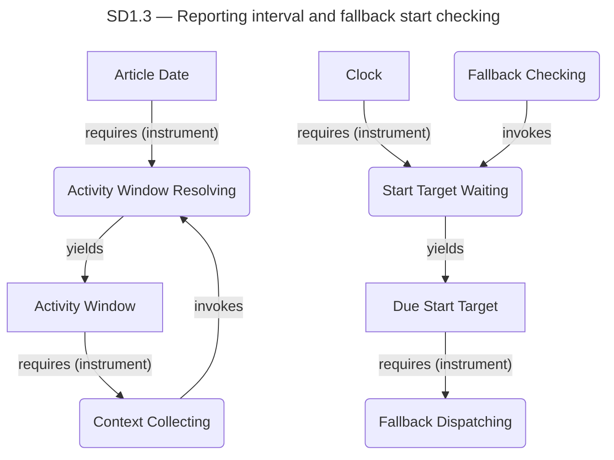

**Source facts (OJF-OPL; bracketed provenance is local metadata):**

```text
Activity Window Resolving requires Article Date. [src: packages/journal/src/activity-window.ts]
Activity Window Resolving yields Activity Window. [src: packages/journal/src/activity-window.ts]
Context Collecting requires Activity Window. [src: src/collect-context.ts]
Context Collecting invokes Activity Window Resolving. [src: src/collect-context.ts]
Start Target Waiting requires Clock. [src: .github/scripts/daily_blog_schedule.py]
Start Target Waiting yields Due Start Target. [src: .github/scripts/daily_blog_schedule.py]
Fallback Checking invokes Start Target Waiting. [src: .github/scripts/daily_blog_schedule.py]
Fallback Dispatching requires Due Start Target. [src: .github/scripts/daily_blog_schedule.py]
```

## SD1.4 — Exact captured invocation admission

**Caption:** This view summarizes the source facts in this section. Rectangles identify objects;
rounded nodes identify processes. Labeled solid arrows distinguish human participation,
required instruments, and transformations. These are compatibility labels, not native OPM links.
Use the source facts below for properties, state detail, and decomposition membership.

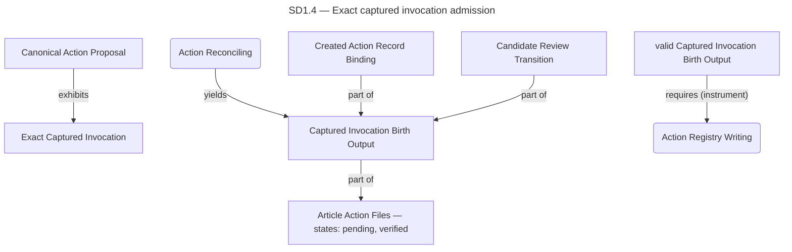

**Source facts (OJF-OPL; bracketed provenance is local metadata):**

```text
Canonical Action Proposal exhibits Exact Captured Invocation. [src: src/review-actions.ts]
Action Reconciling yields Captured Invocation Birth Output. [src: src/review-actions.ts]
Captured Invocation Birth Output consists of Created Action Record Binding and Candidate Review Transition. [src: src/action-registry-schema.ts]
Article Action Files consists of Captured Invocation Birth Output. [src: src/action-registry-schema.ts]
Action Registry Writing requires valid Captured Invocation Birth Output. [src: src/action-registry-schema.ts]
```

## SD1.5 — Candidate link resolution

**Caption:** This view summarizes the source facts in this section. Rectangles identify objects;
rounded nodes identify processes. Labeled solid arrows distinguish human participation,
required instruments, and transformations. These are compatibility labels, not native OPM links.
Use the source facts below for properties, state detail, and decomposition membership.

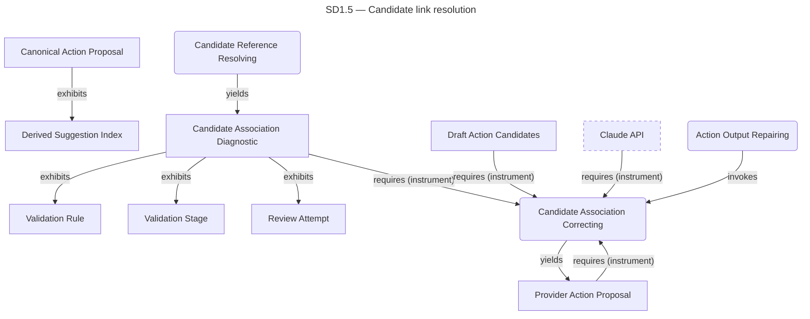

**Source facts (OJF-OPL; bracketed provenance is local metadata):**

```text
Canonical Action Proposal exhibits Derived Suggestion Index. [src: src/review-actions.ts]
Candidate Reference Resolving yields Candidate Association Diagnostic. [src: src/review-actions.ts]
Candidate Association Diagnostic exhibits Validation Rule. [src: src/review-actions.ts]
Candidate Association Diagnostic exhibits Validation Stage. [src: src/review-actions.ts]
Candidate Association Diagnostic exhibits Review Attempt. [src: src/review-actions.ts]
Candidate Association Correcting requires Candidate Association Diagnostic, Provider Action Proposal, and Draft Action Candidates. [src: src/review-actions.ts]
Candidate Association Correcting requires Claude API. [src: src/review-actions.ts]
Candidate Association Correcting yields Provider Action Proposal. [src: src/review-actions.ts]
Action Output Repairing invokes Candidate Association Correcting. [src: src/review-actions.ts]
```

## SD1.6 — Manual held-action review

**Caption:** This view summarizes the source facts in this section. Rectangles identify objects;
rounded nodes identify processes. Labeled solid arrows distinguish human participation,
required instruments, and transformations. These are compatibility labels, not native OPM links.
Use the source facts below for properties, state detail, and decomposition membership.

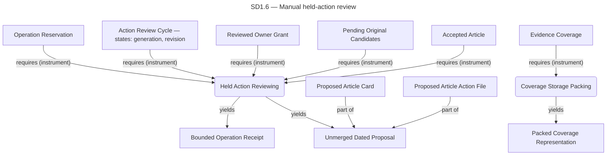

**Source facts (OJF-OPL; bracketed provenance is local metadata):**

```text
Held Action Reviewing requires Accepted Article. [src: scripts/review-held-actions.ts]
Held Action Reviewing requires Pending Original Candidates. [src: scripts/review-held-actions.ts]
Held Action Reviewing requires Reviewed Owner Grant. [src: scripts/review-held-actions.ts]
Held Action Reviewing requires Action Review Cycle. [src: scripts/review-held-actions.ts]
Held Action Reviewing requires Operation Reservation. [src: scripts/review-held-actions.ts]
Held Action Reviewing yields Unmerged Dated Proposal. [src: scripts/review-held-actions.ts]
Held Action Reviewing yields Bounded Operation Receipt. [src: scripts/review-held-actions.ts]
Unmerged Dated Proposal consists of Proposed Article Card and Proposed Article Action File. [src: scripts/review-held-actions.ts]
Coverage Storage Packing requires Evidence Coverage. [src: src/action-coverage-storage.ts]
Coverage Storage Packing yields Packed Coverage Representation. [src: src/action-coverage-storage.ts]
```

## SD2 — Isolated recorded fixture service

**Caption:** This view summarizes the source facts in this section. Rectangles identify objects;
rounded nodes identify processes. Labeled solid arrows distinguish human participation,
required instruments, and transformations. These are compatibility labels, not native OPM links.
Use the source facts below for properties, state detail, and decomposition membership.

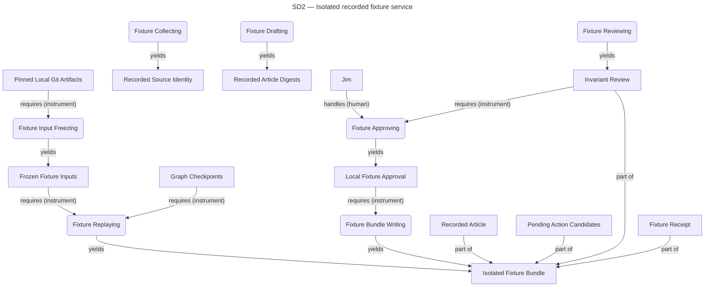

In-zoom membership: Fixture Replaying contains Fixture Collecting, Fixture Drafting, Fixture Reviewing, Fixture Approving, and Fixture Bundle Writing. No execution order is inferred from this compatibility view.

**Source facts (OJF-OPL; bracketed provenance is local metadata):**

```text
Fixture Input Freezing requires Pinned Local Git Artifacts. [src: apps/service/src/fixture.ts]
Fixture Input Freezing yields Frozen Fixture Inputs. [src: apps/service/src/storage.ts]
Fixture Replaying requires Frozen Fixture Inputs. [src: apps/service/src/workflow.ts]
Fixture Replaying requires Graph Checkpoints. [src: apps/service/src/workflow.ts]
Fixture Replaying yields Isolated Fixture Bundle. [src: apps/service/src/workflow.ts]
Fixture Replaying zooms into Fixture Collecting, Fixture Drafting, Fixture Reviewing, Fixture Approving, and Fixture Bundle Writing. [src: apps/service/src/workflow.ts]
Fixture Collecting yields Recorded Source Identity. [src: apps/service/src/workflow.ts]
Fixture Drafting yields Recorded Article Digests. [src: apps/service/src/workflow.ts]
Fixture Reviewing yields Invariant Review. [src: apps/service/src/fixture.ts]
Jim handles Fixture Approving. [src: apps/service/src/workflow.ts]
Fixture Approving requires Invariant Review. [src: apps/service/src/workflow.ts]
Fixture Approving yields Local Fixture Approval. [src: apps/service/src/workflow.ts]
Fixture Bundle Writing requires Local Fixture Approval. [src: apps/service/src/workflow.ts]
Fixture Bundle Writing yields Isolated Fixture Bundle. [src: apps/service/src/storage.ts]
Isolated Fixture Bundle consists of Recorded Article, Pending Action Candidates, Invariant Review, and Fixture Receipt. [src: apps/service/src/storage.ts]
```

## SD2.1 — PostgreSQL fixture persistence

**Caption:** This view summarizes the source facts in this section. Rectangles identify objects;
rounded nodes identify processes. Labeled solid arrows distinguish human participation,
required instruments, and transformations. These are compatibility labels, not native OPM links.
Use the source facts below for properties, state detail, and decomposition membership.

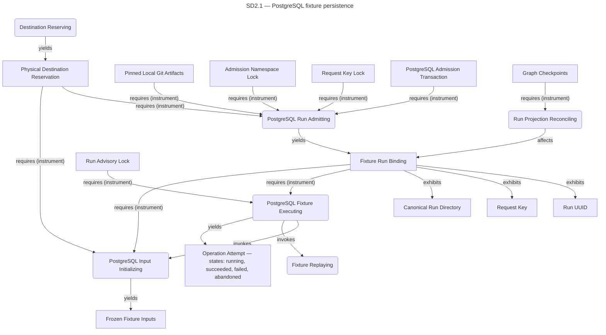

**Source facts (OJF-OPL; bracketed provenance is local metadata):**

```text
Destination Reserving yields Physical Destination Reservation. [src: apps/service/src/postgres-destination.ts]
PostgreSQL Run Admitting requires Pinned Local Git Artifacts. [src: apps/service/src/postgres-runner.ts]
PostgreSQL Run Admitting requires Physical Destination Reservation. [src: apps/service/src/postgres-runner.ts]
PostgreSQL Run Admitting requires Admission Namespace Lock. [src: apps/service/src/postgres-runner.ts]
PostgreSQL Run Admitting requires Request Key Lock. [src: apps/service/src/postgres-runner.ts]
PostgreSQL Run Admitting requires PostgreSQL Admission Transaction. [src: apps/service/src/postgres-runner.ts]
PostgreSQL Run Admitting yields Fixture Run Binding. [src: apps/service/src/postgres-runner.ts]
Fixture Run Binding exhibits Run UUID. [src: apps/service/src/postgres-fixture.ts]
Fixture Run Binding exhibits Request Key. [src: apps/service/migrations/001_fixture_runs.sql]
Fixture Run Binding exhibits Canonical Run Directory. [src: apps/service/migrations/001_fixture_runs.sql]
PostgreSQL Fixture Executing requires Fixture Run Binding. [src: apps/service/src/postgres-runner.ts]
PostgreSQL Fixture Executing requires Run Advisory Lock. [src: apps/service/src/postgres-db.ts]
PostgreSQL Fixture Executing invokes PostgreSQL Input Initializing. [src: apps/service/src/postgres-runner.ts]
PostgreSQL Input Initializing requires Fixture Run Binding. [src: apps/service/src/postgres-runner.ts]
PostgreSQL Input Initializing requires Physical Destination Reservation. [src: apps/service/src/postgres-destination.ts]
PostgreSQL Input Initializing yields Frozen Fixture Inputs. [src: apps/service/src/postgres-destination.ts]
PostgreSQL Fixture Executing invokes Fixture Replaying. [src: apps/service/src/postgres-runner.ts]
PostgreSQL Fixture Executing yields Operation Attempt. [src: apps/service/src/postgres-runner.ts]
Operation Attempt can be running, succeeded, failed, or abandoned. [src: apps/service/migrations/001_fixture_runs.sql]
Run Projection Reconciling requires Graph Checkpoints. [src: apps/service/src/postgres-runner.ts]
Run Projection Reconciling affects Fixture Run Binding. [src: apps/service/src/postgres-runner.ts]
```

## SD2.2 — Durable fixture command delivery

**Caption:** This view summarizes the source facts in this section. Rectangles identify objects;
rounded nodes identify processes. Labeled solid arrows distinguish human participation,
required instruments, and transformations. These are compatibility labels, not native OPM links.
Use the source facts below for properties, state detail, and decomposition membership.

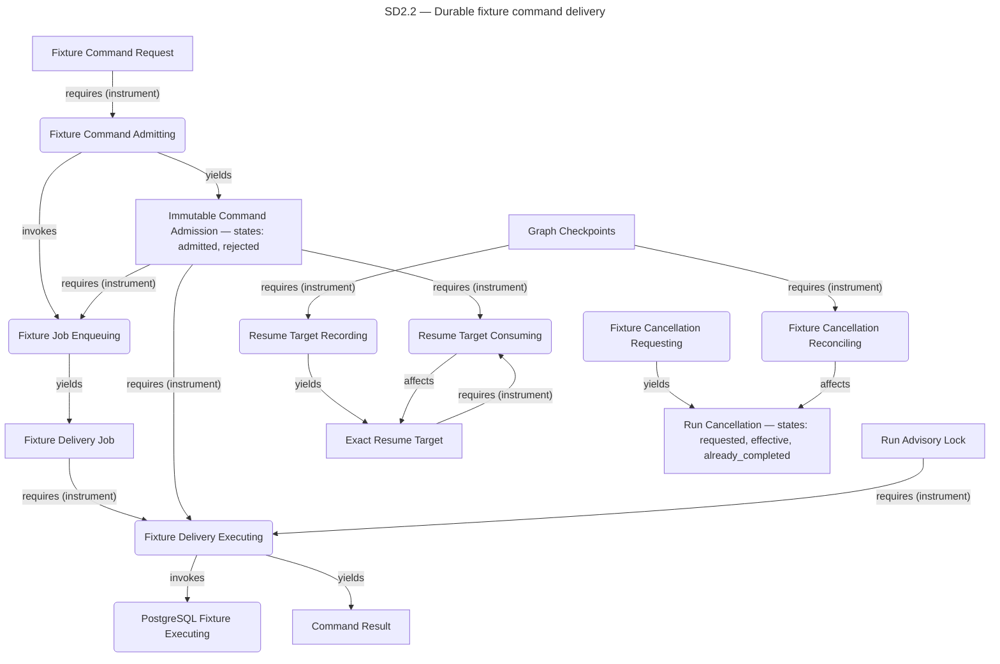

**Source facts (OJF-OPL; bracketed provenance is local metadata):**

```text
Fixture Command Admitting requires Fixture Command Request. [src: apps/service/src/delivery-commands.ts]
Fixture Command Admitting yields Immutable Command Admission. [src: apps/service/src/delivery-commands.ts]
Immutable Command Admission can be admitted or rejected. [src: apps/service/migrations/002_delivery_commands.sql]
Fixture Command Admitting invokes Fixture Job Enqueuing. [src: apps/service/src/delivery-commands.ts]
Fixture Job Enqueuing requires Immutable Command Admission. [src: apps/service/src/delivery-commands.ts]
Fixture Job Enqueuing yields Fixture Delivery Job. [src: apps/service/src/delivery-commands.ts]
Fixture Delivery Executing requires Fixture Delivery Job. [src: apps/service/src/delivery-worker.ts]
Fixture Delivery Executing requires Immutable Command Admission. [src: apps/service/src/delivery-worker.ts]
Fixture Delivery Executing requires Run Advisory Lock. [src: apps/service/src/postgres-runner.ts]
Fixture Delivery Executing invokes PostgreSQL Fixture Executing. [src: apps/service/src/delivery-worker.ts]
Fixture Delivery Executing yields Command Result. [src: apps/service/src/delivery-worker.ts]
Resume Target Recording requires Graph Checkpoints. [src: apps/service/src/delivery-commands.ts]
Resume Target Recording yields Exact Resume Target. [src: apps/service/src/delivery-commands.ts]
Resume Target Consuming requires Exact Resume Target. [src: apps/service/src/delivery-worker.ts]
Resume Target Consuming requires Immutable Command Admission. [src: apps/service/src/delivery-worker.ts]
Resume Target Consuming affects Exact Resume Target. [src: apps/service/src/delivery-worker.ts]
Fixture Cancellation Requesting yields Run Cancellation. [src: apps/service/src/delivery-commands.ts]
Run Cancellation can be requested, effective, or already_completed. [src: apps/service/migrations/002_delivery_commands.sql]
Fixture Cancellation Reconciling requires Graph Checkpoints. [src: apps/service/src/delivery-worker.ts]
Fixture Cancellation Reconciling affects Run Cancellation. [src: apps/service/src/delivery-worker.ts]
```

## SD2.3 — Authenticated fixture HTTP

**Caption:** This view summarizes the source facts in this section. Rectangles identify objects;
rounded nodes identify processes. Labeled solid arrows distinguish human participation,
required instruments, and transformations. These are compatibility labels, not native OPM links.
Use the source facts below for properties, state detail, and decomposition membership.

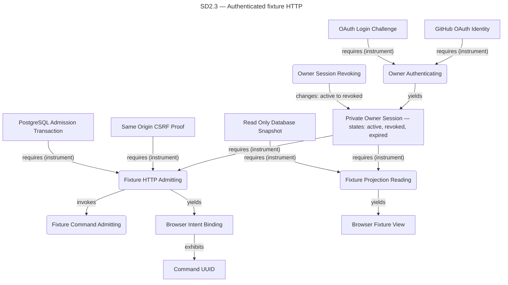

**Source facts (OJF-OPL; bracketed provenance is local metadata):**

```text
Owner Authenticating requires GitHub OAuth Identity. [src: apps/service/src/http-sessions.ts]
Owner Authenticating requires OAuth Login Challenge. [src: apps/service/src/http-sessions.ts]
Owner Authenticating yields Private Owner Session. [src: apps/service/src/http-sessions.ts]
Private Owner Session can be active, revoked, or expired. [src: apps/service/migrations/003_fixture_http.sql]
Owner Session Revoking changes Private Owner Session from active to revoked. [src: apps/service/src/http-server.ts]
Fixture HTTP Admitting requires Private Owner Session. [src: apps/service/src/http-sessions.ts]
Fixture HTTP Admitting requires Same Origin CSRF Proof. [src: apps/service/src/http-sessions.ts]
Fixture HTTP Admitting requires PostgreSQL Admission Transaction. [src: apps/service/src/http-server.ts]
Fixture HTTP Admitting invokes Fixture Command Admitting. [src: apps/service/src/http-fixtures.ts]
Fixture HTTP Admitting yields Browser Intent Binding. [src: apps/service/src/http-fixtures.ts]
Browser Intent Binding exhibits Command UUID. [src: apps/service/migrations/003_fixture_http.sql]
Fixture Projection Reading requires Private Owner Session. [src: apps/service/src/http-sessions.ts]
Fixture Projection Reading requires Read Only Database Snapshot. [src: apps/service/src/http-db.ts]
Fixture Projection Reading yields Browser Fixture View. [src: apps/service/src/http-projections.ts]
```

## SD2.4 — Offline fixture metadata observations

**Caption:** This view summarizes the source facts in this section. Rectangles identify objects;
rounded nodes identify processes. Labeled solid arrows distinguish human participation,
required instruments, and transformations. These are compatibility labels, not native OPM links.
Use the source facts below for properties, state detail, and decomposition membership.

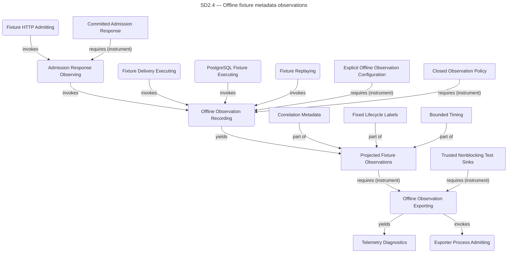

**Source facts (OJF-OPL; bracketed provenance is local metadata):**

```text
Fixture HTTP Admitting invokes Admission Response Observing. [src: apps/service/src/http-server.ts]
Admission Response Observing requires Committed Admission Response. [src: apps/service/src/delivery-commands.ts] [src: apps/service/src/http-server.ts]
Admission Response Observing invokes Offline Observation Recording. [src: apps/service/src/telemetry.ts]
Fixture Delivery Executing invokes Offline Observation Recording. [src: apps/service/src/delivery-worker.ts]
PostgreSQL Fixture Executing invokes Offline Observation Recording. [src: apps/service/src/postgres-runner.ts]
Fixture Replaying invokes Offline Observation Recording. [src: apps/service/src/workflow.ts]
Offline Observation Recording requires Explicit Offline Observation Configuration. [src: apps/service/src/telemetry.ts]
Offline Observation Recording requires Closed Observation Policy. [src: apps/service/src/telemetry-schema.ts]
Offline Observation Recording yields Projected Fixture Observations. [src: apps/service/src/telemetry-schema.ts]
Projected Fixture Observations consists of Correlation Metadata, Fixed Lifecycle Labels, and Bounded Timing. [src: apps/service/src/telemetry-schema.ts]
Offline Observation Exporting requires Projected Fixture Observations. [src: apps/service/src/telemetry.ts]
Offline Observation Exporting requires Trusted Nonblocking Test Sinks. [src: apps/service/src/telemetry.ts]
Offline Observation Exporting yields Telemetry Diagnostics. [src: apps/service/src/telemetry.ts]
Offline Observation Exporting invokes Exporter Process Admitting. [src: apps/service/src/telemetry-export-process.ts]
```

## SD2.5 — Private fixture HTTPS ingress

**Caption:** This view summarizes the source facts in this section. Rectangles identify objects;
rounded nodes identify processes. Labeled solid arrows distinguish human participation,
required instruments, and transformations. These are compatibility labels, not native OPM links.
Use the source facts below for properties, state detail, and decomposition membership.

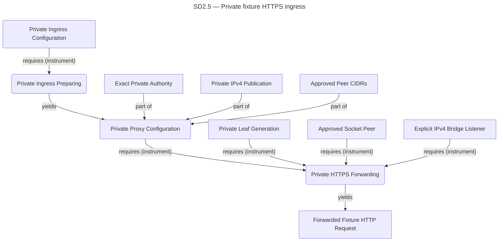

**Source facts (OJF-OPL; bracketed provenance is local metadata):**

```text
Private Ingress Preparing requires Private Ingress Configuration. [src: apps/service/runtime/prepare-ingress.ts]
Private Ingress Preparing yields Private Proxy Configuration. [src: apps/service/runtime/prepare-ingress.ts]
Private Proxy Configuration consists of Exact Private Authority, Private IPv4 Publication, and Approved Peer CIDRs. [src: apps/service/runtime/prepare-ingress.ts]
Private HTTPS Forwarding requires Private Proxy Configuration. [src: apps/service/runtime/prepare-ingress.ts]
Private HTTPS Forwarding requires Private Leaf Generation. [src: apps/service/runtime/prepare-ingress.ts]
Private HTTPS Forwarding requires Approved Socket Peer. [src: apps/service/runtime/prepare-ingress.ts]
Private HTTPS Forwarding requires Explicit IPv4 Bridge Listener. [src: apps/service/src/http-cli.ts] [src: apps/service/runtime/prepare-ingress.ts]
Private HTTPS Forwarding yields Forwarded Fixture HTTP Request. [src: apps/service/runtime/prepare-ingress.ts]
```

## SD2.6 — Opt-in metadata exporter process

**Caption:** This view summarizes the source facts in this section. Rectangles identify objects;
rounded nodes identify processes. Labeled solid arrows distinguish human participation,
required instruments, and transformations. These are compatibility labels, not native OPM links.
Use the source facts below for properties, state detail, and decomposition membership.

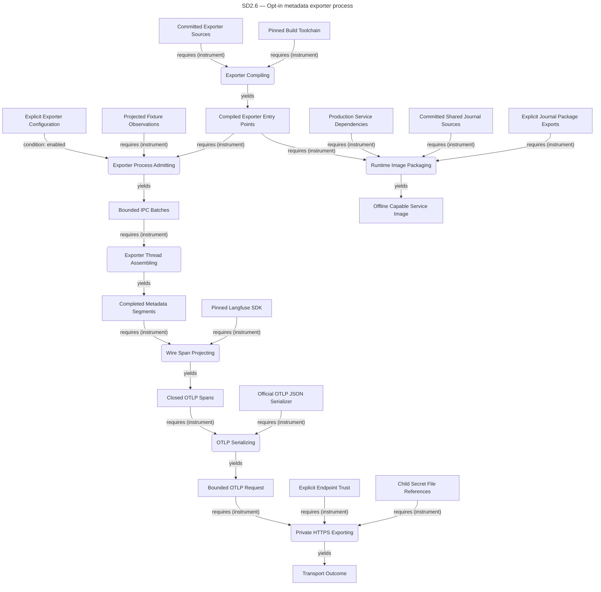

**Source facts (OJF-OPL; bracketed provenance is local metadata):**

```text
Exporter Process Admitting occurs if Explicit Exporter Configuration is enabled. [src: apps/service/src/telemetry-export-config.ts]
Exporter Process Admitting requires Projected Fixture Observations. [src: apps/service/src/telemetry-export-process.ts]
Exporter Process Admitting requires Compiled Exporter Entry Points. [src: apps/service/scripts/build-telemetry.mjs]
Exporter Process Admitting yields Bounded IPC Batches. [src: apps/service/src/telemetry-export-process.ts]
Exporter Thread Assembling requires Bounded IPC Batches. [src: apps/service/src/telemetry-export-child.ts]
Exporter Thread Assembling yields Completed Metadata Segments. [src: apps/service/src/telemetry-langfuse.ts]
Wire Span Projecting requires Completed Metadata Segments. [src: apps/service/src/telemetry-langfuse.ts]
Wire Span Projecting requires Pinned Langfuse SDK. [src: apps/service/package.json]
Wire Span Projecting yields Closed OTLP Spans. [src: apps/service/src/telemetry-wire.ts]
OTLP Serializing requires Closed OTLP Spans. [src: apps/service/src/telemetry-transport.ts]
OTLP Serializing requires Official OTLP JSON Serializer. [src: apps/service/src/telemetry-transport.ts]
OTLP Serializing yields Bounded OTLP Request. [src: apps/service/src/telemetry-transport.ts]
Private HTTPS Exporting requires Bounded OTLP Request. [src: apps/service/src/telemetry-transport.ts]
Private HTTPS Exporting requires Explicit Endpoint Trust. [src: apps/service/src/telemetry-export-config.ts]
Private HTTPS Exporting requires Child Secret File References. [src: apps/service/src/telemetry-langfuse.ts]
Private HTTPS Exporting yields Transport Outcome. [src: apps/service/src/telemetry-transport.ts]
Exporter Compiling requires Committed Exporter Sources. [src: apps/service/runtime/prepare-context.ts]
Exporter Compiling requires Pinned Build Toolchain. [src: apps/service/package.json]
Exporter Compiling yields Compiled Exporter Entry Points. [src: apps/service/scripts/build-telemetry.mjs]
Runtime Image Packaging requires Compiled Exporter Entry Points. [src: apps/service/runtime/Dockerfile]
Runtime Image Packaging requires Production Service Dependencies. [src: apps/service/package.json]
Runtime Image Packaging requires Committed Shared Journal Sources. [src: apps/service/runtime/prepare-context.ts]
Runtime Image Packaging requires Explicit Journal Package Exports. [src: packages/journal/package.json]
Runtime Image Packaging yields Offline Capable Service Image. [src: apps/service/runtime/Dockerfile]
```

## SD2.7 — Disposable fixture image delivery

**Caption:** This view summarizes the source facts in this section. Rectangles identify objects;
rounded nodes identify processes. Labeled solid arrows distinguish human participation,
required instruments, and transformations. These are compatibility labels, not native OPM links.
Use the source facts below for properties, state detail, and decomposition membership.

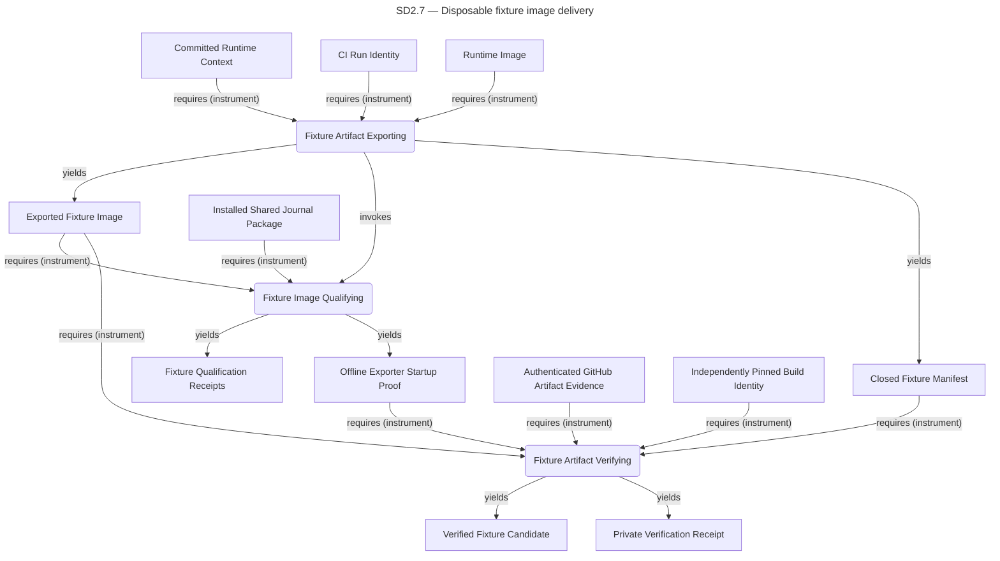

**Source facts (OJF-OPL; bracketed provenance is local metadata):**

```text
Fixture Artifact Exporting requires Committed Runtime Context. [src: apps/service/runtime/artifact.py]
Fixture Artifact Exporting requires CI Run Identity. [src: apps/service/runtime/artifact.py]
Fixture Artifact Exporting requires Runtime Image. [src: apps/service/runtime/artifact.py]
Fixture Artifact Exporting yields Exported Fixture Image. [src: apps/service/runtime/artifact.py]
Fixture Artifact Exporting invokes Fixture Image Qualifying. [src: apps/service/runtime/artifact.py]
Fixture Image Qualifying requires Exported Fixture Image. [src: apps/service/runtime/artifact.py]
Fixture Image Qualifying requires Installed Shared Journal Package. [src: apps/service/runtime/smoke.mjs]
Fixture Image Qualifying yields Fixture Qualification Receipts. [src: apps/service/runtime/artifact.py]
Fixture Image Qualifying yields Offline Exporter Startup Proof. [src: apps/service/runtime/smoke.mjs]
Fixture Artifact Exporting yields Closed Fixture Manifest. [src: apps/service/runtime/artifact.py]
Fixture Artifact Verifying requires Authenticated GitHub Artifact Evidence. [src: apps/service/runtime/artifact.py]
Fixture Artifact Verifying requires Independently Pinned Build Identity. [src: apps/service/runtime/artifact.py]
Fixture Artifact Verifying requires Exported Fixture Image. [src: apps/service/runtime/artifact.py]
Fixture Artifact Verifying requires Closed Fixture Manifest. [src: apps/service/runtime/artifact.py]
Fixture Artifact Verifying requires Offline Exporter Startup Proof. [src: apps/service/runtime/artifact.py]
Fixture Artifact Verifying yields Verified Fixture Candidate. [src: apps/service/runtime/artifact.py]
Fixture Artifact Verifying yields Private Verification Receipt. [src: apps/service/runtime/artifact.py]
```

## SD2.8 — Isolated matched fixture restoration

**Caption:** This view summarizes the source facts in this section. Rectangles identify objects;
rounded nodes identify processes. Labeled solid arrows distinguish human participation,
required instruments, and transformations. These are compatibility labels, not native OPM links.
Use the source facts below for properties, state detail, and decomposition membership.

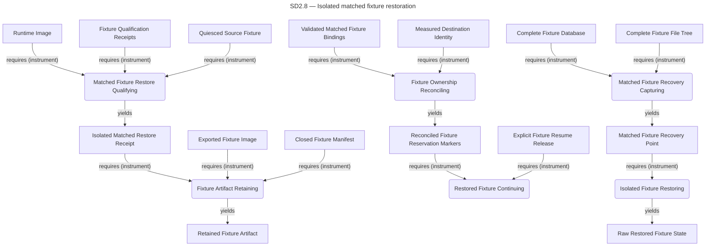

**Source facts (OJF-OPL; bracketed provenance is local metadata):**

```text
Matched Fixture Restore Qualifying requires Runtime Image. [src: apps/service/test/restore/matched-restore.test.mjs]
Matched Fixture Restore Qualifying requires Fixture Qualification Receipts. [src: apps/service/test/restore/matched-restore.test.mjs]
Matched Fixture Restore Qualifying requires Quiesced Source Fixture. [src: apps/service/test/restore/matched-restore.test.mjs]
Matched Fixture Recovery Capturing requires Complete Fixture Database. [src: apps/service/test/restore/matched-restore.test.mjs]
Matched Fixture Recovery Capturing requires Complete Fixture File Tree. [src: apps/service/test/restore/archive.mjs]
Matched Fixture Recovery Capturing yields Matched Fixture Recovery Point. [src: apps/service/test/restore/matched-restore.test.mjs]
Isolated Fixture Restoring requires Matched Fixture Recovery Point. [src: apps/service/test/restore/matched-restore.test.mjs]
Isolated Fixture Restoring yields Raw Restored Fixture State. [src: apps/service/test/restore/matched-restore.test.mjs]
Fixture Ownership Reconciling requires Validated Matched Fixture Bindings. [src: apps/service/test/restore/archive.mjs]
Fixture Ownership Reconciling requires Measured Destination Identity. [src: apps/service/test/restore/archive.mjs]
Fixture Ownership Reconciling yields Reconciled Fixture Reservation Markers. [src: apps/service/test/restore/archive.mjs]
Restored Fixture Continuing requires Reconciled Fixture Reservation Markers. [src: apps/service/test/restore/matched-restore.test.mjs]
Restored Fixture Continuing requires Explicit Fixture Resume Release. [src: apps/service/test/restore/matched-restore.test.mjs]
Matched Fixture Restore Qualifying yields Isolated Matched Restore Receipt. [src: apps/service/test/restore/matched-restore.test.mjs]
Fixture Artifact Retaining requires Isolated Matched Restore Receipt. [src: .github/workflows/service-runtime.yml]
Fixture Artifact Retaining requires Exported Fixture Image. [src: .github/workflows/service-runtime.yml]
Fixture Artifact Retaining requires Closed Fixture Manifest. [src: .github/workflows/service-runtime.yml]
Fixture Artifact Retaining yields Retained Fixture Artifact. [src: .github/workflows/service-runtime.yml]
```

## SD2.9 — Explicit CLI observation lifecycle

**Caption:** This view summarizes the source facts in this section. Rectangles identify objects;
rounded nodes identify processes. Labeled solid arrows distinguish human participation,
required instruments, and transformations. These are compatibility labels, not native OPM links.
Use the source facts below for properties, state detail, and decomposition membership.

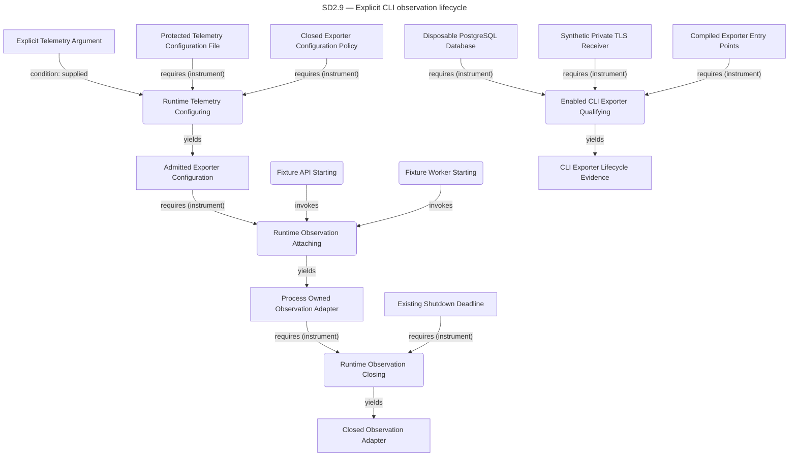

**Source facts (OJF-OPL; bracketed provenance is local metadata):**

```text
Runtime Telemetry Configuring occurs if Explicit Telemetry Argument is supplied. [src: apps/service/src/telemetry-runtime.ts]
Runtime Telemetry Configuring requires Protected Telemetry Configuration File. [src: apps/service/src/telemetry-runtime.ts]
Runtime Telemetry Configuring requires Closed Exporter Configuration Policy. [src: apps/service/src/telemetry-export-config.ts]
Runtime Telemetry Configuring yields Admitted Exporter Configuration. [src: apps/service/src/telemetry-runtime.ts]
Runtime Observation Attaching requires Admitted Exporter Configuration. [src: apps/service/src/telemetry-runtime.ts]
Runtime Observation Attaching yields Process Owned Observation Adapter. [src: apps/service/src/telemetry-runtime.ts]
Fixture API Starting invokes Runtime Observation Attaching. [src: apps/service/src/http-cli.ts]
Fixture Worker Starting invokes Runtime Observation Attaching. [src: apps/service/src/delivery-cli.ts]
Runtime Observation Closing requires Process Owned Observation Adapter. [src: apps/service/src/http-cli.ts] [src: apps/service/src/delivery-worker.ts]
Runtime Observation Closing requires Existing Shutdown Deadline. [src: apps/service/src/telemetry.ts]
Runtime Observation Closing yields Closed Observation Adapter. [src: apps/service/src/telemetry-export-process.ts]
Enabled CLI Exporter Qualifying requires Disposable PostgreSQL Database. [src: apps/service/test/exporter/telemetry-enabled.integration.test.ts]
Enabled CLI Exporter Qualifying requires Synthetic Private TLS Receiver. [src: apps/service/test/exporter/telemetry-enabled.integration.test.ts]
Enabled CLI Exporter Qualifying requires Compiled Exporter Entry Points. [src: apps/service/test/exporter/telemetry-enabled.integration.test.ts]
Enabled CLI Exporter Qualifying yields CLI Exporter Lifecycle Evidence. [src: apps/service/test/exporter/telemetry-enabled.integration.test.ts]
```

## SD2.10 — Enabled exporter image qualification

**Caption:** This view summarizes the source facts in this section. Rectangles identify objects;
rounded nodes identify processes. Labeled solid arrows distinguish human participation,
required instruments, and transformations. These are compatibility labels, not native OPM links.
Use the source facts below for properties, state detail, and decomposition membership.

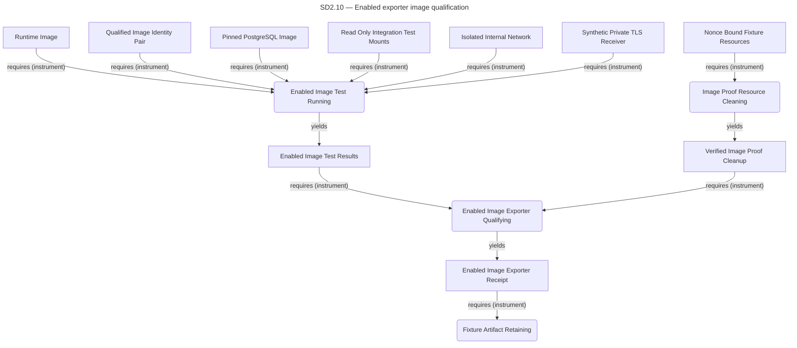

**Source facts (OJF-OPL; bracketed provenance is local metadata):**

```text
Enabled Image Test Running requires Runtime Image. [src: apps/service/runtime/exporter-smoke.mjs]
Enabled Image Test Running requires Qualified Image Identity Pair. [src: .github/workflows/service-runtime.yml]
Enabled Image Test Running requires Pinned PostgreSQL Image. [src: apps/service/runtime/compose.yaml]
Enabled Image Test Running requires Read Only Integration Test Mounts. [src: apps/service/runtime/exporter-smoke.mjs]
Enabled Image Test Running requires Isolated Internal Network. [src: apps/service/runtime/exporter-smoke.mjs]
Enabled Image Test Running requires Synthetic Private TLS Receiver. [src: apps/service/test/fixtures/telemetry-tls.ts]
Enabled Image Test Running yields Enabled Image Test Results. [src: apps/service/runtime/exporter-smoke.mjs]
Image Proof Resource Cleaning requires Nonce Bound Fixture Resources. [src: apps/service/runtime/exporter-smoke.mjs]
Image Proof Resource Cleaning yields Verified Image Proof Cleanup. [src: apps/service/runtime/exporter-smoke.mjs]
Enabled Image Exporter Qualifying requires Enabled Image Test Results. [src: apps/service/runtime/exporter-smoke.mjs]
Enabled Image Exporter Qualifying requires Verified Image Proof Cleanup. [src: apps/service/runtime/exporter-smoke.mjs]
Enabled Image Exporter Qualifying yields Enabled Image Exporter Receipt. [src: apps/service/runtime/exporter-smoke.mjs]
Fixture Artifact Retaining requires Enabled Image Exporter Receipt. [src: .github/workflows/service-runtime.yml]
```

## SD2.11 — Sealed recorded evidence protocol

**Caption:** This view summarizes the source facts in this section. Rectangles identify objects;
rounded nodes identify processes. Labeled solid arrows distinguish human participation,
required instruments, and transformations. These are compatibility labels, not native OPM links.
Use the source facts below for properties, state detail, and decomposition membership.

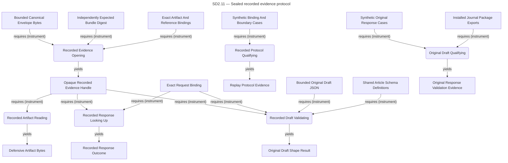

**Source facts (OJF-OPL; bracketed provenance is local metadata):**

```text
Recorded Evidence Opening requires Bounded Canonical Envelope Bytes. [src: apps/service/src/recorded-evidence.ts]
Recorded Evidence Opening requires Independently Expected Bundle Digest. [src: apps/service/src/recorded-evidence.ts]
Recorded Evidence Opening requires Exact Artifact And Reference Bindings. [src: apps/service/src/recorded-evidence.ts]
Recorded Evidence Opening yields Opaque Recorded Evidence Handle. [src: apps/service/src/recorded-evidence.ts]
Recorded Artifact Reading requires Opaque Recorded Evidence Handle. [src: apps/service/src/recorded-evidence.ts]
Recorded Artifact Reading yields Defensive Artifact Bytes. [src: apps/service/src/recorded-evidence.ts]
Recorded Response Looking Up requires Opaque Recorded Evidence Handle. [src: apps/service/src/recorded-response.ts]
Recorded Response Looking Up requires Exact Request Binding. [src: apps/service/src/recorded-response.ts]
Recorded Response Looking Up yields Recorded Response Outcome. [src: apps/service/src/recorded-response.ts]
Recorded Protocol Qualifying requires Synthetic Binding And Boundary Cases. [src: apps/service/test/recorded-evidence.test.ts]
Recorded Protocol Qualifying yields Replay Protocol Evidence. [src: apps/service/test/recorded-evidence.test.ts]
Recorded Draft Validating requires Opaque Recorded Evidence Handle. [src: apps/service/src/recorded-article.ts]
Recorded Draft Validating requires Exact Request Binding. [src: apps/service/src/recorded-article.ts]
Recorded Draft Validating requires Bounded Original Draft JSON. [src: apps/service/src/recorded-article.ts]
Recorded Draft Validating requires Shared Article Schema Definitions. [src: packages/journal/src/article-schema.ts]
Recorded Draft Validating yields Original Draft Shape Result. [src: apps/service/src/recorded-article.ts]
Original Draft Qualifying requires Synthetic Original Response Cases. [src: apps/service/test/recorded-article.test.ts]
Original Draft Qualifying requires Installed Journal Package Exports. [src: apps/service/runtime/smoke.mjs]
Original Draft Qualifying yields Original Response Validation Evidence. [src: apps/service/test/recorded-article.test.ts]
```

## SD2.12 — Shared journal rendering

**Caption:** This view summarizes the source facts in this section. Rectangles identify objects;
rounded nodes identify processes. Labeled solid arrows distinguish human participation,
required instruments, and transformations. These are compatibility labels, not native OPM links.
Use the source facts below for properties, state detail, and decomposition membership.

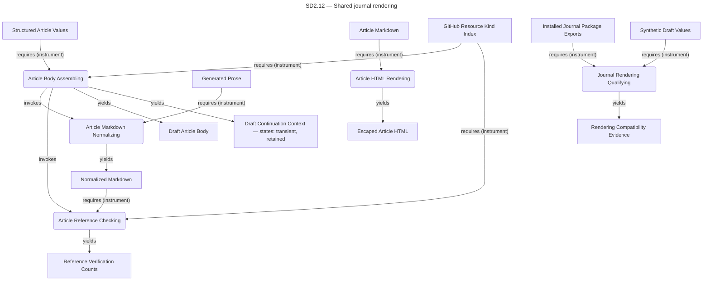

**Source facts (OJF-OPL; bracketed provenance is local metadata):**

```text
Article Body Assembling requires Structured Article Values. [src: packages/journal/src/article-body.ts]
Article Body Assembling requires GitHub Resource Kind Index. [src: packages/journal/src/article-references.ts]
Article Body Assembling invokes Article Markdown Normalizing. [src: packages/journal/src/article-body.ts]
Article Body Assembling invokes Article Reference Checking. [src: packages/journal/src/article-body.ts]
Article Body Assembling yields Draft Article Body. [src: packages/journal/src/article-body.ts]
Article Body Assembling yields Draft Continuation Context. [src: packages/journal/src/recommendation-prose.ts]
Article Markdown Normalizing requires Generated Prose. [src: packages/journal/src/normalize-article-markdown.ts]
Article Markdown Normalizing yields Normalized Markdown. [src: packages/journal/src/normalize-article-markdown.ts]
Article Reference Checking requires Normalized Markdown. [src: packages/journal/src/article-references.ts]
Article Reference Checking requires GitHub Resource Kind Index. [src: packages/journal/src/article-references.ts]
Article Reference Checking yields Reference Verification Counts. [src: packages/journal/src/article-references.ts]
Article HTML Rendering requires Article Markdown. [src: packages/journal/src/render-article.ts]
Article HTML Rendering yields Escaped Article HTML. [src: packages/journal/src/render-article.ts]
Journal Rendering Qualifying requires Installed Journal Package Exports. [src: apps/service/runtime/smoke.mjs]
Journal Rendering Qualifying requires Synthetic Draft Values. [src: apps/service/runtime/smoke.mjs]
Journal Rendering Qualifying yields Rendering Compatibility Evidence. [src: src/__tests__/journal-render.test.ts]
```

## SD2.13 — Shared article serialization and provenance

**Caption:** This view summarizes the source facts in this section. Rectangles identify objects;
rounded nodes identify processes. Labeled solid arrows distinguish human participation,
required instruments, and transformations. These are compatibility labels, not native OPM links.
Use the source facts below for properties, state detail, and decomposition membership.

```mermaid
---
title: "SD2.13 — Shared article serialization and provenance"
---
flowchart TD
  accTitle: SD2.13 — Shared article serialization and provenance
  accDescr: Lossy system model projection. Complete source facts follow this diagram.
  n440("Article Markdown Serializing")
  n441["Generated Article Values"]
  n428("Article Markdown Normalizing")
  n442("Article Footer Formatting")
  n443["Draft Article Markdown"]
  n444("Article Provenance Building")
  n445["Supplied Run Evidence"]
  n446["Supplied Authoring Stages"]
  n447["Supplied Runtime Metadata"]
  n448["Optional Article Provenance"]
  n449["Article Attribution Footer"]
  n450("Authoring Stage Appending")
  n435["Article Markdown"]
  n451["Supplied Authoring Stage"]
  n452("Journal Serialization Qualifying")
  n423["Installed Journal Package Exports"]
  n438["Synthetic Draft Values"]
  n453["Serialization Compatibility Evidence"]
  n441 -->|"requires (instrument)"| n440
  n440 -->|"invokes"| n428
  n440 -->|"invokes"| n442
  n440 -->|"yields"| n443
  n445 -->|"requires (instrument)"| n444
  n446 -->|"requires (instrument)"| n444
  n447 -->|"requires (instrument)"| n444
  n444 -->|"yields"| n448
  n448 -->|"requires (instrument)"| n442
  n442 -->|"yields"| n449
  n435 -->|"requires (instrument)"| n450
  n451 -->|"requires (instrument)"| n450
  n450 -->|"yields"| n435
  n423 -->|"requires (instrument)"| n452
  n438 -->|"requires (instrument)"| n452
  n452 -->|"yields"| n453
```

**Source facts (OJF-OPL; bracketed provenance is local metadata):**

```text
Article Markdown Serializing requires Generated Article Values. [src: packages/journal/src/article-markdown.ts]
Article Markdown Serializing invokes Article Markdown Normalizing. [src: packages/journal/src/article-markdown.ts]
Article Markdown Serializing invokes Article Footer Formatting. [src: packages/journal/src/article-markdown.ts]
Article Markdown Serializing yields Draft Article Markdown. [src: packages/journal/src/article-markdown.ts]
Article Provenance Building requires Supplied Run Evidence. [src: packages/journal/src/article-provenance.ts]
Article Provenance Building requires Supplied Authoring Stages. [src: packages/journal/src/article-provenance.ts]
Article Provenance Building requires Supplied Runtime Metadata. [src: packages/journal/src/article-provenance.ts]
Article Provenance Building yields Optional Article Provenance. [src: packages/journal/src/article-provenance.ts]
Article Footer Formatting requires Optional Article Provenance. [src: packages/journal/src/article-provenance.ts]
Article Footer Formatting yields Article Attribution Footer. [src: packages/journal/src/article-provenance.ts]
Authoring Stage Appending requires Article Markdown. [src: packages/journal/src/article-provenance.ts]
Authoring Stage Appending requires Supplied Authoring Stage. [src: packages/journal/src/article-provenance.ts]
Authoring Stage Appending yields Article Markdown. [src: packages/journal/src/article-provenance.ts]
Journal Serialization Qualifying requires Installed Journal Package Exports. [src: apps/service/runtime/smoke.mjs]
Journal Serialization Qualifying requires Synthetic Draft Values. [src: apps/service/runtime/smoke.mjs]
Journal Serialization Qualifying yields Serialization Compatibility Evidence. [src: src/__tests__/journal-serialization.test.ts]
```

## SD2.14 — Shared draft prompt definitions

**Caption:** This view summarizes the source facts in this section. Rectangles identify objects;
rounded nodes identify processes. Labeled solid arrows distinguish human participation,
required instruments, and transformations. These are compatibility labels, not native OPM links.
Use the source facts below for properties, state detail, and decomposition membership.

```mermaid
---
title: "SD2.14 — Shared draft prompt definitions"
---
flowchart TD
  accTitle: SD2.14 — Shared draft prompt definitions
  accDescr: Lossy system model projection. Complete source facts follow this diagram.
  n105("Drafting")
  n454["Shared Journal Prompt Definitions"]
  n455["Shared Draft Tool Definition"]
  n456("Draft Prompt Selecting")
  n457["Telemetry Presence Flag"]
  n458["Selected Draft System Prompt"]
  n459("Journal Prompt Qualifying")
  n423["Installed Journal Package Exports"]
  n460["Prompt Compatibility Evidence"]
  n454 -->|"requires (instrument)"| n105
  n455 -->|"requires (instrument)"| n105
  n457 -->|"requires (instrument)"| n456
  n454 -->|"requires (instrument)"| n456
  n456 -->|"yields"| n458
  n423 -->|"requires (instrument)"| n459
  n459 -->|"yields"| n460
```

**Source facts (OJF-OPL; bracketed provenance is local metadata):**

```text
Drafting requires Shared Journal Prompt Definitions. [src: packages/journal/src/article-prompts.ts]
Drafting requires Shared Draft Tool Definition. [src: packages/journal/src/article-prompts.ts]
Draft Prompt Selecting requires Telemetry Presence Flag. [src: packages/journal/src/article-prompts.ts]
Draft Prompt Selecting requires Shared Journal Prompt Definitions. [src: packages/journal/src/article-prompts.ts]
Draft Prompt Selecting yields Selected Draft System Prompt. [src: packages/journal/src/article-prompts.ts]
Journal Prompt Qualifying requires Installed Journal Package Exports. [src: apps/service/runtime/smoke.mjs]
Journal Prompt Qualifying yields Prompt Compatibility Evidence. [src: src/__tests__/fleet-prompt-contract.test.ts]
```

## SD2.15 — Request-bound service draft output

**Caption:** This view summarizes the source facts in this section. Rectangles identify objects;
rounded nodes identify processes. Labeled solid arrows distinguish human participation,
required instruments, and transformations. These are compatibility labels, not native OPM links.
Use the source facts below for properties, state detail, and decomposition membership.

```mermaid
---
title: "SD2.15 — Request-bound service draft output"
---
flowchart TD
  accTitle: SD2.15 — Request-bound service draft output
  accDescr: Lossy system model projection. Complete source facts follow this diagram.
  n461("Service Draft Tool Building")
  n462["Sealed Reporting Date"]
  n455["Shared Draft Tool Definition"]
  n463["Complete Service Draft Tool"]
  n464("Recorded Request Reading")
  n408["Opaque Recorded Evidence Handle"]
  n412["Exact Request Binding"]
  n465["Defensive Request And Report Values"]
  n466("Service Draft Request Validating")
  n467["Request Contract Result"]
  n468("Service Draft Output Validating")
  n418["Bounded Original Draft JSON"]
  n419["Shared Article Schema Definitions"]
  n469["Original Service Draft Shape Result"]
  n470("Service Draft Contract Qualifying")
  n471["Synthetic Request And Output Boundary Cases"]
  n472["Installed Service Runtime"]
  n473["Request Bound Draft Compatibility Evidence"]
  n462 -->|"requires (instrument)"| n461
  n455 -->|"requires (instrument)"| n461
  n461 -->|"yields"| n463
  n408 -->|"requires (instrument)"| n464
  n412 -->|"requires (instrument)"| n464
  n464 -->|"yields"| n465
  n465 -->|"requires (instrument)"| n466
  n463 -->|"requires (instrument)"| n466
  n466 -->|"yields"| n467
  n467 -->|"requires (instrument)"| n468
  n418 -->|"requires (instrument)"| n468
  n419 -->|"requires (instrument)"| n468
  n468 -->|"yields"| n469
  n471 -->|"requires (instrument)"| n470
  n472 -->|"requires (instrument)"| n470
  n470 -->|"yields"| n473
```

**Source facts (OJF-OPL; bracketed provenance is local metadata):**

```text
Service Draft Tool Building requires Sealed Reporting Date. [src: apps/service/src/article-output-contract.ts]
Service Draft Tool Building requires Shared Draft Tool Definition. [src: apps/service/src/article-output-contract.ts]
Service Draft Tool Building yields Complete Service Draft Tool. [src: apps/service/src/article-output-contract.ts]
Recorded Request Reading requires Opaque Recorded Evidence Handle. [src: apps/service/src/recorded-evidence.ts]
Recorded Request Reading requires Exact Request Binding. [src: apps/service/src/recorded-evidence.ts]
Recorded Request Reading yields Defensive Request And Report Values. [src: apps/service/src/recorded-evidence.ts]
Service Draft Request Validating requires Defensive Request And Report Values. [src: apps/service/src/recorded-service-draft.ts]
Service Draft Request Validating requires Complete Service Draft Tool. [src: apps/service/src/recorded-service-draft.ts]
Service Draft Request Validating yields Request Contract Result. [src: apps/service/src/recorded-service-draft.ts]
Service Draft Output Validating requires Request Contract Result. [src: apps/service/src/recorded-service-draft.ts]
Service Draft Output Validating requires Bounded Original Draft JSON. [src: apps/service/src/recorded-json.ts]
Service Draft Output Validating requires Shared Article Schema Definitions. [src: packages/journal/src/article-schema.ts]
Service Draft Output Validating yields Original Service Draft Shape Result. [src: apps/service/src/recorded-service-draft.ts]
Service Draft Contract Qualifying requires Synthetic Request And Output Boundary Cases. [src: apps/service/test/recorded-service-draft.test.ts]
Service Draft Contract Qualifying requires Installed Service Runtime. [src: apps/service/runtime/smoke.mjs]
Service Draft Contract Qualifying yields Request Bound Draft Compatibility Evidence. [src: apps/service/test/recorded-service-draft.test.ts]
```
