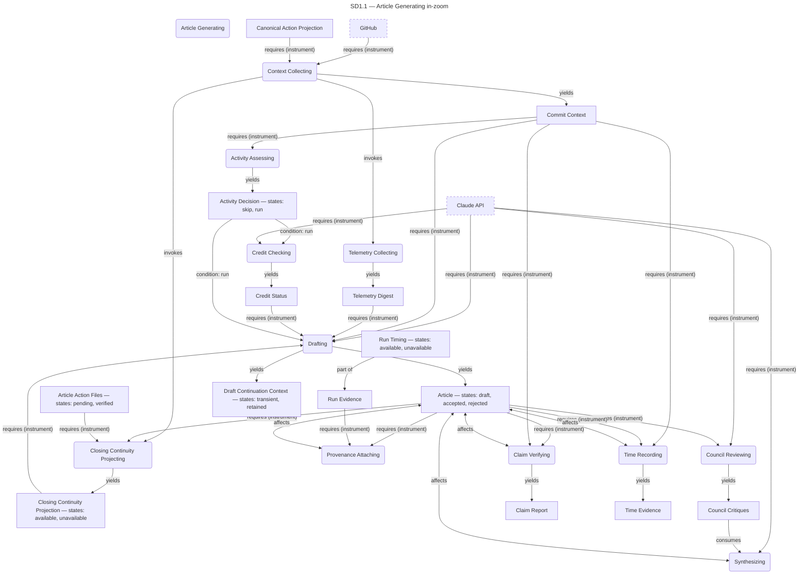
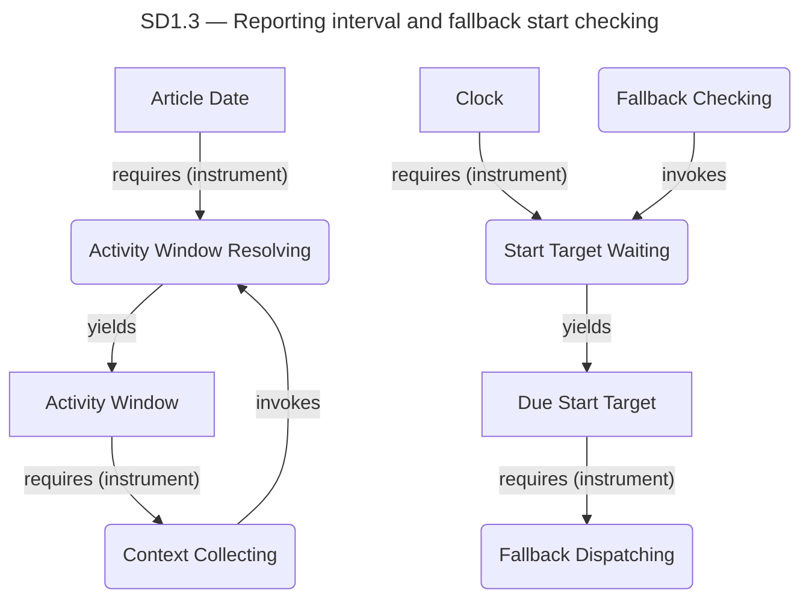

# System model — Mermaid compatibility views

> Generated from `system.opl` by the /opm subset renderer v1. Do not hand-edit.
> Source SHA-256: `e8cdc30e02b91810dd2ed24edb0c0ed353c0bd28787794eeb5f1770981c99776`.
> Lossy projection, not a native OPD or ISO conformance claim. Rounded process nodes and
> labeled arrows replace standard symbols. States are summarized; native state, control,
> property, and refinement geometry is omitted. No order is inferred from decomposition.

## SD — daily-logger: one article per day

**Caption:** This view summarizes the source facts in this section. Rectangles identify objects;
rounded nodes identify processes. Labeled solid arrows distinguish human participation,
required instruments, and transformations. These are compatibility labels, not native OPM links.
Use the source facts below for properties, state detail, and decomposition membership.



```mermaid
---
title: "SD — daily-logger: one article per day"
---
flowchart TD
  accTitle: SD — daily-logger: one article per day
  accDescr: Lossy system model projection. Complete source facts follow this diagram.
  n19["Jim"]
  n4["GitHub"]
  style n4 stroke-dasharray: 5 5
  n36["Claude API"]
  style n36 stroke-dasharray: 5 5
  n0["Article — states: draft, accepted, rejected"]
  n1["Run Admission — states: generate, recover, complete"]
  n2["Cron Firing"]
  n3("Run Admitting")
  n5("Run Evidence Capturing")
  n6["Run Evidence"]
  n7("Article Generating")
  n8("Branch Recovering")
  n9["Article Completion"]
  n10("Cleaner Admitting")
  n11["Cleaner Admission — states: run, skip"]
  n12("Stale Content Cleaning")
  n13["Canonical Action Projection"]
  n14("Fallback Checking")
  n15["Fallback Decision — states: missing, active, complete, failed"]
  n16("Fallback Dispatching")
  n17["Workflow Run"]
  n18["Draft Action Candidates"]
  n20("Editorial Accepting")
  n21("API Building")
  n22("Action Projecting")
  n23["Action Registry"]
  n24["Closing Prompt — states: legacy-options, ranked-shortlist, needs-evidence"]
  n25("Suggested Action Card Rendering")
  n26["Suggested Actions Card"]
  n27["Draft Continuation Context — states: transient, retained"]
  n28("Action Reconciling")
  n29["Action Review Cycle — states: generation, revision"]
  n30["Source Evidence"]
  n31["Recommendation Maintenance Memory"]
  n32["Draft Candidate Evidence Requirements — states: prior-binding, current-binding"]
  n33("Suggestion Proposing")
  n34("Candidate Reference Resolving")
  n35("Suggestion Verifying")
  n37["Provider Action Proposal"]
  n38["Provider Action Proposal and Draft Action Candidates"]
  n39["Canonical Action Proposal"]
  n40["Draft Action Candidate — states: awaiting-review, promoted, mapped-existing, rejected, verified-closure"]
  n140["Candidate Review History"]
  n179["Candidate Review Transition"]
  n180["Historical Source Metadata"]
  n41["Source Identity, Source Kind, Source Locator, and Full Content Digest"]
  n42["Draft Candidate Evidence Association — states: required, context"]
  n181["Background Evidence Reference"]
  n182["Candidate Action Relation"]
  n183["Candidate Input View"]
  n43["Action Registry, Draft Action Candidates, Action Review Cycle, Operator Feedback, and Article Status"]
  n44("Candidate Evidence Preparing")
  n184["Canonical Action Index"]
  n185["Held Suggestion Memory"]
  n186["Rejection Memory"]
  n45["Action Review Snapshot"]
  n46("Candidate Evidence Refreshing")
  n47["unchanged Draft Candidate Evidence Association"]
  n48["unchanged prior Candidate Input View"]
  n49["Accepted Outcome Stamp"]
  n50["Action Review Snapshot and Accepted Outcome Stamp"]
  n51("Acceptance Status Evidence Refreshing")
  n52["current-binding Draft Candidate Evidence Requirements"]
  n187["Ranked Recommendations"]
  n188["Handled Suggestions"]
  n53("Editorial Revising")
  n54["Editorial Revision Request"]
  n55["Draft Suggestion — states: proposed, open, done, dismissed, superseded, deferred"]
  n145["Imported Action Baseline"]
  n105["Article Action Files — states: pending, verified"]
  n56("Inclusion Choosing")
  n57["Reviewed Disposition — states: deferred, completed-existing-evidence, pending-receipt"]
  n189["Canonical Actions"]
  n58["JSON API"]
  n59("Frontend Rendering")
  n60["Rendered Site"]
  n61["Article Fingerprint"]
  n62("Independent Review Projecting")
  n63["Review Projection"]
  n64("Revision Requesting")
  n65["Revision Request"]
  n66("Conversation Saving")
  n67["Saved Message"]
  n190["Review Records"]
  n191["Correspondence"]
  n68["Time Record Pointer"]
  n69("Time Recording")
  n70["Commit Context"]
  n71["Issue Context"]
  n72["Time Evidence"]
  n73("Time Backfilling")
  n74("Time Resolving")
  n75["Time References"]
  n76["Shipment Timestamp — states: available, unavailable"]
  n77["Shipment Source State — states: open, closed-unmerged"]
  n78["Shipment Coverage — states: complete, unavailable"]
  n79("Shipment Time Resolving")
  n80("Issue Time Resolving")
  n81["Projected Issue Times"]
  n82["Time Expressions"]
  n83("Time Projecting")
  n84("Shipment Coverage Checking")
  n85["Projected Time References"]
  n86["Projected Shipment Timestamps"]
  n87["Projected Time Expressions"]
  n88("Time Visualizing")
  n89["Device Timezone"]
  n90["Time Popover"]
  n91("Time Metadata Preserving")
  n2 -->|"object event"| n3
  n4 -->|"requires (instrument)"| n3
  n3 -->|"yields"| n1
  n3 -->|"invokes"| n5
  n4 -->|"requires (instrument)"| n5
  n5 -->|"yields"| n6
  n1 -->|"condition: generate"| n7
  n1 -->|"condition: recover"| n8
  n4 -->|"requires (instrument)"| n8
  n8 -->|"yields"| n9
  n7 -->|"yields"| n9
  n9 -->|"requires (instrument)"| n10
  n10 -->|"yields"| n11
  n11 -->|"condition: run"| n12
  n13 -->|"requires (instrument)"| n12
  n12 <-->|"affects"| n4
  n4 -->|"requires (instrument)"| n14
  n14 -->|"yields"| n15
  n15 -->|"condition: missing"| n16
  n4 -->|"requires (instrument)"| n16
  n16 -->|"yields"| n17
  n17 -->|"object event"| n3
  n7 -->|"yields"| n0
  n7 -->|"yields"| n18
  n19 -->|"handles (human)"| n20
  n20 -->|"changes: draft to accepted"| n0
  n0 -->|"requires (instrument)"| n21
  n0 -->|"requires (instrument)"| n22
  n23 -->|"requires (instrument)"| n22
  n22 -->|"yields"| n13
  n24 -->|"requires (instrument)"| n25
  n23 -->|"requires (instrument)"| n25
  n25 -->|"yields"| n26
  n0 -->|"requires (instrument)"| n28
  n23 -->|"requires (instrument)"| n28
  n29 -->|"requires (instrument)"| n28
  n30 -->|"requires (instrument)"| n28
  n31 -->|"requires (instrument)"| n28
  n18 -->|"requires (instrument)"| n28
  n32 -->|"requires (instrument)"| n28
  n28 -->|"invokes"| n33
  n28 -->|"invokes"| n34
  n28 -->|"invokes"| n35
  n36 -->|"requires (instrument)"| n33
  n36 -->|"requires (instrument)"| n35
  n31 -->|"requires (instrument)"| n33
  n31 -->|"requires (instrument)"| n35
  n18 -->|"requires (instrument)"| n33
  n33 -->|"yields"| n37
  n38 -->|"requires (instrument)"| n34
  n34 -->|"yields"| n39
  n39 -->|"requires (instrument)"| n35
  n18 -->|"requires (instrument)"| n35
  n28 <-->|"affects"| n23
  n28 <-->|"affects"| n0
  n28 -->|"yields"| n24
  n28 -->|"yields"| n31
  n28 -->|"changes: transient to retained"| n27
  n40 -->|"part of"| n18
  n179 -->|"part of"| n140
  n180 -->|"part of"| n140
  n180 -->|"exhibits"| n41
  n42 -->|"part of"| n32
  n181 -->|"part of"| n32
  n182 -->|"part of"| n32
  n183 -->|"part of"| n32
  n43 -->|"requires (instrument)"| n44
  n44 -->|"yields"| n32
  n184 -->|"part of"| n183
  n185 -->|"part of"| n183
  n186 -->|"part of"| n183
  n45 -->|"requires (instrument)"| n46
  n47 -->|"requires (instrument)"| n46
  n48 -->|"requires (instrument)"| n46
  n46 -->|"changes: prior-binding to current-binding"| n32
  n20 -->|"yields"| n49
  n50 -->|"requires (instrument)"| n51
  n0 -->|"condition: accepted"| n51
  n51 -->|"yields"| n52
  n187 -->|"part of"| n26
  n18 -->|"part of"| n26
  n27 -->|"part of"| n26
  n188 -->|"part of"| n26
  n7 -->|"yields"| n29
  n7 -->|"invokes"| n28
  n53 -->|"yields"| n29
  n53 -->|"invokes"| n28
  n54 -->|"requires (instrument)"| n53
  n20 -->|"yields"| n29
  n53 -->|"invokes"| n44
  n20 -->|"invokes"| n44
  n20 -->|"invokes"| n28
  n145 -->|"part of"| n23
  n105 -->|"part of"| n23
  n23 -->|"requires (instrument)"| n56
  n4 -->|"requires (instrument)"| n56
  n56 <-->|"affects"| n23
  n19 -->|"handles (human)"| n56
  n189 -->|"part of"| n13
  n57 -->|"part of"| n13
  n21 -->|"invokes"| n22
  n13 -->|"requires (instrument)"| n21
  n21 -->|"yields"| n58
  n58 -->|"requires (instrument)"| n59
  n13 -->|"requires (instrument)"| n59
  n59 -->|"yields"| n60
  n21 -->|"yields"| n61
  n59 -->|"invokes"| n62
  n4 -->|"requires (instrument)"| n62
  n61 -->|"requires (instrument)"| n62
  n62 -->|"yields"| n63
  n19 -->|"handles (human)"| n64
  n63 -->|"requires (instrument)"| n64
  n64 -->|"yields"| n65
  n64 <-->|"affects"| n4
  n4 -->|"requires (instrument)"| n66
  n61 -->|"requires (instrument)"| n66
  n63 -->|"requires (instrument)"| n66
  n66 -->|"yields"| n67
  n66 <-->|"affects"| n4
  n190 -->|"part of"| n63
  n191 -->|"part of"| n63
  n0 -->|"exhibits"| n68
  n0 -->|"requires (instrument)"| n69
  n13 -->|"requires (instrument)"| n69
  n70 -->|"requires (instrument)"| n69
  n71 -->|"requires (instrument)"| n69
  n69 -->|"yields"| n72
  n69 <-->|"affects"| n0
  n0 -->|"requires (instrument)"| n73
  n4 -->|"requires (instrument)"| n73
  n73 -->|"yields"| n72
  n73 -->|"invokes"| n74
  n72 -->|"requires (instrument)"| n74
  n0 -->|"requires (instrument)"| n74
  n74 -->|"yields"| n75
  n0 -->|"requires (instrument)"| n79
  n72 -->|"requires (instrument)"| n79
  n77 -->|"requires (instrument)"| n79
  n79 -->|"yields"| n76
  n0 -->|"requires (instrument)"| n80
  n13 -->|"requires (instrument)"| n80
  n72 -->|"requires (instrument)"| n80
  n80 -->|"yields"| n81
  n69 -->|"invokes"| n79
  n74 -->|"yields"| n82
  n21 -->|"invokes"| n83
  n21 -->|"invokes"| n84
  n0 -->|"requires (instrument)"| n84
  n72 -->|"requires (instrument)"| n84
  n84 -->|"yields"| n78
  n0 -->|"requires (instrument)"| n83
  n13 -->|"requires (instrument)"| n83
  n72 -->|"requires (instrument)"| n83
  n83 -->|"invokes"| n74
  n83 -->|"invokes"| n79
  n83 -->|"invokes"| n80
  n83 -->|"yields"| n85
  n83 -->|"yields"| n86
  n85 -->|"part of"| n58
  n86 -->|"part of"| n58
  n81 -->|"part of"| n58
  n83 -->|"yields"| n87
  n87 -->|"part of"| n58
  n59 -->|"invokes"| n88
  n85 -->|"requires (instrument)"| n88
  n86 -->|"requires (instrument)"| n88
  n81 -->|"requires (instrument)"| n88
  n89 -->|"requires (instrument)"| n88
  n88 -->|"yields"| n90
  n19 -->|"handles (human)"| n53
  n53 -->|"invokes"| n91
  n0 -->|"requires (instrument)"| n91
  n91 <-->|"affects"| n0
```

Initial-state shorthand: Draft. Object scope must be checked in the source model.

**Source facts (OJF-OPL; bracketed provenance is local metadata):**

```text
Jim is physical.
GitHub is environmental.
Claude API is environmental.
Article can be draft, accepted, or rejected. [src: src/schema.ts]
Draft is initial.
Run Admission can be generate, recover, or complete. [src: .github/scripts/daily_blog_schedule.py]
Cron Firing triggers Run Admitting. [src: .github/workflows/daily-blog.yml]
Run Admitting requires GitHub. [src: .github/scripts/daily_blog_schedule.py]
Run Admitting yields Run Admission. [src: .github/scripts/daily_blog_schedule.py]
Run Admitting invokes Run Evidence Capturing. [src: .github/scripts/daily_blog_schedule.py]
Run Evidence Capturing requires GitHub. [src: .github/scripts/daily_blog_schedule.py]
Run Evidence Capturing yields Run Evidence. [src: .github/scripts/daily_blog_schedule.py]
Article Generating occurs if Run Admission is generate. [src: .github/workflows/daily-blog.yml]
Branch Recovering occurs if Run Admission is recover. [src: .github/workflows/daily-blog.yml]
Branch Recovering requires GitHub. [src: .github/workflows/daily-blog.yml]
Branch Recovering yields Article Completion. [src: .github/workflows/daily-blog.yml]
Article Generating yields Article Completion. [src: .github/workflows/daily-blog.yml]
Cleaner Admitting requires Article Completion. [src: .github/scripts/daily_blog_schedule.py]
Cleaner Admitting yields Cleaner Admission. [src: .github/scripts/daily_blog_schedule.py]
Cleaner Admission can be run or skip. [src: .github/scripts/daily_blog_schedule.py]
Stale Content Cleaning occurs if Cleaner Admission is run. [src: .github/workflows/daily-cleaner.yml]
Stale Content Cleaning requires Canonical Action Projection. [src: src/cleaner.ts]
Stale Content Cleaning affects GitHub. [src: .github/workflows/daily-cleaner.yml]
Fallback Checking requires GitHub. [src: .github/scripts/daily_blog_schedule.py]
Fallback Checking yields Fallback Decision. [src: .github/scripts/daily_blog_schedule.py]
Fallback Decision can be missing, active, complete, or failed. [src: .github/scripts/daily_blog_schedule.py]
Fallback Dispatching occurs if Fallback Decision is missing. [src: .github/scripts/daily_blog_schedule.py]
Fallback Dispatching requires GitHub. [src: .github/scripts/daily_blog_schedule.py]
Fallback Dispatching yields Workflow Run. [src: .github/scripts/daily_blog_schedule.py]
Workflow Run triggers Run Admitting. [src: .github/workflows/daily-blog.yml]
Article Generating yields Article. [src: src/index.ts]
Article Generating yields Draft Action Candidates. [src: src/index.ts]
Jim handles Editorial Accepting. [src: .github/workflows/editorial-revise.yml]
Editorial Accepting changes Article from draft to accepted. [src: packages/frontend/src/utils/stampDraft.ts]
API Building requires Article. [src: src/build-api.ts]
Action Projecting requires Article. [src: src/action-registry.ts]
Action Projecting requires Action Registry. [src: src/action-registry.ts]
Action Projecting yields Canonical Action Projection. [src: src/action-registry.ts]
Suggested Action Card Rendering requires Closing Prompt. [src: src/action-registry.ts]
Suggested Action Card Rendering requires Action Registry. [src: src/action-registry.ts]
Suggested Action Card Rendering yields Suggested Actions Card. [src: src/action-registry.ts]
Draft Continuation Context can be transient or retained. [src: src/recommendation-prose.ts]
Action Reconciling requires Article. [src: src/review-actions.ts]
Action Reconciling requires Action Registry. [src: src/review-actions.ts]
Action Review Cycle can be generation or revision. [src: src/action-review-cycle.ts]
Action Reconciling requires Action Review Cycle. [src: src/review-actions.ts]
Action Reconciling requires Source Evidence. [src: src/review-actions.ts]
Action Reconciling requires Recommendation Maintenance Memory. [src: src/review-actions.ts]
Action Reconciling requires Draft Action Candidates. [src: src/review-actions.ts]
Action Reconciling requires Draft Candidate Evidence Requirements. [src: src/review-actions.ts]
Action Reconciling invokes Suggestion Proposing. [src: src/review-actions.ts]
Action Reconciling invokes Candidate Reference Resolving. [src: src/review-actions.ts]
Action Reconciling invokes Suggestion Verifying. [src: src/review-actions.ts]
Suggestion Proposing requires Claude API. [src: src/review-actions.ts]
Suggestion Verifying requires Claude API. [src: src/review-actions.ts]
Suggestion Proposing requires Recommendation Maintenance Memory. [src: src/review-actions.ts]
Suggestion Verifying requires Recommendation Maintenance Memory. [src: src/review-actions.ts]
Suggestion Proposing requires Draft Action Candidates. [src: src/review-actions.ts]
Suggestion Proposing yields Provider Action Proposal. [src: src/review-actions.ts]
Candidate Reference Resolving requires Provider Action Proposal and Draft Action Candidates. [src: src/review-actions.ts]
Candidate Reference Resolving yields Canonical Action Proposal. [src: src/review-actions.ts]
Suggestion Verifying requires Canonical Action Proposal. [src: src/review-actions.ts]
Suggestion Verifying requires Draft Action Candidates. [src: src/review-actions.ts]
Action Reconciling affects Action Registry. [src: src/review-actions.ts]
Action Reconciling affects Article. [src: src/action-registry.ts]
Action Reconciling yields Closing Prompt. [src: src/review-actions.ts]
Action Reconciling yields Recommendation Maintenance Memory. [src: src/review-actions.ts]
Action Reconciling changes Draft Continuation Context from transient to retained. [src: src/recommendation-prose.ts]
Closing Prompt can be legacy-options, ranked-shortlist, or needs-evidence. [src: src/action-registry-schema.ts]
Draft Action Candidate can be awaiting-review, promoted, mapped-existing, rejected, or verified-closure. [src: src/action-registry-schema.ts]
Draft Action Candidates consists of Draft Action Candidate. [src: src/action-registry-schema.ts]
Candidate Review History consists of Candidate Review Transition. [src: src/action-registry-contract.ts]
Candidate Review History consists of Historical Source Metadata. [src: src/action-registry-contract.ts]
Historical Source Metadata exhibits Source Identity, Source Kind, Source Locator, and Full Content Digest. [src: src/action-registry-contract.ts]
Draft Candidate Evidence Requirements consists of Draft Candidate Evidence Association and Background Evidence Reference. [src: src/action-registry-contract.ts]
Draft Candidate Evidence Association can be required or context. [src: src/action-registry-contract.ts]
Draft Candidate Evidence Requirements consists of Candidate Action Relation and Candidate Input View. [src: src/action-registry-contract.ts]
Candidate Evidence Preparing requires Action Registry, Draft Action Candidates, Action Review Cycle, Operator Feedback, and Article Status. [src: src/action-evidence-selection.ts]
Candidate Evidence Preparing yields Draft Candidate Evidence Requirements. [src: src/action-evidence-selection.ts]
Candidate Input View consists of Canonical Action Index, Held Suggestion Memory, and Rejection Memory. [src: src/action-evidence-selection.ts]
Draft Candidate Evidence Requirements can be prior-binding or current-binding. [src: src/action-evidence-selection.ts]
Candidate Evidence Refreshing requires Action Review Snapshot. [src: src/action-evidence-selection.ts]
Candidate Evidence Refreshing requires unchanged Draft Candidate Evidence Association. [src: src/action-evidence-selection.ts]
Candidate Evidence Refreshing requires unchanged prior Candidate Input View. [src: src/action-evidence-selection.ts]
Candidate Evidence Refreshing changes Draft Candidate Evidence Requirements from prior-binding to current-binding. [src: src/action-evidence-selection.ts]
Editorial Accepting yields Accepted Outcome Stamp. [src: src/stamp-outcome.ts]
Acceptance Status Evidence Refreshing requires Action Review Snapshot and Accepted Outcome Stamp. [src: src/action-evidence-selection.ts]
Acceptance Status Evidence Refreshing occurs if Article is accepted. [src: src/action-evidence-selection.ts]
Acceptance Status Evidence Refreshing yields current-binding Draft Candidate Evidence Requirements. [src: src/action-evidence-selection.ts]
Suggested Actions Card consists of Ranked Recommendations, Draft Action Candidates, Draft Continuation Context, and Handled Suggestions. [src: src/action-registry.ts]
Article Generating yields Action Review Cycle. [src: src/index.ts]
Article Generating invokes Action Reconciling. [src: src/index.ts]
Editorial Revising yields Action Review Cycle. [src: src/revise-article.ts]
Editorial Revising invokes Action Reconciling. [src: src/revise-article.ts]
Editorial Revising requires Editorial Revision Request. [src: .github/scripts/editorial-revision-admission.mjs]
Editorial Accepting yields Action Review Cycle. [src: scripts/reconcile-actions.ts]
Editorial Revising invokes Candidate Evidence Preparing. [src: src/revise-article.ts]
Editorial Accepting invokes Candidate Evidence Preparing. [src: scripts/reconcile-actions.ts]
Editorial Accepting invokes Action Reconciling. [src: .github/workflows/editorial-revise.yml]
Draft Suggestion can be proposed, open, done, dismissed, superseded, or deferred. [src: src/action-registry-schema.ts]
Action Registry consists of Imported Action Baseline and Article Action Files. [src: src/action-registry-schema.ts]
Inclusion Choosing requires Action Registry. [src: packages/frontend/src/utils/actionInclusion.ts]
Inclusion Choosing requires GitHub. [src: packages/frontend/src/utils/actionInclusion.ts]
Inclusion Choosing affects Action Registry. [src: packages/frontend/src/utils/actionInclusion.ts]
Jim handles Inclusion Choosing. [src: packages/frontend/src/components/ArticleActions.tsx]
Reviewed Disposition can be deferred, completed-existing-evidence, or pending-receipt. [src: src/action-model.ts]
Canonical Action Projection consists of Canonical Actions and Reviewed Disposition. [src: src/action-model.ts]
API Building invokes Action Projecting. [src: src/build-api.ts]
API Building requires Canonical Action Projection. [src: src/build-api.ts]
API Building yields JSON API.
Frontend Rendering requires JSON API. [src: packages/frontend]
Frontend Rendering requires Canonical Action Projection. [src: packages/frontend/src/components/ActionsPage.tsx]
Frontend Rendering yields Rendered Site.
API Building yields Article Fingerprint. [src: src/build-api.ts]
Frontend Rendering invokes Independent Review Projecting. [src: packages/frontend/src/components/IndependentArticleReviews.tsx]
Independent Review Projecting requires GitHub. [src: api/_lib/article-review-service.ts]
Independent Review Projecting requires Article Fingerprint. [src: api/_lib/article-review-service.ts]
Independent Review Projecting yields Review Projection. [src: api/_lib/article-review-service.ts]
Jim handles Revision Requesting. [src: packages/frontend/src/components/IndependentArticleReviews.tsx]
Revision Requesting requires Review Projection. [src: api/_lib/article-review-service.ts]
Revision Requesting yields Revision Request. [src: api/_lib/article-review-service.ts]
Revision Requesting affects GitHub. [src: api/_lib/article-review-service.ts]
Conversation Saving requires GitHub. [src: api/_lib/article-review-service.ts]
Conversation Saving requires Article Fingerprint. [src: api/_lib/article-review-service.ts]
Conversation Saving requires Review Projection. [src: api/_lib/article-review-service.ts]
Conversation Saving yields Saved Message. [src: api/_lib/article-review-service.ts]
Conversation Saving affects GitHub. [src: api/_lib/article-review-service.ts]
Review Projection consists of Review Records and Correspondence. [src: shared/article-review.ts]
Article exhibits Time Record Pointer. [src: src/article-time-metadata.ts]
Time Recording requires Article. [src: src/article-time-metadata.ts]
Time Recording requires Canonical Action Projection. [src: src/index.ts]
Time Recording requires Commit Context. [src: src/index.ts]
Time Recording requires Issue Context. [src: src/collect-context.ts]
Time Recording yields Time Evidence. [src: src/article-time-metadata.ts]
Time Recording affects Article. [src: src/article-time-metadata.ts]
Time Backfilling requires Article. [src: src/backfill-times.ts]
Time Backfilling requires GitHub. [src: src/backfill-times.ts]
Time Backfilling yields Time Evidence. [src: src/backfill-times.ts]
Time Backfilling invokes Time Resolving. [src: src/backfill-times.ts]
Time Resolving requires Time Evidence. [src: src/time-references.ts]
Time Resolving requires Article. [src: src/time-references.ts]
Time Resolving yields Time References. [src: src/time-references.ts]
Shipment Timestamp can be available or unavailable. [src: src/shipment-times.ts]
Shipment Source State can be open or closed-unmerged. [src: src/shipment-times.ts]
Shipment Coverage can be complete or unavailable. [src: src/shipment-time-coverage.ts]
Shipment Time Resolving requires Article. [src: src/shipment-times.ts]
Shipment Time Resolving requires Time Evidence. [src: src/shipment-times.ts]
Shipment Time Resolving requires Shipment Source State. [src: src/shipment-times.ts]
Shipment Time Resolving yields Shipment Timestamp. [src: src/shipment-times.ts]
Issue Time Resolving requires Article. [src: src/issue-times.ts]
Issue Time Resolving requires Canonical Action Projection. [src: src/issue-times.ts]
Issue Time Resolving requires Time Evidence. [src: src/issue-times.ts]
Issue Time Resolving yields Projected Issue Times. [src: src/issue-times.ts]
Time Recording invokes Shipment Time Resolving. [src: src/article-time-metadata.ts]
Time Resolving yields Time Expressions. [src: src/time-references.ts]
API Building invokes Time Projecting. [src: src/build-api.ts]
API Building invokes Shipment Coverage Checking. [src: src/build-api.ts]
Shipment Coverage Checking requires Article. [src: src/shipment-time-coverage.ts]
Shipment Coverage Checking requires Time Evidence. [src: src/article-time-metadata.ts]
Shipment Coverage Checking yields Shipment Coverage. [src: src/shipment-time-coverage.ts]
Time Projecting requires Article. [src: src/article-time-metadata.ts]
Time Projecting requires Canonical Action Projection. [src: src/build-api.ts]
Time Projecting requires Time Evidence. [src: src/article-time-metadata.ts]
Time Projecting invokes Time Resolving. [src: src/article-time-metadata.ts]
Time Projecting invokes Shipment Time Resolving. [src: src/article-time-metadata.ts]
Time Projecting invokes Issue Time Resolving. [src: src/article-time-metadata.ts]
Time Projecting yields Projected Time References. [src: src/article-time-metadata.ts]
Time Projecting yields Projected Shipment Timestamps. [src: src/build-api.ts]
JSON API consists of Projected Time References and Projected Shipment Timestamps. [src: src/build-api.ts]
JSON API consists of Projected Issue Times. [src: src/build-api.ts]
Time Projecting yields Projected Time Expressions. [src: src/article-time-metadata.ts]
JSON API consists of Projected Time Expressions. [src: src/build-api.ts]
Frontend Rendering invokes Time Visualizing. [src: packages/frontend/src/hooks/useArticlePopovers.ts]
Time Visualizing requires Projected Time References. [src: packages/frontend/src/utils/timeReferences.ts]
Time Visualizing requires Projected Shipment Timestamps. [src: packages/frontend/src/utils/shipmentTimes.ts]
Time Visualizing requires Projected Issue Times. [src: packages/frontend/src/utils/issueTimes.ts]
Time Visualizing requires Device Timezone. [src: packages/frontend/src/utils/timeDisplay.ts]
Time Visualizing yields Time Popover. [src: packages/frontend/src/components/TimePopoverContent.tsx]
Jim handles Editorial Revising. [src: src/revise-article.ts]
Editorial Revising invokes Time Metadata Preserving. [src: src/revise-article.ts]
Time Metadata Preserving requires Article. [src: src/article-time-frontmatter.ts]
Time Metadata Preserving affects Article. [src: src/article-time-frontmatter.ts]
```

## SD1.1 — Article Generating in-zoom

**Caption:** This view summarizes the source facts in this section. Rectangles identify objects;
rounded nodes identify processes. Labeled solid arrows distinguish human participation,
required instruments, and transformations. These are compatibility labels, not native OPM links.
Use the source facts below for properties, state detail, and decomposition membership.



In-zoom membership: Article Generating contains Context Collecting, Activity Assessing, Credit Checking, Drafting, Council Reviewing, Synthesizing, Claim Verifying, Provenance Attaching, and Time Recording. No execution order is inferred.

**Source facts (OJF-OPL; bracketed provenance is local metadata):**

```text
Activity Decision can be skip or run.
Run Timing can be available or unavailable.
Run Evidence consists of Run Timing.
Article Generating zooms into Context Collecting, Activity Assessing, Credit Checking, Drafting, Council Reviewing, Synthesizing, Claim Verifying, Provenance Attaching, and Time Recording. [src: src/index.ts]
Context Collecting requires GitHub. [src: src/collect-context.ts]
Context Collecting requires Canonical Action Projection. [src: src/collect-context.ts]
Context Collecting invokes Closing Continuity Projecting. [src: src/collect-context.ts]
Context Collecting invokes Telemetry Collecting. [src: src/collect-context.ts]
Context Collecting yields Commit Context.
Closing Continuity Projection can be available or unavailable. [src: src/types.ts]
Closing Continuity Projecting requires Article. [src: src/collect-context.ts]
Closing Continuity Projecting requires Article Action Files. [src: src/collect-context.ts]
Closing Continuity Projecting yields Closing Continuity Projection. [src: src/collect-context.ts]
Telemetry Collecting yields Telemetry Digest. [src: src/collect-telemetry.ts]
Activity Assessing requires Commit Context. [src: src/should-skip-run.ts]
Activity Assessing yields Activity Decision. [src: src/should-skip-run.ts]
Credit Checking occurs if Activity Decision is run. [src: src/index.ts]
Credit Checking requires Claude API. [src: src/check-anthropic-credits.ts]
Credit Checking yields Credit Status. [src: src/check-anthropic-credits.ts]
Drafting requires Claude API. [src: src/generate-article.ts]
Drafting requires Commit Context.
Drafting requires Telemetry Digest.
Drafting requires Credit Status. [src: src/index.ts]
Drafting requires Closing Continuity Projection. [src: src/generate-article.ts]
Drafting occurs if Activity Decision is run. [src: src/index.ts]
Drafting yields Article.
Drafting yields Draft Continuation Context. [src: src/generate-article.ts]
Council Reviewing requires Claude API. [src: src/index.ts]
Council Reviewing requires Article.
Council Reviewing yields Council Critiques.
Synthesizing requires Claude API. [src: src/index.ts]
Synthesizing consumes Council Critiques.
Synthesizing affects Article.
Claim Verifying requires Article. [src: src/verify-claims.ts]
Claim Verifying requires Commit Context.
Claim Verifying yields Claim Report.
Claim Verifying affects Article. [src: src/index.ts]
Provenance Attaching requires Article. [src: src/index.ts]
Provenance Attaching requires Run Evidence. [src: src/index.ts]
Provenance Attaching affects Article. [src: src/index.ts]
Time Recording requires Commit Context. [src: src/index.ts]
Time Recording requires Article. [src: src/index.ts]
Time Recording yields Time Evidence. [src: src/article-time-metadata.ts]
Time Recording affects Article. [src: src/index.ts]
```

## SD1.2 — Continued Editorial Revising in-zoom

**Caption:** This view summarizes the source facts in this section. Rectangles identify objects;
rounded nodes identify processes. Labeled solid arrows distinguish human participation,
required instruments, and transformations. These are compatibility labels, not native OPM links.
Use the source facts below for properties, state detail, and decomposition membership.



```mermaid
---
title: "SD1.2 — Continued Editorial Revising in-zoom"
---
flowchart TD
  accTitle: SD1.2 — Continued Editorial Revising in-zoom
  accDescr: Lossy system model projection. Complete source facts follow this diagram.
  n4["GitHub"]
  style n4 stroke-dasharray: 5 5
  n110("Feedback Version Saving")
  n61["Article Fingerprint"]
  n111["Feedback Version"]
  n112("Explicit Revision Requesting")
  n113["PR Article Fingerprint"]
  n114["Explicit Revision Request"]
  n115("Explicit Revision Admitting")
  n116("Clean Acceptance Requesting")
  n117["Article Action File Fingerprint"]
  n118["Trusted Policy Fingerprint"]
  n119["Clean Acceptance Request"]
  n120("Clean Acceptance Admitting")
  n121["Editorial Request — states: outstanding, artifact-verified, owner-resolved"]
  n122("Owner Resolution Recording")
  n123["Failed First Workflow Attempt"]
  n124["Terminal Receipt Evidence — states: uncertain-receipt, proven-missing-receipt"]
  n125["Explicit Owner Acknowledgment"]
  n126["Owner Resolution"]
  n127["Owner Account"]
  n128["Admitted Revision"]
  n129["Integrated Trusted Policy"]
  n130["Admitted Clean Acceptance"]
  n131("Invocation Claiming")
  n132["Invocation Claim"]
  n133("Clean Acceptance Rechecking")
  n134["Reconfirmed Clean Acceptance"]
  n135("Continued Article Revising")
  n136("Continued Clean Accepting")
  n36["Claude API"]
  style n36 stroke-dasharray: 5 5
  n23["Action Registry"]
  n0["Article — states: draft, accepted, rejected"]
  n137["Revision Outcome"]
  n28("Action Reconciling")
  n138["Clean Acceptance Outcome"]
  n105["Article Action Files — states: pending, verified"]
  n139["Dated Action State Digest"]
  n18["Draft Action Candidates"]
  n140["Candidate Review History"]
  n32["Draft Candidate Evidence Requirements — states: prior-binding, current-binding"]
  n141["valid Candidate Review History"]
  n142("Action Reviewing")
  n143("Action Registry Writing")
  n144["existing Candidate Review History"]
  n145["Imported Action Baseline"]
  n22("Action Projecting")
  n146("Editorial Output Binding")
  n147["Editorial Output Artifact"]
  n148("Clean Acceptance Output Admitting")
  n149("Editorial Rebinding")
  n150("Source Evidence Selecting")
  n30["Source Evidence"]
  n31["Recommendation Maintenance Memory"]
  n151["Selected Source Evidence"]
  n152["Evidence Coverage"]
  n153["Action Evidence Request — states: open, resolved, cancelled, expired, superseded, declined"]
  n154["Private Local Complete Source Artifact"]
  n155["Action Evidence Request Receipt"]
  n156("Source Evidence Projecting")
  n157["Action Evidence Projection"]
  n158["an open Action Evidence Request"]
  n159["current Private Local Complete Source Artifact identity"]
  n160["explicit corrected Action Evidence Projection selection when multiple complete projections exist"]
  n161("Source Evidence Selecting with an explicitly selected incomplete Action Evidence Projection")
  n162("Action Evidence Request Closing")
  n163["Private Local Resolution Artifact"]
  n164("Action Model View Serializing")
  n165["Collector Generated Metadata Provenance — states: available, unavailable"]
  n166("Generated Metadata Compacting")
  n167["Partial Metadata Context"]
  n168["Prepared Evidence View Receipt"]
  n33("Suggestion Proposing")
  n35("Suggestion Verifying")
  n169["Lossless Action Model View"]
  n170["Evidence Resolution Intent"]
  n171["Action Review Output Provenance"]
  n192["Created Action Record Binding"]
  n193["Updated Action Record Binding"]
  n194["Rejection Memory Binding"]
  n172("Evidence Resolution Recording")
  n7("Article Generating")
  n53("Editorial Revising")
  n20("Editorial Accepting")
  n4 -->|"requires (instrument)"| n110
  n61 -->|"requires (instrument)"| n110
  n110 -->|"yields"| n111
  n111 -->|"requires (instrument)"| n112
  n113 -->|"requires (instrument)"| n112
  n112 -->|"yields"| n114
  n114 -->|"object event"| n115
  n113 -->|"requires (instrument)"| n116
  n117 -->|"requires (instrument)"| n116
  n118 -->|"requires (instrument)"| n116
  n116 -->|"yields"| n119
  n119 -->|"object event"| n120
  n4 -->|"requires (instrument)"| n122
  n123 -->|"requires (instrument)"| n122
  n124 -->|"requires (instrument)"| n122
  n125 -->|"requires (instrument)"| n122
  n122 -->|"changes: outstanding to owner-resolved"| n121
  n122 -->|"yields"| n126
  n127 -->|"requires (instrument)"| n115
  n4 -->|"requires (instrument)"| n115
  n115 -->|"yields"| n128
  n127 -->|"requires (instrument)"| n120
  n4 -->|"requires (instrument)"| n120
  n129 -->|"requires (instrument)"| n120
  n120 -->|"yields"| n130
  n128 -->|"object event"| n131
  n130 -->|"object event"| n131
  n4 -->|"requires (instrument)"| n131
  n131 -->|"yields"| n132
  n132 -->|"object event"| n133
  n4 -->|"requires (instrument)"| n133
  n118 -->|"requires (instrument)"| n133
  n119 -->|"requires (instrument)"| n133
  n133 -->|"yields"| n134
  n132 -->|"object event"| n135
  n134 -->|"object event"| n136
  n36 -->|"requires (instrument)"| n135
  n23 -->|"requires (instrument)"| n135
  n135 <-->|"affects"| n0
  n135 <-->|"affects"| n23
  n135 -->|"yields"| n137
  n23 -->|"requires (instrument)"| n136
  n136 -->|"invokes"| n28
  n136 <-->|"affects"| n0
  n136 <-->|"affects"| n23
  n136 -->|"yields"| n138
  n139 -->|"part of"| n105
  n18 -->|"part of"| n105
  n140 -->|"part of"| n105
  n32 -->|"part of"| n105
  n28 -->|"yields"| n139
  n28 -->|"changes: verified to pending"| n105
  n28 -->|"changes: pending to verified"| n105
  n28 -->|"yields"| n105
  n28 -->|"yields"| n140
  n141 -->|"requires (instrument)"| n28
  n141 -->|"requires (instrument)"| n142
  n139 -->|"requires (instrument)"| n142
  n139 -->|"requires (instrument)"| n143
  n144 -->|"requires (instrument)"| n143
  n143 -->|"yields"| n140
  n145 -->|"requires (instrument)"| n22
  n4 -->|"requires (instrument)"| n146
  n146 -->|"yields"| n147
  n147 -->|"requires (instrument)"| n115
  n147 -->|"requires (instrument)"| n148
  n0 -->|"requires (instrument)"| n149
  n149 <-->|"affects"| n105
  n28 -->|"invokes"| n150
  n0 -->|"requires (instrument)"| n150
  n23 -->|"requires (instrument)"| n150
  n30 -->|"requires (instrument)"| n150
  n31 -->|"requires (instrument)"| n150
  n32 -->|"requires (instrument)"| n150
  n150 -->|"yields"| n151
  n150 -->|"yields"| n152
  n28 -->|"yields"| n153
  n28 -->|"yields"| n154
  n28 -->|"yields"| n155
  n155 -->|"part of"| n105
  n153 -->|"requires (instrument)"| n156
  n154 -->|"requires (instrument)"| n156
  n156 -->|"yields"| n157
  n158 -->|"requires (instrument)"| n156
  n157 -->|"requires (instrument)"| n150
  n159 -->|"requires (instrument)"| n150
  n160 -->|"requires (instrument)"| n150
  n161 -->|"yields"| n153
  n162 -->|"changes: open to resolved, cancelled, expired, superseded, or declined"| n153
  n162 -->|"yields"| n163
  n28 -->|"invokes"| n164
  n151 -->|"requires (instrument)"| n164
  n152 -->|"requires (instrument)"| n164
  n165 -->|"condition: available"| n166
  n165 -->|"requires (instrument)"| n166
  n166 -->|"yields"| n167
  n164 -->|"yields"| n168
  n168 -->|"requires (instrument)"| n33
  n168 -->|"requires (instrument)"| n35
  n168 -->|"requires (instrument)"| n28
  n23 -->|"requires (instrument)"| n164
  n164 -->|"yields"| n169
  n169 -->|"requires (instrument)"| n33
  n169 -->|"requires (instrument)"| n35
  n151 -->|"requires (instrument)"| n33
  n151 -->|"requires (instrument)"| n35
  n28 -->|"yields"| n170
  n28 -->|"yields"| n171
  n192 -->|"part of"| n171
  n193 -->|"part of"| n171
  n194 -->|"part of"| n171
  n171 -->|"part of"| n105
  n170 -->|"requires (instrument)"| n172
  n105 -->|"requires (instrument)"| n172
  n172 -->|"yields"| n163
  n7 -->|"invokes"| n172
  n53 -->|"invokes"| n172
  n20 -->|"invokes"| n172
```

In-zoom membership: Action Model View Serializing contains Generated Metadata Compacting. No execution order is inferred.

**Source facts (OJF-OPL; bracketed provenance is local metadata):**

```text
Feedback Version Saving requires GitHub. [src: api/_lib/editorial-continuation.ts]
Feedback Version Saving requires Article Fingerprint. [src: api/_lib/editorial-continuation.ts]
Feedback Version Saving yields Feedback Version. [src: api/_lib/editorial-continuation.ts]
Explicit Revision Requesting requires Feedback Version. [src: packages/frontend/src/components/EditorialContinuation.tsx]
Explicit Revision Requesting requires PR Article Fingerprint. [src: api/_lib/editorial-continuation.ts]
Explicit Revision Requesting yields Explicit Revision Request. [src: api/_lib/editorial-continuation.ts]
Explicit Revision Request triggers Explicit Revision Admitting. [src: .github/workflows/editorial-revise.yml]
Clean Acceptance Requesting requires PR Article Fingerprint. [src: api/_lib/editorial-continuation.ts]
Clean Acceptance Requesting requires Article Action File Fingerprint. [src: api/_lib/editorial-continuation.ts]
Clean Acceptance Requesting requires Trusted Policy Fingerprint. [src: api/_lib/editorial-continuation.ts]
Clean Acceptance Requesting yields Clean Acceptance Request. [src: api/_lib/editorial-continuation.ts]
Clean Acceptance Request triggers Clean Acceptance Admitting. [src: .github/workflows/editorial-revise.yml]
Editorial Request can be outstanding, artifact-verified, or owner-resolved. [src: shared/article-review.ts]
Owner Resolution Recording requires GitHub. [src: api/_lib/editorial-continuation.ts]
Owner Resolution Recording requires Failed First Workflow Attempt. [src: api/_lib/editorial-continuation.ts]
Owner Resolution Recording requires Terminal Receipt Evidence. [src: api/_lib/editorial-continuation.ts]
Terminal Receipt Evidence can be uncertain-receipt or proven-missing-receipt. [src: shared/article-review.ts]
Owner Resolution Recording requires Explicit Owner Acknowledgment. [src: shared/article-review.ts]
Owner Resolution Recording changes Editorial Request from outstanding to owner-resolved. [src: api/_lib/editorial-continuation.ts]
Owner Resolution Recording yields Owner Resolution. [src: api/_lib/editorial-continuation.ts]
Explicit Revision Admitting requires Owner Account. [src: .github/scripts/continue-editorial.ts]
Explicit Revision Admitting requires GitHub. [src: .github/scripts/continue-editorial.ts]
Explicit Revision Admitting yields Admitted Revision. [src: .github/scripts/continue-editorial.ts]
Clean Acceptance Admitting requires Owner Account. [src: .github/scripts/continue-editorial.ts]
Clean Acceptance Admitting requires GitHub. [src: .github/scripts/continue-editorial.ts]
Clean Acceptance Admitting requires Integrated Trusted Policy. [src: .github/scripts/continue-editorial.ts]
Clean Acceptance Admitting yields Admitted Clean Acceptance. [src: .github/scripts/continue-editorial.ts]
Admitted Revision triggers Invocation Claiming. [src: .github/scripts/continue-editorial.ts]
Admitted Clean Acceptance triggers Invocation Claiming. [src: .github/scripts/continue-editorial.ts]
Invocation Claiming requires GitHub. [src: .github/scripts/continue-editorial.ts]
Invocation Claiming yields Invocation Claim. [src: .github/scripts/continue-editorial.ts]
Invocation Claim triggers Clean Acceptance Rechecking. [src: .github/scripts/continue-editorial.ts]
Clean Acceptance Rechecking requires GitHub. [src: .github/scripts/continue-editorial.ts]
Clean Acceptance Rechecking requires Trusted Policy Fingerprint. [src: .github/scripts/continue-editorial.ts]
Clean Acceptance Rechecking requires Clean Acceptance Request. [src: .github/scripts/continue-editorial.ts]
Clean Acceptance Rechecking yields Reconfirmed Clean Acceptance. [src: .github/scripts/continue-editorial.ts]
Invocation Claim triggers Continued Article Revising. [src: .github/scripts/continue-editorial.ts]
Reconfirmed Clean Acceptance triggers Continued Clean Accepting. [src: .github/scripts/continue-editorial.ts]
Continued Article Revising requires Claude API. [src: src/revise-article.ts]
Continued Article Revising requires Action Registry. [src: src/revise-article.ts]
Continued Article Revising affects Article. [src: src/revise-article.ts]
Continued Article Revising affects Action Registry. [src: src/revise-article.ts]
Continued Article Revising yields Revision Outcome. [src: .github/scripts/continue-editorial.ts]
Continued Clean Accepting requires Action Registry. [src: scripts/reconcile-actions.ts]
Continued Clean Accepting invokes Action Reconciling. [src: .github/scripts/continue-editorial.ts]
Continued Clean Accepting affects Article. [src: .github/scripts/continue-editorial.ts]
Continued Clean Accepting affects Action Registry. [src: scripts/reconcile-actions.ts]
Continued Clean Accepting yields Clean Acceptance Outcome. [src: .github/scripts/continue-editorial.ts]
Article Action Files can be pending or verified. [src: src/action-registry-schema.ts]
Article Action Files consists of Dated Action State Digest. [src: src/action-registry.ts]
Article Action Files consists of Draft Action Candidates. [src: src/action-registry-schema.ts]
Article Action Files consists of Candidate Review History. [src: src/action-registry-contract.ts]
Article Action Files consists of Draft Candidate Evidence Requirements. [src: src/action-registry-schema.ts]
Action Reconciling yields Dated Action State Digest. [src: src/review-actions.ts]
Action Reconciling changes Article Action Files from verified to pending. [src: src/review-actions.ts]
Action Reconciling changes Article Action Files from pending to verified. [src: src/review-actions.ts]
Action Reconciling yields Article Action Files. [src: src/review-actions.ts]
Action Reconciling yields Candidate Review History. [src: src/review-actions.ts]
Action Reconciling requires valid Candidate Review History. [src: src/review-actions.ts]
Action Reviewing requires valid Candidate Review History. [src: src/review-actions.ts]
Action Reviewing requires Dated Action State Digest. [src: src/review-actions.ts]
Action Registry Writing requires Dated Action State Digest. [src: src/action-registry.ts]
Action Registry Writing requires existing Candidate Review History. [src: src/action-registry.ts]
Action Registry Writing yields Candidate Review History. [src: src/action-registry.ts]
Action Projecting requires Imported Action Baseline. [src: src/action-registry.ts]
Editorial Output Binding requires GitHub. [src: shared/editorial-action-proof.ts]
Editorial Output Binding yields Editorial Output Artifact. [src: scripts/write-action-output.ts]
Explicit Revision Admitting requires Editorial Output Artifact. [src: .github/scripts/editorial-action-registry.ts]
Clean Acceptance Output Admitting requires Editorial Output Artifact. [src: .github/scripts/editorial-action-registry.ts]
Editorial Rebinding requires Article. [src: src/action-registry.ts]
Editorial Rebinding affects Article Action Files. [src: src/action-registry.ts]
Action Reconciling invokes Source Evidence Selecting. [src: src/review-actions.ts]
Source Evidence Selecting requires Article. [src: src/action-evidence-selection.ts]
Source Evidence Selecting requires Action Registry. [src: src/action-evidence-selection.ts]
Source Evidence Selecting requires Source Evidence. [src: src/action-evidence-selection.ts]
Source Evidence Selecting requires Recommendation Maintenance Memory. [src: src/action-evidence-selection.ts]
Source Evidence Selecting requires Draft Candidate Evidence Requirements. [src: src/action-evidence-selection.ts]
Source Evidence Selecting yields Selected Source Evidence. [src: src/action-evidence-selection.ts]
Source Evidence Selecting yields Evidence Coverage. [src: src/action-evidence-selection.ts]
Action Evidence Request can be open, resolved, cancelled, expired, superseded, or declined. [src: src/action-registry-contract.ts]
Action Reconciling yields Action Evidence Request. [src: src/review-actions.ts]
Action Reconciling yields Private Local Complete Source Artifact. [src: src/action-evidence-retrieval.ts]
Action Reconciling yields Action Evidence Request Receipt. [src: src/review-actions.ts]
Article Action Files consists of Action Evidence Request Receipt. [src: src/action-registry-contract.ts]
Source Evidence Projecting requires Action Evidence Request. [src: src/action-evidence-retrieval.ts]
Source Evidence Projecting requires Private Local Complete Source Artifact. [src: src/action-evidence-retrieval.ts]
Source Evidence Projecting yields Action Evidence Projection. [src: src/action-evidence-retrieval.ts]
Source Evidence Projecting requires an open Action Evidence Request. [src: src/action-evidence-retrieval.ts]
Source Evidence Selecting requires Action Evidence Projection. [src: src/action-evidence-selection.ts]
Source Evidence Selecting requires current Private Local Complete Source Artifact identity. [src: src/review-actions.ts]
Source Evidence Selecting requires explicit corrected Action Evidence Projection selection when multiple complete projections exist. [src: src/action-evidence-selection.ts]
Source Evidence Selecting with an explicitly selected incomplete Action Evidence Projection yields Action Evidence Request. [src: src/action-evidence-selection.ts]
Action Evidence Request Closing changes Action Evidence Request from open to resolved, cancelled, expired, superseded, or declined. [src: src/action-evidence-retrieval.ts]
Action Evidence Request Closing yields Private Local Resolution Artifact. [src: src/action-evidence-retrieval.ts]
Action Reconciling invokes Action Model View Serializing. [src: src/review-actions.ts]
Action Model View Serializing requires Selected Source Evidence. [src: src/action-evidence-view.ts]
Action Model View Serializing requires Evidence Coverage. [src: src/review-actions.ts]
Collector Generated Metadata Provenance can be available or unavailable. [src: src/action-evidence-view.ts]
Generated Metadata Compacting occurs if Collector Generated Metadata Provenance is available. [src: src/action-evidence-view.ts]
Generated Metadata Compacting requires Collector Generated Metadata Provenance. [src: src/action-evidence-view.ts]
Generated Metadata Compacting yields Partial Metadata Context. [src: src/action-evidence-view.ts]
Action Model View Serializing zooms into Generated Metadata Compacting. [src: src/action-evidence-view.ts]
Action Model View Serializing yields Prepared Evidence View Receipt. [src: src/action-evidence-view.ts]
Suggestion Proposing requires Prepared Evidence View Receipt. [src: src/review-actions.ts]
Suggestion Verifying requires Prepared Evidence View Receipt. [src: src/review-actions.ts]
Action Reconciling requires Prepared Evidence View Receipt. [src: src/review-actions.ts]
Action Model View Serializing requires Action Registry. [src: src/action-model-view.ts]
Action Model View Serializing yields Lossless Action Model View. [src: src/action-model-view.ts]
Suggestion Proposing requires Lossless Action Model View. [src: src/review-actions.ts]
Suggestion Verifying requires Lossless Action Model View. [src: src/review-actions.ts]
Suggestion Proposing requires Selected Source Evidence. [src: src/review-actions.ts]
Suggestion Verifying requires Selected Source Evidence. [src: src/review-actions.ts]
Action Reconciling yields Evidence Resolution Intent. [src: src/review-actions.ts]
Action Reconciling yields Action Review Output Provenance. [src: src/review-actions.ts]
Action Review Output Provenance consists of Created Action Record Binding, Updated Action Record Binding, and Rejection Memory Binding. [src: src/action-registry-contract.ts]
Article Action Files consists of Action Review Output Provenance. [src: src/action-registry-contract.ts]
Evidence Resolution Recording requires Evidence Resolution Intent. [src: src/action-evidence-retrieval.ts]
Evidence Resolution Recording requires Article Action Files. [src: src/action-registry.ts]
Evidence Resolution Recording yields Private Local Resolution Artifact. [src: src/action-evidence-retrieval.ts]
Article Generating invokes Evidence Resolution Recording. [src: src/index.ts]
Editorial Revising invokes Evidence Resolution Recording. [src: src/revise-article.ts]
Editorial Accepting invokes Evidence Resolution Recording. [src: scripts/reconcile-actions.ts]
```

## SD1.3 — Reporting interval and fallback start checking

**Caption:** This view summarizes the source facts in this section. Rectangles identify objects;
rounded nodes identify processes. Labeled solid arrows distinguish human participation,
required instruments, and transformations. These are compatibility labels, not native OPM links.
Use the source facts below for properties, state detail, and decomposition membership.



**Source facts (OJF-OPL; bracketed provenance is local metadata):**

```text
Activity Window Resolving requires Article Date. [src: src/activity-window.ts]
Activity Window Resolving yields Activity Window. [src: src/activity-window.ts]
Context Collecting requires Activity Window. [src: src/collect-context.ts]
Context Collecting invokes Activity Window Resolving. [src: src/collect-context.ts]
Start Target Waiting requires Clock. [src: .github/scripts/daily_blog_schedule.py]
Start Target Waiting yields Due Start Target. [src: .github/scripts/daily_blog_schedule.py]
Fallback Checking invokes Start Target Waiting. [src: .github/scripts/daily_blog_schedule.py]
Fallback Dispatching requires Due Start Target. [src: .github/scripts/daily_blog_schedule.py]
```
